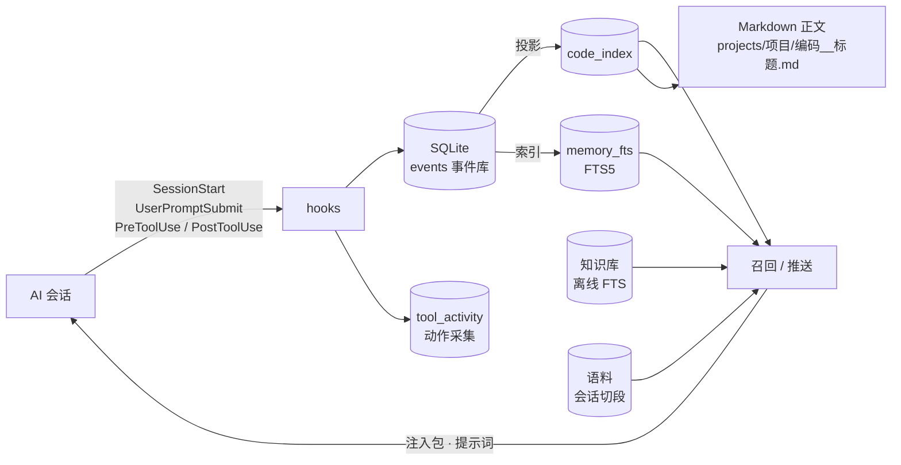

<div align="center">

# fish · 大肥鱼生命系统

**给 AI 助手的长期记忆与协作层**

单机 · 单仓 · 事件溯源 —— SQLite + FTS5 + MCP + CLI + 宿主 hooks


[它解决什么问题](#它解决什么问题) · [特性](#特性) · [架构](#架构) · [快速开始](#快速开始) · [质量与判据](#质量与判据) · [已知限制](#已知限制) · [致谢](#致谢)

</div>

---

## 它解决什么问题

多个 AI 会话一起干活时，有三件事反复发生：

1. **记不住** —— 换一个会话，之前定过的约定、踩过的坑、做过的决定全丢了；
2. **记太多** —— 把什么都塞进上下文，模型反而抓不住重点；
3. **互相踩** —— 两个会话同时改同一块，谁也不知道。

fish 的答案是：**记忆落库、召回算分、推送看价值、协作看看板**。
它不追求"记得多"，追求**在正确的时刻递上正确的一条**。

## 特性

| 层面 | 能力 | 关键设计 |
|---|---|---|
| **记忆** | 编码式长期记忆 | `<前缀>-<YYMMDD>-<序号>`；正文 Markdown 落盘，索引进 SQLite；事件溯源可重建 |
| **召回** | 两段式检索 | 先 AND 精确命中，无命中再 OR 回退，并**如实标记** `meta.fallback`（可观测，不假装命中） |
| **推送** | 三通道 | `inject`（会话开场）/ `tool_after`（工具调用后）/ `prompt`（用户消息边界） |
| **去重** | 内容感知 | 读过的、过期的**永久不再推**；内容变了（指纹不同）才推新版 |
| **排序** | 可插拔四件套 | RRF 跨路融合 / 三因子 `recency×importance×relevance` / MMR 多样性 / 价值门 |
| **身份** | 公民 + 凭证 | 会话 token 绑定公民；绑定已有公民**必须带证明**；`rule` / `identity` 类记忆写入需凭证 |
| **协作** | 看板 | 谁在动哪块、有没有撞车 |
| **语料** | 历史会话 | 切成可检索的段，不重跑全量 |
| **知识库** | 离线索引 | 对 Markdown 库做 FTS，复用同一套两段式召回 |
| **数据面** | 资产清点 | 扫描 vault、反查引用、生成缩略图、读图片尺寸 |

> 四个排序开关（`push.rrf_enabled` / `push.factors_enabled` / `push.mmr_enabled` /
> `push.value_floor`）**默认全关**——它们会改变"推哪几条"，观察后再开。

## 架构



**依赖方向由判据钉住**：领域模块不得 `import fish`（J2/J6 + **J2b 函数体内上行依赖**）、
导出面双向对账（J1b）、行数窗口防膨胀（J4，**窗口只许降**）、函数体 AST 等价（J8）。

### 模块分层

```
基层（不依赖任何领域模块）
  fish_common.py     配置 / 关键词 / 注入预算 / 可见性 SQL
  fish_schema.py     DDL 单一来源
  fish_db.py         连接 / 迁移
  fish_meta.py       schema 版本号（F-P2-5）
  fish_atomic.py     原子写（temp + fsync + replace，F-P2-8）

领域
  fish.py            编排层：CLI 装配 / 领域函数 / 事件 / 投影
  fish_push*.py      推送：候选 / 门槛 / 去重 / 融合排序
  fish_corpus*.py    语料：采集 → 切段 → 检索 → 推送候选
  fish_kb*.py        知识库离线索引（3.6k 行，最大的领域模块）
  fish_dataplane.py  数据面：扫描 / 反查 / 缩略图 / 读数
  fish_profile.py    主人画像（固定槽位）
  fish_trust.py      信任门：权限 / 凭证 / 记忆类型授权
  fish_activity.py   看板与会话活跃度
  fish_token.py      会话 token 清点与清理（F-P2-6）

入口
  fish_cli.py        argparse 装配
  mcp_server.py      MCP 服务（stdio，21 个工具 + 2 个资源）
  hook_*.py          宿主 hook 快速通道
```

## 快速开始

```bash
# 1. 依赖（只有一个可选依赖；缺了会让部分测试静默少跑）
python -m pip install -r p0/requirements.txt

# 2. 初始化
python p0/fish.py init

# 3. 注册项目前缀（编码需要它）
python p0/fish.py project-add demo --namespace "示例项目"

# 4. 记一条，再搜回来
python p0/fish.py remember demo "第一条记忆" --body "正文"
python p0/fish.py recall 第一条

# 5. 健康检查
python p0/fish.py healthcheck
```

要求 **Python ≥ 3.11**（用到 `tomllib` / `zoneinfo`）。

**接入 MCP**（Claude Desktop / Codex / WorkBuddy 等）：把 `p0/mcp_server.py` 注册为 stdio server 即可。

## 质量与判据

| 项 | 读数（2026-11-19 实测） |
|---|---|
| 判据 | **1,971 条**（146 个 `test_*.py`） |
| 变异体 | **27 个**（`p0/mutation_*.py`）——用来证明判据**真的会失败**，不是摆设 |
| 代码规模 | `fish.py` **12,626 行** + **38 个领域模块** |
| MCP 面 | **21 个工具 + 2 个资源** |
| 设计文档 | 40 篇（`docs/`） |

三条纪律写在代码里：

1. **判据必须能失败** —— 每个关键判据配一个变异体：改坏实现，判据必须红；还原后必须绿。
2. **不静默降级** —— 拿不到证据就标"判不到（SKIP）"，绝不写成"通过"。
3. **默认关闭新行为** —— 任何会改变排序/推送的开关默认关。

### 四条被自己踩出来的教训（写进代码，不只是写进文档）

| 事故 | 落在哪里 |
|---|---|
| **判据把假话钉死**：注释说「不做隔离」而代码在隔离，判据还断言那段必须在 | 判据改成断言**真话**，并加反向断言（假话回潮即红） |
| **锚点可伪造**：`（见 notes.md）` 里那个文件根本不存在也算锚点 | 锚点必须**真的存在**（真去文件系统问）；记忆编码算弱锚点 |
| **测试改用户文件**：跑 54 个脚本的 `--help`，其中两个没有 argparse，直接执行 `main()` | 只跑**真有 `--help`** 的脚本 + 沙箱环境；判据守"跑完不留 `data/`" |
| **钩子被顶掉**：加新 `pytest_configure` 时把旧的静默覆盖 | 判据守"钩子不许重名"+"两件事都还在做" |

## 目录结构

```
p0/                主体（单文件编排 + 领域模块）
  fish.py            编排层（12.6k 行）
  fish_*.py          38 个领域模块（见上）
  mcp_server.py      MCP 服务（stdio，21 工具 + 2 资源）
  hook_*.py          hook 快速通道（关闭态早退 + 按 hook 冷却）
  mutation_*.py      27 个变异体
  test_*.py          146 个判据文件
docs/              设计 / 评审 / 对账文档（40 篇）
*.md               各阶段的设计与评审报告
```

## 已知限制

- **单机单用户**：多 AI 会话共享同一个 OS 账户与数据库文件，逻辑层的"可见性"
  不构成存储层边界（正文是明文 Markdown）。
- **位置敏感**：极少数判据（`test_workspace_map`）假定仓库不在 `%TEMP%`/`AppData` 下。
- **历史文档**：`docs/` 与根目录的 md 保留了写作当时的环境与判断，属项目记录，未做追溯改写。
- **`mem_type='identity'` 不进 L0**：设计文档说它「L0 常驻」，但 L0 段实际从 `citizens` 表建，
  `code_index` 里 identity 行没有任何代码**按它特殊处理**（普通检索读得到）。
  接线需要先定"identity 记忆与 `citizens.display_name` 冲突时谁赢"。
- **`kb_asset.duration_ms` / `detail` 仍空**：前者要 ffprobe（外部依赖），后者无写入方。
  图片的 `width` / `height` 已填。
- **`deliver()` 没有生产调用方**：它是已设计、已测试的压缩扩展点，但压缩器没注入。
  `dataplane stats` 会报 `missing_dims`，同理不让人靠"没人发现"过日子。

## 更新记录

### 2026-11-18 / 11-19（外部审查 ZC审查-261118-01 逐条落地）

- **P0 四条**：记忆写入单事务（`append_event(commit=False)` + 一次 commit）／rebuild 删除前预检 + 快照补回／
  未归属 lesson 不进注入包／语料无 token 明确拒绝并指引取得 token
- **P1 十条**：ACL 收紧／`visibility=private` 补齐读路径（开关关着就**拒绝写入**）／附件大小上限 + 敏感名单 +
  允许根 + 流式哈希／kb vault relocate（journal 断点 + 原子替换）／数据面接 CLI／healthcheck 断链 exit 1 且只读／
  `citizen restore`／测试 env 隔离／mutation 靶点 0 命中算失败／God module 拆分 + J4 棘轮
- **P2 十一条**：隐藏上行依赖（J2b）／identity 登记为"无特殊处理"／`kb_asset` 图片尺寸真填／`deliver` 登记为
  已声明的例外／schema 版本号（同版本零写、不降级）／token 清点与清理／路径穿越（判 resolve 后的真实路径）／
  正文原子写 + 事件带 `body_sha256`／rebuild 不许静默丢无事件行／README 读数单源／公开包可跑

### 2026-10-29

- **推送**：结案（读过 / 过期）**永久去重**；`content_hash` 内容感知去重；分通道时效门
- **排序**：RRF 跨路融合、三因子、MMR 多样性、价值门——全部可配、默认关
- **身份**：绑定需证明、退役/合并接吊销、事件事务边界、`rebuild` 保留 visibility
- **安全**：路径穿越拦截、语料按公民过滤、私钥整段脱敏、hook 关闭态早退（0.2s）
- **诚实性**：SKIP/MISS 用退出码表达、金标缺文件 fail-open、变异体覆盖到 27 个

## 致谢

这个项目在设计、审查与实现过程中参考并受益于以下工作：

- **[DeepSeek Harness](https://github.com/deepseek-ai)** —— 本项目运行的宿主平台。hook 契约、会话日志格式、
  MCP 工具面、以及"多 Agent 协作"这一整套语境都来自它。
- **SQLite / FTS5** —— 单文件数据库 + 全文检索。整个"事件溯源 + FTS 索引"的骨架建立在它之上。
- **[Model Context Protocol](https://modelcontextprotocol.io)** —— MCP 规范。21 个工具 + 2 个资源的接口形状按它设计。
- **BM25 / RRF / MMR** —— 召回与排序的经典算法（ Robertson & Zaragoza 的 BM25、Cormack 等人的
  Reciprocal Rank Fusion、Carbonell & Goldstein 的 MMR）。三因子打分与价值门是它们之上的工程化组合。
- **Claude Code / Codex / CodeBuddy / WorkBuddy** —— 语料采集与 hook 适配的宿主方言来源；
  `HOST_SESSION_ENVS` 与语料 adapter 的分支对应它们的会话标识约定。
- **Pillow** —— 数据面读取图片尺寸（`kb_asset.width/height`）。
- 以及**历次外部独立审查**（第 1–8 轮）：每一轮都在本项目里找到过真实缺陷，包括
  "判据把假话钉死"、"测试改用户文件"这类只有独立视角才看得见的问题。
  本项目的质量纪律大多是被它们逼出来的。

## 版权

© 2026 安逸。内部项目公开源码，**未附开源许可证**；引用或复用请先联系作者。
