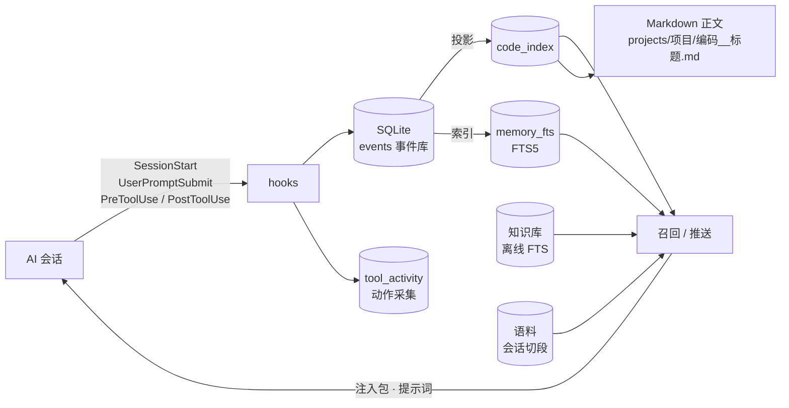

<div align="center">

# fish · 大肥鱼生命系统

**给 AI 助手的长期记忆与协作层**

单机 · 单仓 · 事件溯源 —— SQLite + FTS5 + MCP + CLI + 宿主 hooks


[它解决什么问题](#它解决什么问题) · [特性](#特性) · [架构](#架构) · [快速开始](#快速开始) · [质量与判据](#质量与判据) · [已知限制](#已知限制)

</div>

---

## 它解决什么问题

多个 AI 会话一起干活时，有三件事反复发生：

1. **记不住** —— 换一个会话，之前定过的约定、踩过的坑、做过的决定全丢了；
2. **记太多** —— 把什么都塞进上下文，模型反而抓不住重点；
3. **互相踩** —— 两个会话同时改同一块，谁也不知道。

fish 的答案是：**记忆落库、召回算分、推送看价值、协作看看板**。
它不追求"记得多"，追求**在正确的时刻递上正确的一条**。

## 特性

| 层面 | 能力 | 关键设计 |
|---|---|---|
| **记忆** | 编码式长期记忆 | `<前缀>-<YYMMDD>-<序号>`；正文 Markdown 落盘，索引进 SQLite；事件溯源可重建 |
| **召回** | 两段式检索 | 先 AND 精确命中，无命中再 OR 回退，并**如实标记** `meta.fallback`（可观测，不假装命中） |
| **推送** | 三通道 | `inject`（会话开场）/ `tool_after`（工具调用后）/ `prompt`（用户消息边界） |
| **去重** | 内容感知 | 读过的、过期的**永久不再推**；内容变了（指纹不同）才推新版 |
| **排序** | 可插拔四件套 | RRF 跨路融合 / 三因子 `recency×importance×relevance` / MMR 多样性 / 价值门 |
| **协作** | 看板 | 谁在动哪块、有没有撞车 |
| **语料** | 历史会话 | 切成可检索的段，不重跑全量 |
| **知识库** | 离线索引 | 对 Markdown 库做 FTS，复用同一套两段式召回 |

> 四个排序开关（`push.rrf_enabled` / `push.factors_enabled` / `push.mmr_enabled` /
> `push.value_floor`）**默认全关**——它们会改变"推哪几条"，观察后再开。

## 架构



**依赖方向由判据钉住**：领域模块不得 `import fish`（J2/J6）、导出面双向对账（J1b）、
行数窗口防膨胀（J4）、函数体 AST 等价（J8）。

## 快速开始

```bash
# 1. 依赖（只有一个可选依赖；缺了会让部分测试静默少跑）
python -m pip install -r p0/requirements.txt

# 2. 初始化
python p0/fish.py init

# 3. 注册项目前缀（编码需要它）
python p0/fish.py project-add demo --namespace "示例项目"

# 4. 记一条，再搜回来
python p0/fish.py remember demo "第一条记忆" --body "正文"
python p0/fish.py recall 第一条

# 5. 健康检查
python p0/fish.py healthcheck
```

要求 **Python ≥ 3.11**（用到 `tomllib` / `zoneinfo`）。

**接入 MCP**（Claude Desktop / Codex / WorkBuddy 等）：把 `p0/mcp_server.py` 注册为 stdio server 即可，参数见 `p0/install_mcp.py` 的示例。

## 质量与判据

| 项 | 读数 |
|---|---|
| 测试 | **1,680 passed / 9 skipped**（118 个测试文件；`python -m pytest -q -p no:cacheprovider`）。另有 2 条需私有 `data/` 目录的判据在本仓库里会失败——它们测的是"在生产库只读副本上复现缺陷"，不设 `FISH_PROD_DB` 就判不到 |
| 变异体 | **27 个**（`p0/mutation_*.py`）——用来证明判据**真的会失败**，不是摆设 |
| 代码规模 | `fish.py` **12,984 行** + **29 个** `fish_*.py` 领域模块。2026-11-11 拆包抽出四个：`fish_trust`（身份锚/授权）、`fish_rebuild`（重建投影）、`fish_schema`（全部 DDL + `connect`）、`fish_db`（建表/补列一族） |
| 跟踪文件 | 343 |

> 读数口径（2026-11-11 校准）：上面是**本仓库**的读数；在生产树（带私有 `data/`）里跑
> 全量是 **1,686 passed / 5 skipped / 0 failed**，两边总数一致。引用测试数时请说清
> 是**在哪棵树上跑**的——这个项目以前就因为没说清，出现过 1,166 / 1,573 / 1,647 / 1,651
> 四个互相冲突的公开值。

三条纪律写在代码里：

1. **判据必须能失败** —— 每个关键判据配一个变异体：改坏实现，判据必须红；还原后必须绿。
2. **不静默降级** —— 拿不到证据就标"判不到（SKIP）"，绝不写成"通过"。
3. **默认关闭新行为** —— 任何会改变排序/推送的开关默认关。

## 目录结构

```
p0/                主体（单文件编排 + 领域模块）
  fish.py            编排层：CLI / 领域函数 / 事件 / 投影（14.4k 行）
  fish_push.py       推送：候选生成 / 门槛 / 去重
  fish_push_rank.py  融合排序：RRF / 三因子 / MMR / 价值门
  fish_corpus*.py    语料层：采集 → 切段 → 检索 → 推送候选
  fish_kb*.py        知识库离线索引
  fish_common.py     配置 / 关键词 / 注入预算
  mcp_server.py      MCP 服务（stdio，19 个工具 + 2 个资源）
  hook_fastpath.py   hook 快速通道（关闭态早退 + 按 hook 冷却）
  mutation_*.py      27 个变异体
  test_*.py          113 个判据文件
docs/              设计 / 评审 / 对账文档（40 篇）
*.md               各阶段的设计与评审报告
```

## DSH 插件（`dsh-fish/`）

`dsh-fish/` 是 fish 在 **DeepSeek Harness（DSH）** 上的原生 TypeScript 插件。

**2026-11-09 起定位调整为「只读 + 本体能力补充」**——不再追求与 Python 侧逐字节等价，只做 DSH 里读得到、看得见的那部分。

| 维度 | 内容 |
|---|---|
| 形态 | 影子期（只读）：不注册模型可见工具、不注入上下文、不写 fish 库 |
| 能力 | `/fish shadow presence \| recall \| whoami \| health` + `conversation.view` 槽位的 canvas 面板 |
| 体量 | 2026-11-09 三轮减重：**16.2 MB → 1.78 MB**（git 跟踪体积）；`lib/index.js` 458 KB → **328 KB** |
| 判据 | `typecheck 0` / `build 0` / `unit 54/54` / `check-spec 30/30` |
| 与 Python 的关系 | Python 本体是**权威**；插件只读同一个 SQLite 库。写操作（`rebuild` / `remember` / `push` 等）一律给指引，不代执行 |

细节见 [`dsh-fish/README.md`](dsh-fish/README.md) 与 [`dsh-fish/docs/减重清单-20261109.md`](dsh-fish/docs/减重清单-20261109.md)。

## 已知限制

- **`visibility=private` 目前只是标签**：写入可选、默认 `shared`；执行层未完成——
  只有 `search_memories` 一条路径按 owner 过滤，另有 10 条读路径仍返回 private
  （`read_body` 全文、`resolve_code` 元数据、`recall` 回退列表、`list`、`neighbors`、
  `inject` 注入包、`recall --by relevance`、推送管线、`fish://index` 资源面）。
  **不要**打开 `privacy.visibility_enforced`（打开后连 owner 自己也看不到）。
- **单机单用户**：多 AI 会话共享同一个 OS 账户与数据库文件，逻辑层的"可见性"
  不构成存储层边界（正文是明文 Markdown）。
- **位置敏感**：极少数判据（`test_workspace_map`）假定仓库不在 `%TEMP%`/`AppData` 下。
- **历史文档**：`docs/` 与根目录的 md 保留了写作当时的环境与判断，属项目记录，未做追溯改写。
- **`fish.py` 仍是单文件巨石（约 14,500 行）**：拆包是已知的最大结构债（错题本 E-11）。
  2026-11-11 已把身份锚 / 合并链 / 写入鉴权抽到 `fish_trust.py`，`pytest.ini` 里也有
  行数窗口守着它不再长——但"拆开"本身还没做完，不要以为它已经模块化了。
- **脱敏的明确边界**：裸 base64 只在 **≥400 字符**时才脱敏。低于这个长度、又没有键名
  或 PEM 标记的长串**不会**被掩——那种长度无法与普通高熵文本区分，强掩会大面积损伤
  语料可用性。这条是有意的取舍，不是漏实现（判据 `test_corpus_contract` B1–B5）。
- **`session.token_ttl_hours` 出厂值是 0（永不过期）**：这是 2026-10-25 的**用户裁定**，
  不是缺陷。旋转与吊销链路是完整的（退役/合并会真的吊销），但"到期自动失效"不启用。
- **本机文件的 ACL 未收紧**：`data/index.sqlite` 与 `data/_audit/` 继承的是
  `BUILTIN\Users:(F)`——同机其他 OS 用户可读。逻辑层的归属与凭证校验不构成存储层边界。

## 更新记录

### 2026-11-11

一轮以「先修根基、再谈功能」为口径的债务清理（对照一份外部审查的 12 条致命项逐条核
当下状态，结果见 `67-对账-外部审查红项当下状态-20261111.md`）：

- **身份**：无凭证绑定路径的分界线从「该公民签发过任何 token」改为**本机身份锚的会话
  白名单**。前者实际上让"知道 citizen_id 就能接管"对所有真实身份成立（含主人）。
- **数据完整性**：`rebuild` 现在重放 `citizen.merged` / `citizen.retired{migrated_to}`。
  此前一次 rebuild 会**静默撤销**人工合并，把归属退回到已退役公民。
- **写入鉴权**：`rule` / `identity` 需要有效凭证，`fact` / `episode` / `lesson` /
  `artifact` 保持免凭证（分级口径，策略只有一份实现）。
- **知识库**：索引"新鲜度"不再只看 `MAX(indexed_at)`（它只在行变更时才动，会让
  "索引正确 + 维护跑成功"被判陈旧并静默关掉召回）；`fish healthcheck` 现在会报索引
  三态与断路器的后果。
- **hooks**：`pretool` / `posttool` 的连续超时冷却此前**从未被写入**（检查永远返回 0），
  现在按自测耗时记账并真的退避。
- **脱敏**：补上裸 base64（≥400 字符）规则，并明确低于该长度的边界。
- **测试口径**：新增 `pytest.ini`（此前从生产目录跑 `pytest` 会把备份目录里的 227 个
  测试一起收进来，导致"测试数"有多个互相冲突的公开值）。
- **结构债（E-11）**：`fish.py` 从 **14,541 → 12,984 行（−10.7%）**，拆出四个模块——
  `fish_trust` / `fish_rebuild` / `fish_schema` / `fish_db`。分层现在是
  `fish_common ← fish_schema ← fish_db ← fish_kb / fish_rebuild / fish_trust ← fish.py`，
  新模块一律禁止反向 `import fish`（J2 静态判据守着）。拆完把行数窗口**往下调**而不是放宽。

### 2026-10-29

- **推送**：结案（读过 / 过期）**永久去重**；`content_hash` 内容感知去重（内容变了才重推）；分通道时效门（fact/episode/artifact 过硬门槛，rule/lesson 免疫）
- **排序**：RRF 跨路融合、三因子、MMR 多样性、价值门——全部可配、默认关
- **身份**：绑定需证明（含历史 token，吊销 7 天内有效）、退役/合并接吊销、事件事务边界、`rebuild` 保留 visibility
- **安全**：路径穿越拦截、语料按公民过滤、私钥整段脱敏、hook 关闭态早退（0.2s）
- **诚实性**：SKIP/MISS 用退出码表达、金标缺文件 fail-open、变异体覆盖到 27 个

## 致谢 / Acknowledgements

fish 的判断标准、数据结构与排序算法不是凭空来的。下面按**借鉴方式**分组——
证据等级不同，所以分开写：**读过全文**的、**抓了原文逐段比对**的、**只引了出处**的，
不能混为一谈。

### 一、读了全文并落地到设计（5 篇）

> 这 5 篇的全文 PDF 存于开发侧私有工作区的 `_research/` 目录，**未随源码发布**
> （第三方论文不并入本仓，避免许可问题）。下表给出可公开访问的原始出处。

| 论文 | 作者 / 出处 | 落到 fish 哪里 |
|---|---|---|
| **Mikoshi: An Existence Execution Environment for Persistent Artificial Identity** | Kuranto Nanamori, Preprint v2.0, 2026-07-25, [Zenodo 21536749](https://zenodo.org/records/21536749) | 身份连续性的五条主张 → 六种 `mem_type`（"不可折叠"是硬约束）；`resident/visitor/role/system` 四种居留形态；"权威当下" → 注入包的定位 |
| **REALM: Retrieval-Driven Memory Reconsolidation for Long-Term LLM Agents** | Yuanyi Song 等（上海交大 / OPPO / NUS）, [arXiv:2609.16053](https://arxiv.org/abs/2609.16053) | 检索驱动的记忆再巩固 → `links.weight` 随使用动态调整（原设计是"写入时算好的静态值"，被这篇否掉） |
| **When Should the Agent Speak? A Survey of Intervention Timing for Always-On AI Assistants** | Tao An（FIM Labs, Singapore）, 2026-07-19, [Zenodo 21438397](https://zenodo.org/records/21438397) | 推送判据 = **预期收益 > 预期打扰成本**（原设计只有收益、没有成本项） |
| **DAWN: Duty-Aware Wake Network for Hibernating Personal Agents on Device** | Ravi Kiran Kadaboina, 2026-09-24, [Zenodo 22941511](https://zenodo.org/records/22941511) | 静默 / 通知 / 升级三态；唤醒时"该不该开口"的决策 |
| **The Agent Brain: Mapping Modern AI Agent Components to Human Neural Architecture** | Tom Jaejoon Lee（ClawSouls）, 2026-03-05, [Zenodo 18869871](https://zenodo.org/records/18869871) | 人脑分区 ↔ 模块映射的旁证（只取到标题与摘要，未声称深入借鉴） |

### 二、抓了原文逐段比对（架构对照，原文存于 `p0/research/_raw/`）

**记忆与知识组织**

- [HippoRAG](https://arxiv.org/abs/2405.14831)（NeurIPS 2024）—— 离线建图 + 在线 PPR，支撑"索引离线化"的取舍
- [Mem0](https://arxiv.org/abs/2504.19413) —— 两阶段管道 + LLM 决定四种操作
- [Zep / Graphiti](https://arxiv.org/abs/2501.13956)（[getzep/graphiti](https://github.com/getzep/graphiti)）—— **双时态 + 边失效**
- [MemGPT](https://arxiv.org/abs/2310.08560) —— 三层上下文 + 自编辑
- [A-MEM: Agentic Memory](https://arxiv.org/abs/2502.12110) —— Zettelkasten 式笔记；**新记忆会反向改写旧记忆**
- [Microsoft GraphRAG](https://arxiv.org/abs/2404.16130) —— 社区检测 + 社区摘要 + 分层下钻（"分页+下钻"的文献依据）
- [Cognee](https://arxiv.org/abs/2505.24478)（[topoteretes/cognee](https://github.com/topoteretes/cognee)）—— 图 + 向量混合组织
- [Retrieval-Augmented Generation for LLMs: A Survey](https://arxiv.org/abs/2312.10997) —— 索引优化三块 / 增强检索三条路径
- [Letta](https://github.com/letta-ai/letta) —— 记忆块的工程化实现对照

**推送与排序**

- [Generative Agents](https://arxiv.org/abs/2304.03442)（Park et al.）—— memory stream 的 **recency / importance / relevance 三因子相乘**与指数衰减
- **Reciprocal Rank Fusion**（Cormack, Clarke & Buettcher, SIGIR 2009）—— RRF 的定义与 `k=60`
- [How often do Answers Change? Estimating Recency Requirements in QA](https://arxiv.org/abs/2603.16544) —— recency 需求是**查询相关**的，所以时效门要分通道
- [Temporal Information Retrieval and Extraction: From Foundations to RAG](https://dl.acm.org/doi/pdf/10.1145/3805712.3808638)（ACM 2026）—— 时间作为过滤 / 排序信号 / 表示的三条路径
- [TREC 2012 Microblog](https://trec.nist.gov/pubs/trec21/papers/UWaterlooMDS.microblog.nb.pdf)（University of Waterloo）—— RRF 与逻辑回归的对照
- [Paying Attention?](https://blogs.lse.ac.uk/behaviouralscience/2017/04/21/paying-attention-an-enquiry-into-the-impact-of-interruptions-on-task-performance-and-well-being/)（LSE Behavioural Science, 2017）与 [Mobile use in an age of interruption](https://www.sciencedirect.com/science/article/abs/pii/S0378720624001514)（2024）—— "打扰有成本"的实证依据

**搜索与目录工程（官方文档）**

- [Elasticsearch Index Modules](https://www.elastic.co/guide/en/elasticsearch/reference/current/index-modules.html) / [Lucene 9.10 Index Package](https://lucene.apache.org/core/9_10_0/core/org/apache/lucene/index/package-summary.html) —— 不可变段 + 后台合并
- [Vespa Overview](https://docs.vespa.ai/en/overview.html) / [Ranking](https://docs.vespa.ai/en/ranking.html) —— **三阶段排序漏斗**
- [Exa: next-gen search](https://exa.ai/blog/how-to-build-nextgen-search) / [web-scale vector DB](https://exa.ai/blog/building-web-scale-vector-db)
- [Everything](https://www.voidtools.com/)（voidtools）—— MFT 直读 + 内存副本 + USN 增量 + 查询编译，四机制叠加
- [Obsidian Omnisearch](https://github.com/scambier/obsidian-omnisearch) / [Obsidian Bases](https://help.obsidian.md/bases) —— 知识库检索与声明式视图的对照（结论：Bases 不是索引）
- [Nuxt Content](https://content.nuxt.com/) —— 静态内容管线的分层与分页

### 三、只引了出处、未见全文存档（**如实标注**）

下面三篇被当作理论锚点引用，但项目里**没有全文存档**，因此**不声称深入借鉴**：

- **Memcurrency: Memory Decay and Refresh Mechanism for Long-Running LLM Agents** —— [IEEE 11633479](https://ieeexplore.ieee.org/document/11633479/)：支撑"衰减必要 + 按类型分层"
- **Typed Decay**（preprint）—— [Zenodo 22643061](https://zenodo.org/records/22643061)：typed decay 的直接依据
- **Giving stateless agents a sense of time: A reconsolidating episodic–semantic memory architecture** —— [ScienceDirect S0950705126019192](https://www.sciencedirect.com/science/article/pii/S0950705126019192)：支撑"回忆是重构，不是读取"

### 四、经典认知理论（公式与模型的来源）

- **ACT-R 激活公式**（Anderson 等）—— 扇形效应 `S_ji = S − log(fan_j)`
- **扩散激活**（Collins & Loftus 传统）—— 激活沿边扩散、按距离衰减
- **记忆再巩固**（Nader et al., 2000 传统）—— 重新激活 → 可塑状态 → 连接被改写

### 五、软件依赖

fish 的第三方依赖只有两个，其余全部是 Python 标准库：

| 依赖 | 用途 |
|---|---|
| [zstandard](https://github.com/facebook/zstd) | 读取 zstd 压缩的 DSH 会话日志 |
| [tiktoken](https://github.com/openai/tiktoken) | token 计数（注入包预算） |

> **本项目未内嵌（vendor）任何第三方项目代码。** 对上述论文与工程的借鉴是
> **架构与算法层面**的，不是代码拷贝。`p0/requirements.txt` 里也写明了"核心路径纯 stdlib，
> 保持可离线、可打包"。

### 六、取证方式（可复跑）

上面每一条都能在仓库里找到痕迹（下面的命令以仓库根目录为当前目录，直接可跑）：

```bash
# 1. 抓取原文（17 篇 / 约 76 万字，每篇一个文件）
ls p0/research/_raw/*.txt
#    每篇的来源 URL 与抓取字数见 docs 里 31/32 号文档的 §0「调研语料（可复查）」

# 2. 第三方依赖（确认只有 2 个）
cd p0 && python - <<'PY'
import ast, os, sys
stdlib, local = set(sys.stdlib_module_names), {f[:-3] for f in os.listdir(".") if f.endswith(".py")}
third = set()
for f in os.listdir("."):
    if not f.endswith(".py") or f.startswith(("test_", "mutation_")):
        continue
    for n in ast.walk(ast.parse(open(f, encoding="utf-8").read())):
        if isinstance(n, ast.Import):
            names = [a.name.split(".")[0] for a in n.names]
        elif isinstance(n, ast.ImportFrom) and n.module and n.level == 0:
            names = [n.module.split(".")[0]]
        else:
            names = []
        third |= {x for x in names if x not in stdlib and x not in local and x != "__future__"}
print("第三方依赖:", sorted(third))
PY
# → 第三方依赖: ['tiktoken', 'zstandard']
```

## 版权

© 2026 安逸。内部项目公开源码，**未附开源许可证**；引用或复用请先联系作者。
