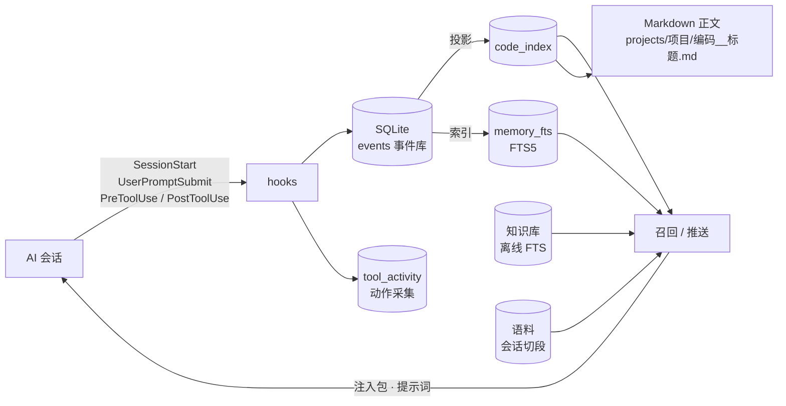

<div align="center">

# fish · 大肥鱼生命系统

**给 AI 助手的长期记忆与协作层**

单机 · 单仓 · 事件溯源 —— SQLite + FTS5 + MCP + CLI + 宿主 hooks


[它解决什么问题](#它解决什么问题) · [特性](#特性) · [架构](#架构) · [快速开始](#快速开始) · [质量与判据](#质量与判据) · [已知限制](#已知限制) · [致谢](#致谢)

</div>

---

## 它解决什么问题

多个 AI 会话一起干活时，有三件事反复发生：

1. **记不住** —— 换一个会话，之前定过的约定、踩过的坑、做过的决定全丢了；
2. **记太多** —— 把什么都塞进上下文，模型反而抓不住重点；
3. **互相踩** —— 两个会话同时改同一块，谁也不知道。

fish 的答案是：**记忆落库、召回算分、推送看价值、协作看看板**。
它不追求"记得多"，追求**在正确的时刻递上正确的一条**。

## 特性

| 层面 | 能力 | 关键设计 |
|---|---|---|
| **记忆** | 编码式长期记忆 | `<前缀>-<YYMMDD>-<序号>`；正文 Markdown 落盘，索引进 SQLite；事件溯源可重建 |
| **召回** | 两段式检索 | 先 AND 精确命中，无命中再 OR 回退，并**如实标记** `meta.fallback`（可观测，不假装命中） |
| **推送** | 三通道 | `inject`（会话开场）/ `tool_after`（工具调用后）/ `prompt`（用户消息边界） |
| **去重** | 内容感知 | 读过的、过期的**永久不再推**；内容变了（指纹不同）才推新版 |
| **排序** | 可插拔四件套 | RRF 跨路融合 / 三因子 `recency×importance×relevance` / MMR 多样性 / 价值门 |
| **身份** | 公民 + 凭证 | 会话 token 绑定公民；绑定已有公民**必须带证明**；`rule` / `identity` 类记忆写入需凭证 |
| **协作** | 看板 | 谁在动哪块、有没有撞车 |
| **语料** | 历史会话 | 切成可检索的段，不重跑全量 |
| **知识库** | 离线索引 | 对 Markdown 库做 FTS，复用同一套两段式召回 |
| **数据面** | 资产清点 | 扫描 vault、反查引用、生成缩略图、读图片尺寸 |

> 四个排序开关（`push.rrf_enabled` / `push.factors_enabled` / `push.mmr_enabled` /
> `push.value_floor`）**默认全关**——它们会改变"推哪几条"，观察后再开。

## 架构



**依赖方向由判据钉住**：领域模块不得 `import fish`（J2/J6 + **J2b 函数体内上行依赖**）、
导出面双向对账（J1b）、行数窗口防膨胀（J4，**窗口只许降**）、函数体 AST 等价（J8）。

### 模块分层

```
基层（不依赖任何领域模块）
  fish_common.py     配置 / 关键词 / 注入预算 / 可见性 SQL
  fish_schema.py     DDL 单一来源
  fish_db.py         连接 / 迁移
  fish_meta.py       schema 版本号（F-P2-5）
  fish_atomic.py     原子写（temp + fsync + replace，F-P2-8）

领域
  fish.py            编排层：CLI 装配 / 领域函数 / 事件 / 投影
  fish_push*.py      推送：候选 / 门槛 / 去重 / 融合排序
  fish_corpus*.py    语料：采集 → 切段 → 检索 → 推送候选
  fish_kb*.py        知识库离线索引（3.6k 行，最大的领域模块）
  fish_dataplane.py  数据面：扫描 / 反查 / 缩略图 / 读数
  fish_profile.py    主人画像（固定槽位）
  fish_trust.py      信任门：权限 / 凭证 / 记忆类型授权
  fish_activity.py   看板与会话活跃度
  fish_token.py      会话 token 清点与清理（F-P2-6）

入口
  fish_cli.py        argparse 装配
  mcp_server.py      MCP 服务（stdio，21 个工具 + 2 个资源）
  hook_*.py          宿主 hook 快速通道
```

## 快速开始

```bash
# 1. 依赖（只有一个可选依赖；缺了会让部分测试静默少跑）
python -m pip install -r p0/requirements.txt

# 2. 初始化
python p0/fish.py init

# 3. 注册项目前缀（编码需要它）
python p0/fish.py project-add demo --namespace "示例项目"

# 4. 记一条，再搜回来
python p0/fish.py remember demo "第一条记忆" --body "正文"
python p0/fish.py recall 第一条

# 5. 健康检查
python p0/fish.py healthcheck
```

要求 **Python ≥ 3.11**（用到 `tomllib` / `zoneinfo`）。

**接入 MCP**（Claude Desktop / Codex / WorkBuddy 等）：把 `p0/mcp_server.py` 注册为 stdio server 即可。

## 质量与判据

| 项 | 读数（2026-11-19 实测） |
|---|---|
| 判据 | **1,971 条**（146 个 `test_*.py`） |
| 变异体 | **27 个**（`p0/mutation_*.py`）——用来证明判据**真的会失败**，不是摆设 |
| 代码规模 | `fish.py` **10,509 行** + **39 个领域模块** |
| MCP 面 | **21 个工具 + 2 个资源** |
| 设计文档 | 40 篇（`docs/`，仅生产树；公开包只镜像 `p0/`） |

三条纪律写在代码里：

1. **判据必须能失败** —— 每个关键判据配一个变异体：改坏实现，判据必须红；还原后必须绿。
2. **不静默降级** —— 拿不到证据就标"判不到（SKIP）"，绝不写成"通过"。
3. **默认关闭新行为** —— 任何会改变排序/推送的开关默认关。

### 四条被自己踩出来的教训（写进代码，不只是写进文档）

| 事故 | 落在哪里 |
|---|---|
| **判据把假话钉死**：注释说「不做隔离」而代码在隔离，判据还断言那段必须在 | 判据改成断言**真话**，并加反向断言（假话回潮即红） |
| **锚点可伪造**：`（见 notes.md）` 里那个文件根本不存在也算锚点 | 锚点必须**真的存在**（真去文件系统问）；记忆编码算弱锚点 |
| **测试改用户文件**：跑 54 个脚本的 `--help`，其中两个没有 argparse，直接执行 `main()` | 只跑**真有 `--help`** 的脚本 + 沙箱环境；判据守"跑完不留 `data/`" |
| **钩子被顶掉**：加新 `pytest_configure` 时把旧的静默覆盖 | 判据守"钩子不许重名"+"两件事都还在做" |

## 目录结构

```
p0/                主体（单文件编排 + 领域模块）
  fish.py            编排层（12.6k 行）
  fish_*.py          38 个领域模块（见上）
  mcp_server.py      MCP 服务（stdio，21 工具 + 2 资源）
  hook_*.py          hook 快速通道（关闭态早退 + 按 hook 冷却）
  mutation_*.py      27 个变异体
  test_*.py          146 个判据文件
docs/              设计 / 评审 / 对账文档（40 篇，仅生产树）
*.md               各阶段的设计与评审报告
```

## 已知限制

- **单机单用户**：多 AI 会话共享同一个 OS 账户与数据库文件，逻辑层的"可见性"
  不构成存储层边界（正文是明文 Markdown）。
- **位置敏感**：极少数判据（`test_workspace_map`）假定仓库不在 `%TEMP%`/`AppData` 下。
- **历史文档**：`docs/` 与根目录的 md 保留了写作当时的环境与判断，属项目记录，未做追溯改写。
- **`mem_type='identity'` 不进 L0**：设计文档说它「L0 常驻」，但 L0 段实际从 `citizens` 表建，
  `code_index` 里 identity 行没有任何代码**按它特殊处理**（普通检索读得到）。
  接线需要先定"identity 记忆与 `citizens.display_name` 冲突时谁赢"。
- **`kb_asset.duration_ms` / `detail` 仍空**：前者要 ffprobe（外部依赖），后者无写入方。
  图片的 `width` / `height` 已填。
- **`deliver()` 没有生产调用方**：它是已设计、已测试的压缩扩展点，但压缩器没注入。
  `dataplane stats` 会报 `missing_dims`，同理不让人靠"没人发现"过日子。

## 更新记录

### 2026-11-18 / 11-19（外部审查 ZC审查-261118-01 逐条落地）

- **P0 四条**：记忆写入单事务（`append_event(commit=False)` + 一次 commit）／rebuild 删除前预检 + 快照补回／
  未归属 lesson 不进注入包／语料无 token 明确拒绝并指引取得 token
- **P1 十条**：ACL 收紧／`visibility=private` 补齐读路径（开关关着就**拒绝写入**）／附件大小上限 + 敏感名单 +
  允许根 + 流式哈希／kb vault relocate（journal 断点 + 原子替换）／数据面接 CLI／healthcheck 断链 exit 1 且只读／
  `citizen restore`／测试 env 隔离／mutation 靶点 0 命中算失败／God module 拆分 + J4 棘轮
- **P2 十一条**：隐藏上行依赖（J2b）／identity 登记为"无特殊处理"／`kb_asset` 图片尺寸真填／`deliver` 登记为
  已声明的例外／schema 版本号（同版本零写、不降级）／token 清点与清理／路径穿越（判 resolve 后的真实路径）／
  正文原子写 + 事件带 `body_sha256`／rebuild 不许静默丢无事件行／README 读数单源／公开包可跑

### 2026-10-29

- **推送**：结案（读过 / 过期）**永久去重**；`content_hash` 内容感知去重；分通道时效门
- **排序**：RRF 跨路融合、三因子、MMR 多样性、价值门——全部可配、默认关
- **身份**：绑定需证明、退役/合并接吊销、事件事务边界、`rebuild` 保留 visibility
- **安全**：路径穿越拦截、语料按公民过滤、私钥整段脱敏、hook 关闭态早退（0.2s）
- **诚实性**：SKIP/MISS 用退出码表达、金标缺文件 fail-open、变异体覆盖到 27 个

## 致谢 / Acknowledgements

fish 的判断标准、数据结构与排序算法不是凭空来的。下面按**借鉴方式**分组——
证据等级不同，所以分开写：**读过全文**的、**抓了原文逐段比对**的、**只引了出处**的，
不能混为一谈。

### 一、读了全文并落地到设计（5 篇）

> 这 5 篇的全文 PDF 存于开发侧私有工作区的 `_research/` 目录，**未随源码发布**
> （第三方论文不并入本仓，避免许可问题）。下表给出可公开访问的原始出处。

| 论文 | 作者 / 出处 | 落到 fish 哪里 |
|---|---|---|
| **Mikoshi: An Existence Execution Environment for Persistent Artificial Identity** | Kuranto Nanamori, Preprint v2.0, 2026-07-25, [Zenodo 21536749](https://zenodo.org/records/21536749) | 身份连续性的五条主张 → 六种 `mem_type`（"不可折叠"是硬约束）；`resident/visitor/role/system` 四种居留形态；"权威当下" → 注入包的定位 |
| **REALM: Retrieval-Driven Memory Reconsolidation for Long-Term LLM Agents** | Yuanyi Song 等（上海交大 / OPPO / NUS）, [arXiv:2609.16053](https://arxiv.org/abs/2609.16053) | 检索驱动的记忆再巩固 → `links.weight` 随使用动态调整（原设计是"写入时算好的静态值"，被这篇否掉） |
| **When Should the Agent Speak? A Survey of Intervention Timing for Always-On AI Assistants** | Tao An（FIM Labs, Singapore）, 2026-07-19, [Zenodo 21438397](https://zenodo.org/records/21438397) | 推送判据 = **预期收益 > 预期打扰成本**（原设计只有收益、没有成本项） |
| **DAWN: Duty-Aware Wake Network for Hibernating Personal Agents on Device** | Ravi Kiran Kadaboina, 2026-09-24, [Zenodo 22941511](https://zenodo.org/records/22941511) | 静默 / 通知 / 升级三态；唤醒时"该不该开口"的决策 |
| **The Agent Brain: Mapping Modern AI Agent Components to Human Neural Architecture** | Tom Jaejoon Lee（ClawSouls）, 2026-03-05, [Zenodo 18869871](https://zenodo.org/records/18869871) | 人脑分区 ↔ 模块映射的旁证（只取到标题与摘要，未声称深入借鉴） |

### 二、抓了原文逐段比对（架构对照，原文存于 `p0/research/_raw/`）

**记忆与知识组织**

- [HippoRAG](https://arxiv.org/abs/2405.14831)（NeurIPS 2024）—— 离线建图 + 在线 PPR，支撑"索引离线化"的取舍
- [Mem0](https://arxiv.org/abs/2504.19413) —— 两阶段管道 + LLM 决定四种操作
- [Zep / Graphiti](https://arxiv.org/abs/2501.13956)（[getzep/graphiti](https://github.com/getzep/graphiti)）—— **双时态 + 边失效**
- [MemGPT](https://arxiv.org/abs/2310.08560) —— 三层上下文 + 自编辑
- [A-MEM: Agentic Memory](https://arxiv.org/abs/2502.12110) —— Zettelkasten 式笔记；**新记忆会反向改写旧记忆**
- [Microsoft GraphRAG](https://arxiv.org/abs/2404.16130) —— 社区检测 + 社区摘要 + 分层下钻（"分页+下钻"的文献依据）
- [Cognee](https://arxiv.org/abs/2505.24478)（[topoteretes/cognee](https://github.com/topoteretes/cognee)）—— 图 + 向量混合组织
- [Retrieval-Augmented Generation for LLMs: A Survey](https://arxiv.org/abs/2312.10997) —— 索引优化三块 / 增强检索三条路径
- [Letta](https://github.com/letta-ai/letta) —— 记忆块的工程化实现对照

**推送与排序**

- [Generative Agents](https://arxiv.org/abs/2304.03442)（Park et al.）—— memory stream 的 **recency / importance / relevance 三因子相乘**与指数衰减
- **Reciprocal Rank Fusion**（Cormack, Clarke & Buettcher, SIGIR 2009）—— RRF 的定义与 `k=60`
- [How often do Answers Change? Estimating Recency Requirements in QA](https://arxiv.org/abs/2603.16544) —— recency 需求是**查询相关**的，所以时效门要分通道
- [Temporal Information Retrieval and Extraction: From Foundations to RAG](https://dl.acm.org/doi/pdf/10.1145/3805712.3808638)（ACM 2026）—— 时间作为过滤 / 排序信号 / 表示的三条路径
- [TREC 2012 Microblog](https://trec.nist.gov/pubs/trec21/papers/UWaterlooMDS.microblog.nb.pdf)（University of Waterloo）—— RRF 与逻辑回归的对照
- [Paying Attention?](https://blogs.lse.ac.uk/behaviouralscience/2017/04/21/paying-attention-an-enquiry-into-the-impact-of-interruptions-on-task-performance-and-well-being/)（LSE Behavioural Science, 2017）与 [Mobile use in an age of interruption](https://www.sciencedirect.com/science/article/abs/pii/S0378720624001514)（2024）—— "打扰有成本"的实证依据

**搜索与目录工程（官方文档）**

- [Elasticsearch Index Modules](https://www.elastic.co/guide/en/elasticsearch/reference/current/index-modules.html) / [Lucene 9.10 Index Package](https://lucene.apache.org/core/9_10_0/core/org/apache/lucene/index/package-summary.html) —— 不可变段 + 后台合并
- [Vespa Overview](https://docs.vespa.ai/en/overview.html) / [Ranking](https://docs.vespa.ai/en/ranking.html) —— **三阶段排序漏斗**
- [Exa: next-gen search](https://exa.ai/blog/how-to-build-nextgen-search) / [web-scale vector DB](https://exa.ai/blog/building-web-scale-vector-db)
- [Everything](https://www.voidtools.com/)（voidtools）—— MFT 直读 + 内存副本 + USN 增量 + 查询编译，四机制叠加
- [Obsidian Omnisearch](https://github.com/scambier/obsidian-omnisearch) / [Obsidian Bases](https://help.obsidian.md/bases) —— 知识库检索与声明式视图的对照（结论：Bases 不是索引）
- [Nuxt Content](https://content.nuxt.com/) —— 静态内容管线的分层与分页

### 三、只引了出处、未见全文存档（**如实标注**）

下面三篇被当作理论锚点引用，但项目里**没有全文存档**，因此**不声称深入借鉴**：

- **Memcurrency: Memory Decay and Refresh Mechanism for Long-Running LLM Agents** —— [IEEE 11633479](https://ieeexplore.ieee.org/document/11633479/)：支撑"衰减必要 + 按类型分层"
- **Typed Decay**（preprint）—— [Zenodo 22643061](https://zenodo.org/records/22643061)：typed decay 的直接依据
- **Giving stateless agents a sense of time: A reconsolidating episodic–semantic memory architecture** —— [ScienceDirect S0950705126019192](https://www.sciencedirect.com/science/article/pii/S0950705126019192)：支撑"回忆是重构，不是读取"

### 四、经典认知理论（公式与模型的来源）

- **ACT-R 激活公式**（Anderson 等）—— 扇形效应 `S_ji = S − log(fan_j)`
- **扩散激活**（Collins & Loftus 传统）—— 激活沿边扩散、按距离衰减
- **记忆再巩固**（Nader et al., 2000 传统）—— 重新激活 → 可塑状态 → 连接被改写

### 五、软件依赖

依赖口径（2026-11-20 用 AST 逐文件实测）：

| 依赖 | 必需？ | 用途 | 缺了会怎样 |
|---|---|---|---|
| [zstandard](https://github.com/facebook/zstd) | **必需** | 读 zstd 压缩的 DSH 会话日志 | 5 个测试文件顶层 import 失败，被 unittest **静默丢弃**（不是 skip、不是红）——249 条判据凭空消失 |
| [tiktoken](https://github.com/openai/tiktoken) | 可选 | token 计数（注入包预算） | 回落到"中文≈1.2 token/字"的估算（`fish_common.count_tokens`），不崩 |
| [Pillow](https://python-pillow.org/) | 可选 | 读图片尺寸写 `kb_asset.width/height` | 返回 `(None, None)`，扫描继续，只是那几行没有尺寸（`fish_dataplane._media_dims`） |

只有 `zstandard` 进了 `requirements.txt`。另两个是**可选增强**：缺了功能降级，不缺判据。

> **本项目未内嵌（vendor）任何第三方项目代码。** 对上述论文与工程的借鉴是
> **架构与算法层面**的，不是代码拷贝。核心路径保持纯 stdlib、可离线、可打包。

### 六、取证方式（可复跑）

上面每一条都能在仓库里找到痕迹（下面的命令以仓库根目录为当前目录，直接可跑）：

```bash
# 1. 抓取原文（17 篇 / 约 76 万字，每篇一个文件）
ls p0/research/_raw/*.txt
#    每篇的来源 URL 与抓取字数见 docs 里 31/32 号文档的 §0「调研语料（可复查）」

# 2. 第三方依赖（2026-11-20 实测：3 个模块，其中只有 zstandard 是必需的）
cd p0 && python - <<'PY'
import ast, os, sys
stdlib, local = set(sys.stdlib_module_names), {f[:-3] for f in os.listdir(".") if f.endswith(".py")}
third = set()
for f in os.listdir("."):
    if not f.endswith(".py") or f.startswith(("test_", "mutation_")):
        continue
    for n in ast.walk(ast.parse(open(f, encoding="utf-8").read())):
        if isinstance(n, ast.Import):
            names = [a.name.split(".")[0] for a in n.names]
        elif isinstance(n, ast.ImportFrom) and n.module and n.level == 0:
            names = [n.module.split(".")[0]]
        else:
            names = []
        third |= {x for x in names if x not in stdlib and x not in local and x != "__future__"}
print("第三方依赖:", sorted(third))
PY
# → 第三方依赖: ['PIL', 'tiktoken', 'zstandard']
#   只有 zstandard 必须装（requirements.txt）；另两个缺了功能降级，不减判据
```

### 七、本轮补充（2026-11-18 / 20）

上面六节是论文与工程的来源。**这一轮修外部审查报告（ZC审查-261118-01）时，
下面这些是直接帮上忙的**：

**宿主与协议**

- **[DeepSeek Harness](https://github.com/deepseek-ai)** —— 本项目运行的宿主。hook 契约
  （SessionStart / UserPromptSubmit / PreToolUse / PostToolUse）、`.jsonl.zstd` 会话日志格式、
  MCP 工具面、以及"多 Agent 协作"这一整套语境都来自它。**语料能从会话日志重建，靠的就是它的日志格式。**
- **[Model Context Protocol](https://modelcontextprotocol.io)** —— 21 个工具 + 2 个资源的接口形状按它设计。
- **Claude Code / Codex / CodeBuddy / WorkBuddy** —— 语料 adapter 与 `HOST_SESSION_ENVS` 的分支
  对应它们的会话标识约定；`test_env_isolation` 那套隔离口径也是被它们各自的 env 命名逼出来的。

**算法**

- **BM25**（Robertson & Zaragoza）—— 召回打分。
- **Reciprocal Rank Fusion**（Cormack, Clarke & Buettcher, SIGIR 2009）—— 跨路融合，`k=60`。
- **MMR**（Carbonell & Goldstein）—— 多样性。

**九轮外部独立审查**

这个项目的质量纪律，大半是被**外部审查**逼出来的。九轮下来，每一轮都找到过真实缺陷，
其中几条只有独立视角才看得见：

| 轮次 | 找到的东西 |
|---|---|
| 第三轮 | 自选 8 个"最可靠靶点"里 4 个改坏了也不会红 |
| 第四轮 | 报告了一个**源码里根本不存在**的修复 |
| 第五轮 | 清单 31 项里 6 条理由与源码**相反** |
| 第六轮 | 语料隔离只装在 MCP 门口、**执行层没有锁** |
| 第七轮 | 「identity 无读取路径」是假话，且**判据把假话钉死** |
| 第八轮 | 一个测试每次全量跑都在**改用户的外部文件**（`I:\app\codex` 生成 57 个配置备份） |
| 第九轮 | 我自己的防护测试 `importlib.reload` 把**护栏解除**了；一个变异体**永远绿** |

**最重要的不是它们找出了 bug，而是它们反复证明同一件事**：

> **判据只能验证「实现符合规格」。它永远验证不了「规格符合意图」。**
>
> 而后者不在代码里，在人和人的对话里。

## 版权

© 2026 安逸。内部项目公开源码，**未附开源许可证**；引用或复用请先联系作者。
