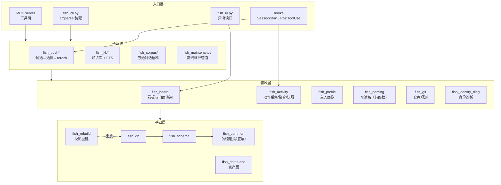

<div align="center">

# fish · 大肥鱼生命系统

**给 AI 助手的长期记忆与协作层**

单机 · 单仓 · 事件溯源 —— SQLite + FTS5 + MCP + CLI + 宿主 hooks


[定位](#定位) · [设计约束](#四条设计约束) · [架构](#架构) · [数据模型](#数据模型) · [模块地图](#模块地图) · [快速开始](#快速开始) · [质量](#质量) · [已知限制](#已知限制)

</div>

---

## 定位

多个 AI 会话一起干活时，有三件事反复发生：**记不住**（换会话就丢上下文）、**记太多**（塞满反而抓不住重点）、**互相踩**（同时改同一块没人知道）。

fish 不是"又一个向量记忆库"。它是一条**带证据的写入链路**：

```
写入 → 事件（不可变） → 投影表（可重建） → 门面（只读渲染） → 人的编辑面
```

四层各管一件事，任意一层坏了都能从上一层重建。**这是它敢把记忆当基础设施用的原因。**

它不追求"记得多"，追求**在正确的时刻递上正确的一条**，并且**能说清那条是怎么来的**。

## 四条设计约束

这四条不是理念，是被自己的 bug 逼出来的，每条都有判据钉住。

**① 事件是唯一真相。**
`events` 表只追加、不可改（有触发器挡 UPDATE）。所有查询表都是投影，可 `rebuild` 重放。改投影不叫改数据，只叫改"读法"。

**② 不知道是谁 ≠ 谁都可以。**
身份的唯一来源是凭证（token）。查不到就返回 `None`，**绝不从会话键推一段身份出来**。这条写死在 `fish_activity` 的注释里，并由 `test_activity::FrozenCitizensSqlTest` 逐条冻结。

**③ 分层是硬的，靠不 import 来保证。**
`fish_common ← fish_schema ← fish_db ← 领域模块 ← fish.py`。下层不 import `fish`，所以它们能被单独测试、单独重建。破坏它会立刻炸环。

**④ 每条判据都要先证明它**能**失败。**
判据通过不代表它有判别力——本仓里出现过判据被"恰好也含这个词"的注释满足、被测试数据自己的名字满足、被一行死代码永不触发的情况。所以有 `mutation_*.py`：把守卫拆掉，判据必须**红**；还原后必须**绿**且字节一致。

## 架构



## 数据模型

| 层 | 载体 | 是否可变 | 重建方式 |
|---|---|---|---|
| **事件** | `events`（seq 单调） | **不可变**（触发器拦 UPDATE） | —— 它是起点 |
| **投影** | `code_index` / `presence` / `board_posts` … | 可变 | 从 `events` 重放（`fish_rebuild`） |
| **门面** | `fish-home/` 下的 Markdown | 可重生成 | 从投影渲染 |
| **编辑面** | 人改 Markdown | 自由 | 回写成事件 |

**关键点**：门面是**只读渲染产物**，手改它等于手改缓存——下次渲染就没了。要改内容得走事件。

### 记忆编码

```
<项目前缀>-<YYMMDD>-<序号>      例：大肥鱼生命系统-261122-45
```

正文 Markdown 落盘，索引与元数据进 SQLite。编码一旦分配不再变，`supersede` 是加新条目指向旧的，不是改旧的。

## 模块地图

`p0/` 下 **47 个模块**，按层排列（下表只列主要的）：

| 层 | 模块 | 职责 |
|---|---|---|
| **入口** | `fish.py` · 10,600 行 | 记忆/检索/事件/注入/编码/看板的汇合点 |
| | `fish_cli.py` | argparse 装配与命令分发 |
| | `fish_ui.py` | 只读读口（给界面用） |
| | `fish_dsh_hook.py` · `fish_posttool_hook.py` | 会话签发、动作采集、绕路提醒、推送 |
| **子系统** | `fish_kb.py` · `fish_kb_index.py` | 知识库（B3）+ 全文索引 |
| | `fish_push.py` · `fish_push_rerank.py` | 推送管线：候选→选择→六特征重排→断路器 |
| | `fish_corpus*.py`（6 个） | 原始对话语料：摄取、DSH/WB 适配、排序、治理 |
| | `fish_maintenance.py` | 离线维护管道，8 个任务按间隔调度 |
| **领域** | `fish_board.py` | 看板渲染、占用面重叠判定、帖子↔记忆关联 |
| | `fish_activity.py` | 动作流采集/聚合/快照、在场缓存（瞬时+会话累计） |
| | `fish_profile.py` | 主人画像槽位 |
| | `fish_naming.py` | 可读名（**纯函数，无 DB**） |
| | `fish_git.py` | 仓库身份发现与观测 |
| | `fish_identity_diag.py` | 身份四锚诊断 + 归属缺口与显式补账 |
| **基础** | `fish_rebuild.py` | 从事件重放重建投影 |
| | `fish_dataplane.py` | 资产层 |
| | `fish_db.py` | 补列/加索引/迁移辅助（幂等） |
| | `fish_schema.py` | 全部 DDL 常量的唯一来源 |
| | `fish_common.py` | 共享原语 + 全量配置键表（**依赖图最底层**） |

## 快速开始

```bash
# 1. 依赖（只有一个可选依赖；缺了会让部分测试静默少跑）
pip install fts5  # 多数 Python 自带；缺了 FTS 检索会降级

# 2. 初始化（建库 + 迁移 + 落门面）
python p0/fish.py init

# 3. 注册项目前缀（编码需要它）
python p0/fish.py project add --prefix 我的项目 --name "我的项目"

# 4. 记一条，再搜回来
python p0/fish.py remember --project 我的项目 --title "结论" --body "正文"
python p0/fish.py recall "结论"

# 5. 体检（断链、幽灵归属、归属缺口）
python p0/fish.py healthcheck
```

### 看板：谁在动哪块

```bash
# 签到（surface 填你最不希望被别人无意识改掉的文件）
fish board checkin --doing "在改看板渲染" --surface p0/fish_board.py

# 发一条动态（正文没写记忆编码时，会自动补上本会话最近那条）
fish board post --kind progress --text "渲染改完，跑了 6 条判据"

# 看现场
fish board show
```

`surface` 的诚实价值是**可观测**——填了，别人看板上就看得见你在动哪几个文件。它**不承诺**防覆盖（实测碰撞 20 天内文件级 0 次）。

### 会话与身份

```bash
# 签发会话凭证（拿不到就别猜身份，fish 不会替你造一个）
fish session start

# 改可读名（自动占位名形如 未命名·dsh#88f9）
fish rename-citizen --name "fish-主AI"

# 历史写入没有归属？先看缺口，再显式补账（缺省干跑）
fish healthcheck
fish activity attribute --session codebuddy:xxx --citizen <id> --apply
```

## 质量

判据不是"跑过了"，是**能红**。

| 手段 | 做法 | 为什么需要 |
|---|---|---|
| **判据** | 每条断言一个可证伪的行为 | 「函数返回对了」不等于「装配接上了」 |
| **变异自证** | `mutation_*.py`：拆守卫 → 判据必须红 → 还原后必须绿且 sha256 一致 | 判据通过可能只是没触达那段代码 |
| **反向守** | 对"某件事**不该**发生"的断言（不建板、不重复推、不跨会话关联） | 这类断言在 bug 未修复时会**空过** |
| **行数棘轮** | `j4_ratchet.json` 只许降；各模块有窗口常量 | 防 `fish.py` 长成第二个巨石 |
| **装配判据** | 断言用户可见的输出里出现特征句，而不是函数返回值 | 本仓里 `render_questions_block` 死过一周 |

**变异测试抓到的三类真问题**（都写进了代码注释）：

1. **不可达死代码** —— 某段"新格式精确比对"被前缀分支先返回，变异后判据仍绿 → 说明它永不执行，删掉。
2. **假绿断言** —— 断言"输出含 `占用面`"，而接线代码**上方的注释**就含这三个字；删掉接线后断言仍真。改用只有用户可见文案才有的句子。
3. **测错原因** —— 测试因 `SystemExit` 失败，与被测行为无关。断言必须为**你想测的原因**失败。

## 已知限制

| 限制 | 现状 | 出路 |
|---|---|---|
| **单机单进程** | SQLite + WAL，同目录只能一个写入方 | 跨设备同步未做 |
| **89.7% 写入无归属** | 12 个 codebuddy 会话从未调用 `session start` | `healthcheck` 已能看见 + `activity attribute` 显式补账；**不自动建公民** |
| **`fish.py` 到顶** | 10,600/10,600（J4 棘轮上限） | 下次十行需求就该**拆模块**，不是再压注释 |
| **自动签到不编造占用面** | 自动签到占 85%，surface 留空 | 刻意：编造的面会让重叠检测失去意义 |
| **一个 flaky 判据** | `test_push_rerank::R6a2`（hook 子进程分布，时序敏感） | 全量负载下偶红，隔离复跑稳定通过 |
| **工作区文档不入库** | `/[0-9][0-9]-*.md` 被 `.git/info/exclude` 排除 | 公开仓只放代码；内部设计文档留本地 |

## 更新记录

| 日期 | 变更 |
|---|---|
| 2026-11-22 | 看板四项：读路径不建板、空板提前归档进台账、占用面提示、帖子自动关联记忆；会话累计占用面；归属缺口可见 + 显式补账；自动名改中文并修活"起名提示"（此前 **0/173** 命中） |
| 2026-11-21 | 系统级修复：根因全量调查与完整方案 |
| 2026-11-20 | 架构优化与拆包；fish 引入 git 观测；DSH hook 断流根因修复 |
| 2026-10-27 | 原始对话语料层；知识库检索一次 walk 化 |
| 2026-10-26 | 看板与撞车判定；hooks 深度利用 |

---

<div align="center">

**判据、变异、棘轮——三样东西共同保证：这个仓里"通过了"是真的通过。**

</div>
