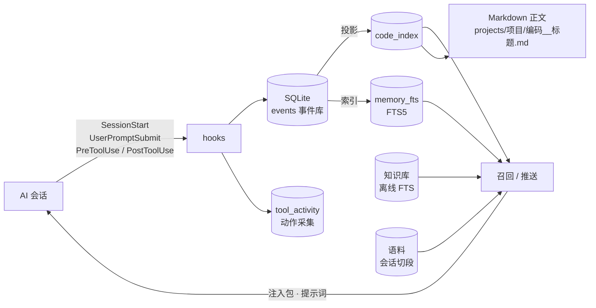

<div align="center">

# fish · 大肥鱼生命系统

**给 AI 助手的长期记忆与协作层**

单机 · 单仓 · 事件溯源 —— SQLite + FTS5 + MCP + CLI + 宿主 hooks


[它解决什么问题](#它解决什么问题) · [特性](#特性) · [架构](#架构) · [快速开始](#快速开始) · [质量与判据](#质量与判据) · [已知限制](#已知限制)

</div>

---

## 它解决什么问题

多个 AI 会话一起干活时，有三件事反复发生：

1. **记不住** —— 换一个会话，之前定过的约定、踩过的坑、做过的决定全丢了；
2. **记太多** —— 把什么都塞进上下文，模型反而抓不住重点；
3. **互相踩** —— 两个会话同时改同一块，谁也不知道。

fish 的答案是：**记忆落库、召回算分、推送看价值、协作看看板**。
它不追求"记得多"，追求**在正确的时刻递上正确的一条**。

## 特性

| 层面 | 能力 | 关键设计 |
|---|---|---|
| **记忆** | 编码式长期记忆 | `<前缀>-<YYMMDD>-<序号>`；正文 Markdown 落盘，索引进 SQLite；事件溯源可重建 |
| **召回** | 两段式检索 | 先 AND 精确命中，无命中再 OR 回退，并**如实标记** `meta.fallback`（可观测，不假装命中） |
| **推送** | 三通道 | `inject`（会话开场）/ `tool_after`（工具调用后）/ `prompt`（用户消息边界） |
| **去重** | 内容感知 | 读过的、过期的**永久不再推**；内容变了（指纹不同）才推新版 |
| **排序** | 可插拔四件套 | RRF 跨路融合 / 三因子 `recency×importance×relevance` / MMR 多样性 / 价值门 |
| **协作** | 看板 | 谁在动哪块、有没有撞车 |
| **语料** | 历史会话 | 切成可检索的段，不重跑全量 |
| **知识库** | 离线索引 | 对 Markdown 库做 FTS，复用同一套两段式召回 |

> 四个排序开关（`push.rrf_enabled` / `push.factors_enabled` / `push.mmr_enabled` /
> `push.value_floor`）**默认全关**——它们会改变"推哪几条"，观察后再开。

## 架构



**依赖方向由判据钉住**：领域模块不得 `import fish`（J2/J6）、导出面双向对账（J1b）、
行数窗口防膨胀（J4）、函数体 AST 等价（J8）。

## 快速开始

```bash
# 1. 依赖（只有一个可选依赖；缺了会让部分测试静默少跑）
python -m pip install -r p0/requirements.txt

# 2. 初始化
python p0/fish.py init

# 3. 注册项目前缀（编码需要它）
python p0/fish.py project-add demo --namespace "示例项目"

# 4. 记一条，再搜回来
python p0/fish.py remember demo "第一条记忆" --body "正文"
python p0/fish.py recall 第一条

# 5. 健康检查
python p0/fish.py healthcheck
```

要求 **Python ≥ 3.11**（用到 `tomllib` / `zoneinfo`）。

**接入 MCP**（Claude Desktop / Codex / WorkBuddy 等）：把 `p0/mcp_server.py` 注册为 stdio server 即可，参数见 `p0/install_mcp.py` 的示例。

## 质量与判据

| 项 | 读数 |
|---|---|
| 测试 | **1,647 passed / 3 skipped**（113 个测试文件，`python -m unittest discover -p "test_*.py"`） |
| 变异体 | **27 个**（`p0/mutation_*.py`）——用来证明判据**真的会失败**，不是摆设 |
| 代码规模 | `fish.py` 14,408 行 + 6 个领域模块（push / corpus / kb / common / maintenance / surface） |
| 跟踪文件 | 350 |

三条纪律写在代码里：

1. **判据必须能失败** —— 每个关键判据配一个变异体：改坏实现，判据必须红；还原后必须绿。
2. **不静默降级** —— 拿不到证据就标"判不到（SKIP）"，绝不写成"通过"。
3. **默认关闭新行为** —— 任何会改变排序/推送的开关默认关。

## 目录结构

```
p0/                主体（单文件编排 + 领域模块）
  fish.py            编排层：CLI / 领域函数 / 事件 / 投影（14.4k 行）
  fish_push.py       推送：候选生成 / 门槛 / 去重
  fish_push_rank.py  融合排序：RRF / 三因子 / MMR / 价值门
  fish_corpus*.py    语料层：采集 → 切段 → 检索 → 推送候选
  fish_kb*.py        知识库离线索引
  fish_common.py     配置 / 关键词 / 注入预算
  mcp_server.py      MCP 服务（stdio，19 个工具 + 2 个资源）
  hook_fastpath.py   hook 快速通道（关闭态早退 + 按 hook 冷却）
  mutation_*.py      27 个变异体
  test_*.py          113 个判据文件
docs/              设计 / 评审 / 对账文档（40 篇）
*.md               各阶段的设计与评审报告
```

## 已知限制

- **`visibility=private` 目前只是标签**：写入可选、默认 `shared`；执行层未完成——
  只有 `search_memories` 一条路径按 owner 过滤，另有 10 条读路径仍返回 private
  （`read_body` 全文、`resolve_code` 元数据、`recall` 回退列表、`list`、`neighbors`、
  `inject` 注入包、`recall --by relevance`、推送管线、`fish://index` 资源面）。
  **不要**打开 `privacy.visibility_enforced`（打开后连 owner 自己也看不到）。
- **单机单用户**：多 AI 会话共享同一个 OS 账户与数据库文件，逻辑层的"可见性"
  不构成存储层边界（正文是明文 Markdown）。
- **位置敏感**：极少数判据（`test_workspace_map`）假定仓库不在 `%TEMP%`/`AppData` 下。
- **历史文档**：`docs/` 与根目录的 md 保留了写作当时的环境与判断，属项目记录，未做追溯改写。

## 更新记录

### 2026-10-29

- **推送**：结案（读过 / 过期）**永久去重**；`content_hash` 内容感知去重（内容变了才重推）；分通道时效门（fact/episode/artifact 过硬门槛，rule/lesson 免疫）
- **排序**：RRF 跨路融合、三因子、MMR 多样性、价值门——全部可配、默认关
- **身份**：绑定需证明（含历史 token，吊销 7 天内有效）、退役/合并接吊销、事件事务边界、`rebuild` 保留 visibility
- **安全**：路径穿越拦截、语料按公民过滤、私钥整段脱敏、hook 关闭态早退（0.2s）
- **诚实性**：SKIP/MISS 用退出码表达、金标缺文件 fail-open、变异体覆盖到 27 个

## 版权

© 2026 安逸。内部项目公开源码，**未附开源许可证**；引用或复用请先联系作者。
