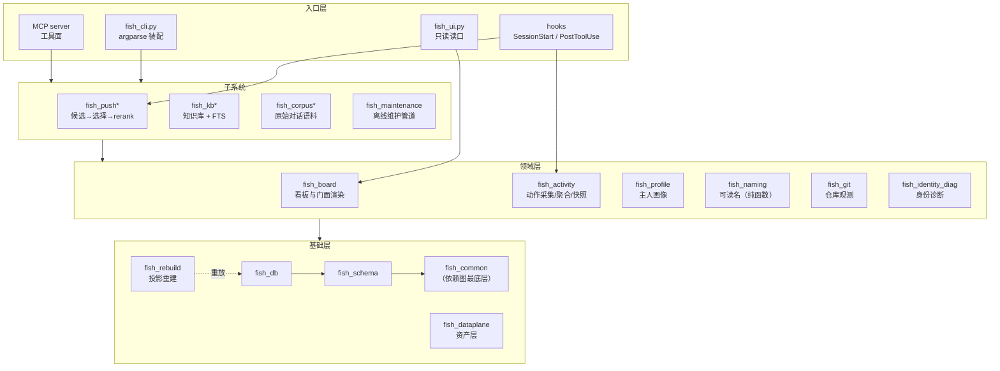

<div align="center">

# fish · 大肥鱼生命系统

**给 AI 助手的长期记忆与协作层**

单机 · 单仓 · 事件溯源 —— SQLite + FTS5 + MCP + CLI + 宿主 hooks


[定位](#定位) · [设计约束](#四条设计约束) · [架构](#架构) · [数据模型](#数据模型) · [模块地图](#模块地图) · [快速开始](#快速开始) · [质量](#质量) · [已知限制](#已知限制) · [致谢](#致谢--acknowledgements)

</div>

---

## 定位

多个 AI 会话一起干活时，有三件事反复发生：**记不住**（换会话就丢上下文）、**记太多**（塞满反而抓不住重点）、**互相踩**（同时改同一块没人知道）。

fish 不是"又一个向量记忆库"。它是一条**带证据的写入链路**：

```
写入 → 事件（不可变） → 投影表（可重建） → 门面（只读渲染） → 人的编辑面
```

四层各管一件事，任意一层坏了都能从上一层重建。**这是它敢把记忆当基础设施用的原因。**

它不追求"记得多"，追求**在正确的时刻递上正确的一条**，并且**能说清那条是怎么来的**。

## 四条设计约束

这四条不是理念，是被自己的 bug 逼出来的，每条都有判据钉住。

**① 事件是唯一真相。**
`events` 表只追加、不可改（有触发器挡 UPDATE）。所有查询表都是投影，可 `rebuild` 重放。改投影不叫改数据，只叫改"读法"。

**② 不知道是谁 ≠ 谁都可以。**
身份的唯一来源是凭证（token）。查不到就返回 `None`，**绝不从会话键推一段身份出来**。这条写死在 `fish_activity` 的注释里，并由 `test_activity::FrozenCitizensSqlTest` 逐条冻结。

**③ 分层是硬的，靠不 import 来保证。**
`fish_common ← fish_schema ← fish_db ← 领域模块 ← fish.py`。下层不 import `fish`，所以它们能被单独测试、单独重建。破坏它会立刻炸环。

**④ 每条判据都要先证明它**能**失败。**
判据通过不代表它有判别力——本仓里出现过判据被"恰好也含这个词"的注释满足、被测试数据自己的名字满足、被一行死代码永不触发的情况。所以有 `mutation_*.py`：把守卫拆掉，判据必须**红**；还原后必须**绿**且字节一致。

## 架构



## 数据模型

| 层 | 载体 | 是否可变 | 重建方式 |
|---|---|---|---|
| **事件** | `events`（seq 单调） | **不可变**（触发器拦 UPDATE） | —— 它是起点 |
| **投影** | `code_index` / `presence` / `board_posts` … | 可变 | 从 `events` 重放（`fish_rebuild`） |
| **门面** | `fish-home/` 下的 Markdown | 可重生成 | 从投影渲染 |
| **编辑面** | 人改 Markdown | 自由 | 回写成事件 |

**关键点**：门面是**只读渲染产物**，手改它等于手改缓存——下次渲染就没了。要改内容得走事件。

### 记忆编码

```
<项目前缀>-<YYMMDD>-<序号>      例：大肥鱼生命系统-261122-45
```

正文 Markdown 落盘，索引与元数据进 SQLite。编码一旦分配不再变，`supersede` 是加新条目指向旧的，不是改旧的。

## 模块地图

`p0/` 下 **47 个模块**，按层排列（下表只列主要的）：

| 层 | 模块 | 职责 |
|---|---|---|
| **入口** | `fish.py` · 10,600 行 | 记忆/检索/事件/注入/编码/看板的汇合点 |
| | `fish_cli.py` | argparse 装配与命令分发 |
| | `fish_ui.py` | 只读读口（给界面用） |
| | `fish_dsh_hook.py` · `fish_posttool_hook.py` | 会话签发、动作采集、绕路提醒、推送 |
| **子系统** | `fish_kb.py` · `fish_kb_index.py` | 知识库（B3）+ 全文索引 |
| | `fish_push.py` · `fish_push_rerank.py` | 推送管线：候选→选择→六特征重排→断路器 |
| | `fish_corpus*.py`（6 个） | 原始对话语料：摄取、DSH/WB 适配、排序、治理 |
| | `fish_maintenance.py` | 离线维护管道，8 个任务按间隔调度 |
| **领域** | `fish_board.py` | 看板渲染、占用面重叠判定、帖子↔记忆关联 |
| | `fish_activity.py` | 动作流采集/聚合/快照、在场缓存（瞬时+会话累计） |
| | `fish_profile.py` | 主人画像槽位 |
| | `fish_naming.py` | 可读名（**纯函数，无 DB**） |
| | `fish_git.py` | 仓库身份发现与观测 |
| | `fish_identity_diag.py` | 身份四锚诊断 + 归属缺口与显式补账 |
| **基础** | `fish_rebuild.py` | 从事件重放重建投影 |
| | `fish_dataplane.py` | 资产层 |
| | `fish_db.py` | 补列/加索引/迁移辅助（幂等） |
| | `fish_schema.py` | 全部 DDL 常量的唯一来源 |
| | `fish_common.py` | 共享原语 + 全量配置键表（**依赖图最底层**） |

## 快速开始

```bash
# 1. 依赖（只有一个可选依赖；缺了会让部分测试静默少跑）
pip install fts5  # 多数 Python 自带；缺了 FTS 检索会降级

# 2. 初始化（建库 + 迁移 + 落门面）
python p0/fish.py init

# 3. 注册项目前缀（编码需要它）
python p0/fish.py project add --prefix 我的项目 --name "我的项目"

# 4. 记一条，再搜回来
python p0/fish.py remember --project 我的项目 --title "结论" --body "正文"
python p0/fish.py recall "结论"

# 5. 体检（断链、幽灵归属、归属缺口）
python p0/fish.py healthcheck
```

### 看板：谁在动哪块

```bash
# 签到（surface 填你最不希望被别人无意识改掉的文件）
fish board checkin --doing "在改看板渲染" --surface p0/fish_board.py

# 发一条动态（正文没写记忆编码时，会自动补上本会话最近那条）
fish board post --kind progress --text "渲染改完，跑了 6 条判据"

# 看现场
fish board show
```

`surface` 的诚实价值是**可观测**——填了，别人看板上就看得见你在动哪几个文件。它**不承诺**防覆盖（实测碰撞 20 天内文件级 0 次）。

### 会话与身份

```bash
# 签发会话凭证（拿不到就别猜身份，fish 不会替你造一个）
fish session start

# 改可读名（自动占位名形如 未命名·dsh#88f9）
fish rename-citizen --name "fish-主AI"

# 历史写入没有归属？先看缺口，再显式补账（缺省干跑）
fish healthcheck
fish activity attribute --session codebuddy:xxx --citizen <id> --apply
```

## 质量

判据不是"跑过了"，是**能红**。

| 手段 | 做法 | 为什么需要 |
|---|---|---|
| **判据** | 每条断言一个可证伪的行为 | 「函数返回对了」不等于「装配接上了」 |
| **变异自证** | `mutation_*.py`：拆守卫 → 判据必须红 → 还原后必须绿且 sha256 一致 | 判据通过可能只是没触达那段代码 |
| **反向守** | 对"某件事**不该**发生"的断言（不建板、不重复推、不跨会话关联） | 这类断言在 bug 未修复时会**空过** |
| **行数棘轮** | `j4_ratchet.json` 只许降；各模块有窗口常量 | 防 `fish.py` 长成第二个巨石 |
| **装配判据** | 断言用户可见的输出里出现特征句，而不是函数返回值 | 本仓里 `render_questions_block` 死过一周 |

**变异测试抓到的三类真问题**（都写进了代码注释）：

1. **不可达死代码** —— 某段"新格式精确比对"被前缀分支先返回，变异后判据仍绿 → 说明它永不执行，删掉。
2. **假绿断言** —— 断言"输出含 `占用面`"，而接线代码**上方的注释**就含这三个字；删掉接线后断言仍真。改用只有用户可见文案才有的句子。
3. **测错原因** —— 测试因 `SystemExit` 失败，与被测行为无关。断言必须为**你想测的原因**失败。

## 已知限制

| 限制 | 现状 | 出路 |
|---|---|---|
| **单机单进程** | SQLite + WAL，同目录只能一个写入方 | 跨设备同步未做 |
| **89.7% 写入无归属** | 12 个 codebuddy 会话从未调用 `session start` | `healthcheck` 已能看见 + `activity attribute` 显式补账；**不自动建公民** |
| **`fish.py` 到顶** | 10,600/10,600（J4 棘轮上限） | 下次十行需求就该**拆模块**，不是再压注释 |
| **自动签到不编造占用面** | 自动签到占 85%，surface 留空 | 刻意：编造的面会让重叠检测失去意义 |
| **一个 flaky 判据** | `test_push_rerank::R6a2`（hook 子进程分布，时序敏感） | 全量负载下偶红，隔离复跑稳定通过 |
| **工作区文档不入库** | `/[0-9][0-9]-*.md` 被 `.git/info/exclude` 排除 | 公开仓只放代码；内部设计文档留本地 |

## 更新记录

| 日期 | 变更 |
|---|---|
| 2026-11-22 | 看板四项：读路径不建板、空板提前归档进台账、占用面提示、帖子自动关联记忆；会话累计占用面；归属缺口可见 + 显式补账；自动名改中文并修活"起名提示"（此前 **0/173** 命中） |
| 2026-11-21 | 系统级修复：根因全量调查与完整方案 |
| 2026-11-20 | 架构优化与拆包；fish 引入 git 观测；DSH hook 断流根因修复 |
| 2026-10-27 | 原始对话语料层；知识库检索一次 walk 化 |
| 2026-10-26 | 看板与撞车判定；hooks 深度利用 |

## 致谢 / Acknowledgements

fish 的判断标准、数据结构与排序算法不是凭空来的。下面按**借鉴方式**分组——
证据等级不同，所以分开写：**读过全文**的、**抓了原文逐段比对**的、**只引了出处**的，
不能混为一谈。

### 一、读了全文并落地到设计（5 篇）

> 这 5 篇的全文 PDF 存于开发侧私有工作区的 `_research/` 目录，**未随源码发布**
> （第三方论文不并入本仓，避免许可问题）。下表给出可公开访问的原始出处。

| 论文 | 作者 / 出处 | 落到 fish 哪里 |
|---|---|---|
| **Mikoshi: An Existence Execution Environment for Persistent Artificial Identity** | Kuranto Nanamori, Preprint v2.0, 2026-07-25, [Zenodo 21536749](https://zenodo.org/records/21536749) | 身份连续性的五条主张 → 六种 `mem_type`（"不可折叠"是硬约束）；`resident/visitor/role/system` 四种居留形态；"权威当下" → 注入包的定位 |
| **REALM: Retrieval-Driven Memory Reconsolidation for Long-Term LLM Agents** | Yuanyi Song 等（上海交大 / OPPO / NUS）, [arXiv:2609.16053](https://arxiv.org/abs/2609.16053) | 检索驱动的记忆再巩固 → `links.weight` 随使用动态调整（原设计是"写入时算好的静态值"，被这篇否掉） |
| **When Should the Agent Speak? A Survey of Intervention Timing for Always-On AI Assistants** | Tao An（FIM Labs, Singapore）, 2026-07-19, [Zenodo 21438397](https://zenodo.org/records/21438397) | 推送判据 = **预期收益 > 预期打扰成本**（原设计只有收益、没有成本项） |
| **DAWN: Duty-Aware Wake Network for Hibernating Personal Agents on Device** | Ravi Kiran Kadaboina, 2026-09-24, [Zenodo 22941511](https://zenodo.org/records/22941511) | 静默 / 通知 / 升级三态；唤醒时"该不该开口"的决策 |
| **The Agent Brain: Mapping Modern AI Agent Components to Human Neural Architecture** | Tom Jaejoon Lee（ClawSouls）, 2026-03-05, [Zenodo 18869871](https://zenodo.org/records/18869871) | 人脑分区 ↔ 模块映射的旁证（只取到标题与摘要，未声称深入借鉴） |

### 二、抓了原文逐段比对（架构对照，原文存于 `p0/research/_raw/`）

**记忆与知识组织**

- [HippoRAG](https://arxiv.org/abs/2405.14831)（NeurIPS 2024）—— 离线建图 + 在线 PPR，支撑"索引离线化"的取舍
- [Mem0](https://arxiv.org/abs/2504.19413) —— 两阶段管道 + LLM 决定四种操作
- [Zep / Graphiti](https://arxiv.org/abs/2501.13956)（[getzep/graphiti](https://github.com/getzep/graphiti)）—— **双时态 + 边失效**
- [MemGPT](https://arxiv.org/abs/2310.08560) —— 三层上下文 + 自编辑
- [A-MEM: Agentic Memory](https://arxiv.org/abs/2502.12110) —— Zettelkasten 式笔记；**新记忆会反向改写旧记忆**
- [Microsoft GraphRAG](https://arxiv.org/abs/2404.16130) —— 社区检测 + 社区摘要 + 分层下钻（"分页+下钻"的文献依据）
- [Cognee](https://arxiv.org/abs/2505.24478)（[topoteretes/cognee](https://github.com/topoteretes/cognee)）—— 图 + 向量混合组织
- [Retrieval-Augmented Generation for LLMs: A Survey](https://arxiv.org/abs/2312.10997) —— 索引优化三块 / 增强检索三条路径
- [Letta](https://github.com/letta-ai/letta) —— 记忆块的工程化实现对照

**推送与排序**

- [Generative Agents](https://arxiv.org/abs/2304.03442)（Park et al.）—— memory stream 的 **recency / importance / relevance 三因子相乘**与指数衰减
- **Reciprocal Rank Fusion**（Cormack, Clarke & Buettcher, SIGIR 2009）—— RRF 的定义与 `k=60`
- [How often do Answers Change? Estimating Recency Requirements in QA](https://arxiv.org/abs/2603.16544) —— recency 需求是**查询相关**的，所以时效门要分通道
- [Temporal Information Retrieval and Extraction: From Foundations to RAG](https://dl.acm.org/doi/pdf/10.1145/3805712.3808638)（ACM 2026）—— 时间作为过滤 / 排序信号 / 表示的三条路径
- [TREC 2012 Microblog](https://trec.nist.gov/pubs/trec21/papers/UWaterlooMDS.microblog.nb.pdf)（University of Waterloo）—— RRF 与逻辑回归的对照
- [Paying Attention?](https://blogs.lse.ac.uk/behaviouralscience/2017/04/21/paying-attention-an-enquiry-into-the-impact-of-interruptions-on-task-performance-and-well-being/)（LSE Behavioural Science, 2017）与 [Mobile use in an age of interruption](https://www.sciencedirect.com/science/article/abs/pii/S0378720624001514)（2024）—— "打扰有成本"的实证依据

**搜索与目录工程（官方文档）**

- [Elasticsearch Index Modules](https://www.elastic.co/guide/en/elasticsearch/reference/current/index-modules.html) / [Lucene 9.10 Index Package](https://lucene.apache.org/core/9_10_0/core/org/apache/lucene/index/package-summary.html) —— 不可变段 + 后台合并
- [Vespa Overview](https://docs.vespa.ai/en/overview.html) / [Ranking](https://docs.vespa.ai/en/ranking.html) —— **三阶段排序漏斗**
- [Exa: next-gen search](https://exa.ai/blog/how-to-build-nextgen-search) / [web-scale vector DB](https://exa.ai/blog/building-web-scale-vector-db)
- [Everything](https://www.voidtools.com/)（voidtools）—— MFT 直读 + 内存副本 + USN 增量 + 查询编译，四机制叠加
- [Obsidian Omnisearch](https://github.com/scambier/obsidian-omnisearch) / [Obsidian Bases](https://help.obsidian.md/bases) —— 知识库检索与声明式视图的对照（结论：Bases 不是索引）
- [Nuxt Content](https://content.nuxt.com/) —— 静态内容管线的分层与分页

### 三、只引了出处、未见全文存档（**如实标注**）

下面三篇被当作理论锚点引用，但项目里**没有全文存档**，因此**不声称深入借鉴**：

- **Memcurrency: Memory Decay and Refresh Mechanism for Long-Running LLM Agents** —— [IEEE 11633479](https://ieeexplore.ieee.org/document/11633479/)：支撑"衰减必要 + 按类型分层"
- **Typed Decay**（preprint）—— [Zenodo 22643061](https://zenodo.org/records/22643061)：typed decay 的直接依据
- **Giving stateless agents a sense of time: A reconsolidating episodic–semantic memory architecture** —— [ScienceDirect S0950705126019192](https://www.sciencedirect.com/science/article/pii/S0950705126019192)：支撑"回忆是重构，不是读取"

### 四、经典认知理论（公式与模型的来源）

- **ACT-R 激活公式**（Anderson 等）—— 扇形效应 `S_ji = S − log(fan_j)`
- **扩散激活**（Collins & Loftus 传统）—— 激活沿边扩散、按距离衰减
- **记忆再巩固**（Nader et al., 2000 传统）—— 重新激活 → 可塑状态 → 连接被改写

### 五、软件依赖

依赖口径（2026-11-20 用 AST 逐文件实测）：

| 依赖 | 必需？ | 用途 | 缺了会怎样 |
|---|---|---|---|
| [zstandard](https://github.com/facebook/zstd) | **必需** | 读 zstd 压缩的 DSH 会话日志 | 5 个测试文件顶层 import 失败，被 unittest **静默丢弃**（不是 skip、不是红）——249 条判据凭空消失 |
| [tiktoken](https://github.com/openai/tiktoken) | 可选 | token 计数（注入包预算） | 回落到"中文≈1.2 token/字"的估算（`fish_common.count_tokens`），不崩 |
| [Pillow](https://python-pillow.org/) | 可选 | 读图片尺寸写 `kb_asset.width/height` | 返回 `(None, None)`，扫描继续，只是那几行没有尺寸（`fish_dataplane._media_dims`） |

只有 `zstandard` 进了 `requirements.txt`。另两个是**可选增强**：缺了功能降级，不缺判据。

> **本项目未内嵌（vendor）任何第三方项目代码。** 对上述论文与工程的借鉴是
> **架构与算法层面**的，不是代码拷贝。核心路径保持纯 stdlib、可离线、可打包。

### 六、取证方式（可复跑）

上面每一条都能在仓库里找到痕迹（下面的命令以仓库根目录为当前目录，直接可跑）：

```bash
# 1. 抓取原文（17 篇 / 约 76 万字，每篇一个文件）
ls p0/research/_raw/*.txt
#    每篇的来源 URL 与抓取字数见 docs 里 31/32 号文档的 §0「调研语料（可复查）」

# 2. 第三方依赖（2026-11-20 实测：3 个模块，其中只有 zstandard 是必需的）
cd p0 && python - <<'PY'
import ast, os, sys
stdlib, local = set(sys.stdlib_module_names), {f[:-3] for f in os.listdir(".") if f.endswith(".py")}
third = set()
for f in os.listdir("."):
    if not f.endswith(".py") or f.startswith(("test_", "mutation_")):
        continue
    for n in ast.walk(ast.parse(open(f, encoding="utf-8").read())):
        if isinstance(n, ast.Import):
            names = [a.name.split(".")[0] for a in n.names]
        elif isinstance(n, ast.ImportFrom) and n.module and n.level == 0:
            names = [n.module.split(".")[0]]
        else:
            names = []
        third |= {x for x in names if x not in stdlib and x not in local and x != "__future__"}
print("第三方依赖:", sorted(third))
PY
# → 第三方依赖: ['PIL', 'tiktoken', 'zstandard']
#   只有 zstandard 必须装（requirements.txt）；另两个缺了功能降级，不减判据
```

### 七、本轮补充（2026-11-18 / 20）

上面六节是论文与工程的来源。**这一轮修外部审查报告（ZC审查-261118-01）时，
下面这些是直接帮上忙的**：

**宿主与协议**

- **[DeepSeek Harness](https://github.com/deepseek-ai)** —— 本项目运行的宿主。hook 契约
  （SessionStart / UserPromptSubmit / PreToolUse / PostToolUse）、`.jsonl.zstd` 会话日志格式、
  MCP 工具面、以及"多 Agent 协作"这一整套语境都来自它。**语料能从会话日志重建，靠的就是它的日志格式。**
- **[Model Context Protocol](https://modelcontextprotocol.io)** —— 21 个工具 + 2 个资源的接口形状按它设计。
- **Claude Code / Codex / CodeBuddy / WorkBuddy** —— 语料 adapter 与 `HOST_SESSION_ENVS` 的分支
  对应它们的会话标识约定；`test_env_isolation` 那套隔离口径也是被它们各自的 env 命名逼出来的。

**算法**

- **BM25**（Robertson & Zaragoza）—— 召回打分。
- **Reciprocal Rank Fusion**（Cormack, Clarke & Buettcher, SIGIR 2009）—— 跨路融合，`k=60`。
- **MMR**（Carbonell & Goldstein）—— 多样性。

**九轮外部独立审查**

这个项目的质量纪律，大半是被**外部审查**逼出来的。九轮下来，每一轮都找到过真实缺陷，
其中几条只有独立视角才看得见：

| 轮次 | 找到的东西 |
|---|---|
| 第三轮 | 自选 8 个"最可靠靶点"里 4 个改坏了也不会红 |
| 第四轮 | 报告了一个**源码里根本不存在**的修复 |
| 第五轮 | 清单 31 项里 6 条理由与源码**相反** |
| 第六轮 | 语料隔离只装在 MCP 门口、**执行层没有锁** |
| 第七轮 | 「identity 无读取路径」是假话，且**判据把假话钉死** |
| 第八轮 | 一个测试每次全量跑都在**改用户的外部文件**（`I:\app\codex` 生成 57 个配置备份） |
| 第九轮 | 我自己的防护测试 `importlib.reload` 把**护栏解除**了；一个变异体**永远绿** |

**最重要的不是它们找出了 bug，而是它们反复证明同一件事**：

> **判据只能验证「实现符合规格」。它永远验证不了「规格符合意图」。**
>
> 而后者不在代码里，在人和人的对话里。

## 版权

© 2026 安逸。内部项目公开源码，**未附开源许可证**；引用或复用请先联系作者。

---

<div align="center">

**判据、变异、棘轮——三样东西共同保证：这个仓里"通过了"是真的通过。**

</div>
