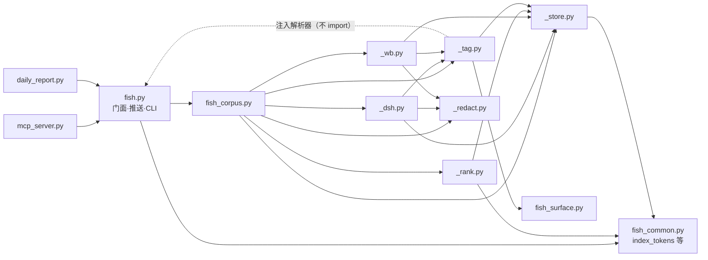
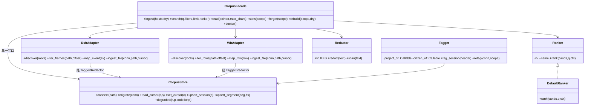
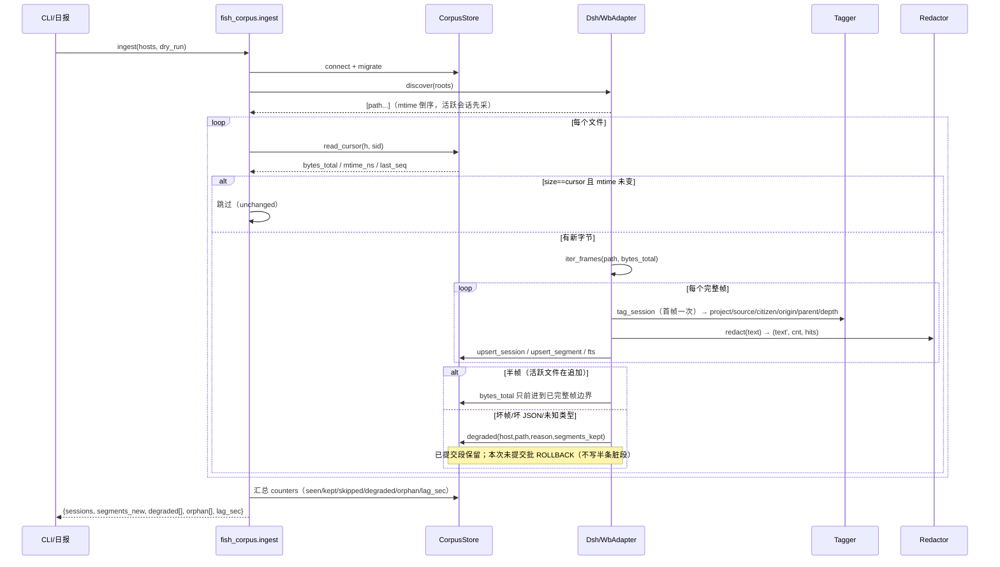
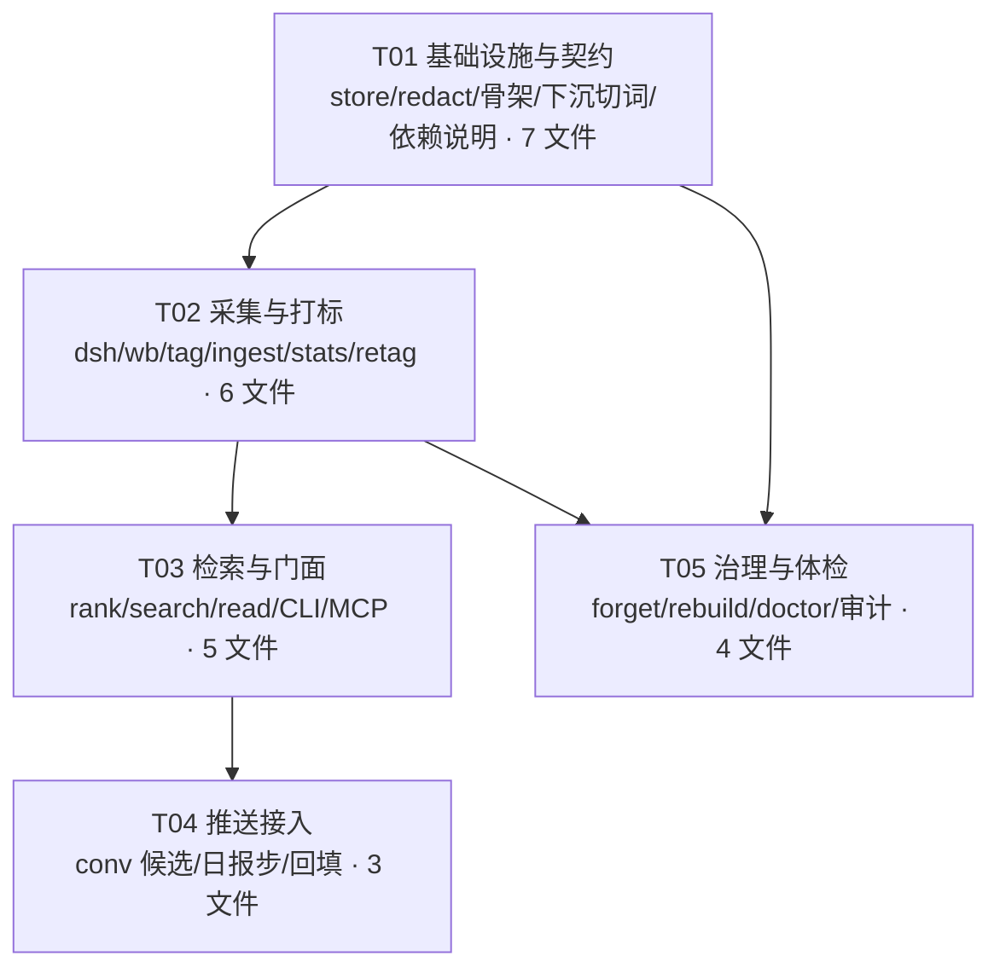

# 架构设计 · 原始对话语料层（`fish_corpus`）v0.1

| 项 | 内容 |
|---|---|
| 作者 / 日期 | 架构师 高见远 · 2026-10-27 |
| 上游 | `_research/PRD-对话语料层-261027.md`（9 条 P0 基线）、`facts-对话语料-20261027.md`、`report-dsh-world.md`、`report-dsh-agent-soul.md` |
| 实施分支 | `dev/fish-corpus-261027`（实测 `git branch --show-current` 已是此值） |
| 范围 | 只写设计。不改代码、不建库、不改宿主日志（只读扫盘） |
| 证据口径 | 沿用 PRD 缩写（`F:n/W:n/S:n/A:n/P:n/M:n/K:n`）；标「实测」的数字均为 2026-10-27 03:39–03:55 本次只读取证（命令见各条） |

## 0 一页结论
1. **缺的不是存储技术，是"可回原话的那一层"**：主库 19 表零对话表（F:8-10）。本层只做「采集+打标+门牌+推 1 条」，排序算法归主 AI 研究线（PRD §8.2）。
2. **主库零改动**：实测 `_PUSH_LOG_DDL`（P:419-432）对 `code`/`channel` 无 CHECK、词表校验只在 Python 层（P:2556），`conv:` 前缀直接可用；不建表不加列。
3. **只能扫盘 + 帧边界游标**：hook 的 `transcript_path` 恒空（A:54,70,90）。实测 DSH **515 个 `session.v4.jsonl.zstd`**（另 17 legacy + 1 v3），单文件最多 **2,773 帧**（12.5 MB→58,519,266 B），游标只能记"帧边界字节"。
4. **`user/message` 不能照采**：实测 `data.source.kind` 有 **15 种**，3 个大会话样本里 `user` 仅 531 条，其余 527 条是 `goal`(136)/`time-context`(87)/`runtime-context`(56)/`skill-catalog`(43)/`agent-instructions`(20)…——**全是注入块**。白名单 `kind=='user'` 才是 PRD §3.1 铁律的正确落法（D02）。
5. **子代理语料必须采**：实测 460/515 是 `origin=subagent`（depth 1:338/2:123），其任务正文确以 `kind='user'` 到达 → 白名单不丢 89% 语料。
6. **项目归属现状 0 覆盖**（515/515 未命中；`workspace_map` 仅 4 条且全指子目录）。本层不替用户补映射：只保证 `project_source` 必填 + `retag` 让补映射后重算历史。
7. **中文检索沿用既有范式**：`index_tokens`（P:3857，CJK 重叠 bigram）+`unicode61`+引号 token（P:3880）。索引侧与查询侧必须同一切法，否则"存进去搜不到"。
8. **推送走 prompt 时机、单批 1 条、精确回填**：注入包不加段（开场无 query 判不了相关性）；采纳用精确 `code` 而非 `prefix`（prefix 会把同窗口无关推送一并置 accepted，虚高 K7）——与 PRD 字面不同，见附录 A·D-1。

## 1 关键决策表
| # | 决策 | 理由（证据） | 被否决的替代方案 |
|---|---|---|---|
| D01 | 独立库 `data/corpus.sqlite`，**主库零新表零新列** | 主库实测 6,688,768 B；`events` 不可变（P:890-894）；`memory_fts` 不混装（PRD §4.2）；`push_log` 已够（`kb:`/`board:` 先例 P:8017/P:8178） | ①主库加 `corpus_*` 表：forget 的 bulk delete 膨胀 WAL、拖慢 recall，且每张表都要挤进 `_ensure_push_tables` 的"建表→补列→建索引"纪律（P:1065-1080）。②加 `push_log.kind` 列：前缀已能分类，加列是给不需要的信息付迁移成本 |
| D02 | 只采 `user/message(kind='user')` + `assistant/message` 的 text part | 结论 4（实测 15 种 kind） | 按事件类型全采：等于把 `system/message`（含 token 明文 F:38）换个门放进来 |
| D03 | `agent/inbox/spliced` 不入库 | 实测它是既有消息的转投：`user/message(seq=18)` 与 `spliced(seq=10)` 同 `data.id` 同文本 | 入库后按 msg_id 去重：同文本两个 seq，去重键不可靠 |
| D04 | 指针双形：canonical `log:<host>:<sid>#seq=<n>[.<p>]`；推送缩写 `conv:<host>:<sid8>#seq=<n>[.<p>]`；WB 用 `#line=<n>` | `push_log` 走 120 token 预算（P:241），全 id（`session-3931d23f-17c9-4de8-…` 46 字符）挤不进一行，`read` 又必须可解析 | 只用 sid8：前缀碰撞时**必须响亮失败**（`ambiguous_pointer`+候选），不许猜；515 会话碰撞概率约 3e-5，但概率不是正确性 |
| D05 | 游标 = `(host,session_id)` 上的 `bytes_total`（帧边界）+`mtime_ns`+`last_seq/last_line` | 会话文件秒级追加（F:50）；单文件 2,773 帧 | 每轮全量重扫：12.5 MB×515 全解压，不可接受 |
| D06 | 正确性靠 `BEGIN IMMEDIATE`+`busy_timeout=15000`；文件锁只做"别白跑" | WAL 单写多读 | 只用文件锁：进程被杀留死锁，需 reap 协议才安全 |
| D07 | `Ranker` 可替换（注册表+`rank()` 协议），默认 BM25+时间衰减 | PRD §8.2；U9「换算法不改调用面」 | 把 BM25 写死进 SQL：改算法就要改调用面 |
| D08 | 中文复用 `index_tokens`（bigram）+`unicode61`+引号 token | P:3857-3889 是既有唯一范式（ADR-005），`memory_fts` 已验证（P:955） | 自研 2–4 字 n-gram：索引侧与查询侧两套切法必然漂 |
| D09 | 切词三函数 `index_tokens/fts_text/fts_match_expr` **下沉 `fish_common`**，`fish.py` 再导出（同一对象） | `fish_common.py:5-24` 正是为"两子系统都要用又不能循环导入"而生；搬运法已在拆包第一轮验证（`test_split_contract` J1） | 在 `fish_corpus_rank` 镜像一份 + 契约测试锁等式：可行，列备选（附录 A·D-2） |
| D10 | `conv_related` 只挂 prompt 时机；注入包不加段 | 开场无 query 只能按"最近/同项目"推，正是 `tool_after` 956 推 / 1 采纳（实测）的失败模式 | 注入包加第 6 段：1600 预算的裁剪链（P:9586-9600）与两处截断声明（P:9545-9576）都为固定段集合写死，改契约换不来召回 |
| D11 | 子代理**采集+可检索、默认不推送**（`corpus.push.include_subagent=false`） | 460/515 是子代理；推错代价高于主会话（O11 未拍板，取安全侧，开关可开） | 默认推+加「（子代理会话）」标注：PRD §3.1 备选，噪音风险更大 |
| D12 | 采纳回填用**精确 `code`**（`mark_push_accepted`），不整前缀 | conv 的 code 可精确寻址（含 `#seq.p`）；前缀会把同窗口其它 conv 推送一并置 accepted → K7 虚高 | PRD C-P0-6 字面写 `mark_push_accepted_prefix('conv:%')` → 记偏离 D-1 |
| D13 | 不做常驻守护进程；日报一步 + 手动 CLI | 无新计划任务/服务面（铁律⑯留痕，多一个常驻就多一处要监控）；全量解压 2–3 GB，高频扫盘不划算 | 每分钟扫盘 / hook 内增量：`import fish` 已 400ms（`fish_surface.py:7`），再解 zstd 拖垮每次工具调用 |
| D14 | 删除 = tombstone+物理删；`rebuild` 跳过 tombstone | PRD C-P0-8/U5「重建不复活」 | 软删（留正文）：等于"删了还在库里"，K9/隐私不成立 |

## 2 模块与文件布局
| 文件（全部在 `p0/`） | 职责 | 行数量级 | 允许依赖 |
|---|---|---|---|
| `fish_corpus_store.py` | `corpus.sqlite` 唯一入口：connect/PRAGMA、完整 DDL、`migrate()`、帧边界游标、事务批写、幂等 UPSERT | ~460 | `sqlite3`、`fish_common` |
| `fish_corpus_redact.py` | 脱敏规则**单源**（3 道共用）、`redact()`、`scan()` | ~130 | `re` |
| `fish_corpus_tag.py` | `Tagger`：应用注入的解析器、冲突规则、`retag()` | ~210 | store、`fish_surface` |
| `fish_corpus_dsh.py` | DSH adapter：发现、按帧解码、事件映射、游标推进、坏帧降级 | ~330 | store、redact、tag |
| `fish_corpus_wb.py` | WB adapter：行流、行模型映射、超长行/坏行降级 | ~230 | store、redact、tag |
| `fish_corpus_rank.py` | `Ranker` 协议+`DefaultRanker`（BM25+时间衰减）+切词/`MATCH` 表达式+注册表 | ~210 | store、`fish_common` |
| `fish_corpus.py` | **门面**：`ingest/search/read/stats/forget/rebuild/doctor/retag`，CLI 与 MCP 唯一调用面 | ~400 | 上面 6 个 |
| `test_corpus_contract.py` | 模块边界判据（禁 import fish、切词单源、工具数/CLI 面） | ~180 | — |
| `test_corpus_ingest_dsh.py`/`_wb.py`、`_search.py`、`_push.py`、`_governance.py` | C-P0 判据（fixture 造帧/造行/造库） | ~260/~200/~230/~200/~210 | — |
| `docs/依赖说明-corpus.md` | 铁律⑰五节（需求/操作/依赖清单/人话架构/失效提示），登记 `zstandard 0.25.0` | ~90 | — |

**改动文件（最小侵入 5 处，约 +180 行）**
| # | 位置 | 改什么 | 行数 |
|---|---|---|---|
| 1 | `fish.py` 顶部 import 区 | `from fish_corpus import (...)`；`from fish_common import (index_tokens, fts_text, fts_match_expr)`（D09）再导出 | +14 |
| 2 | `fish.py:8210` 后（kb 块之后） | 新增 `_conv_push_candidates()`（**与 `_kb_push_candidates` 同级同理由**：推送管线归 fish.py，见 `fish_kb.py:9-10` 既有裁决）；`build_push_candidates` 内 +3 行 | +48 |
| 3 | `fish.py:8698` 前 | `build_prompt_candidates` 追加 conv 候选（与 kb 同批同预算） | +4 |
| 4 | `fish.py:15319` 附近 | `corpus` 子命令注册 + `cmd_corpus()` 薄壳 | +62 |
| 5 | `fish.py:10883` 前（healthcheck 收尾） | 一行语料体检（库不存在则跳过） | +6 |
| — | `SCHEMA`(876)/`migrate`(1788)/`select_push_candidates`(8703)/`append_push_log`(2539)/`mark_*`(2605,2679) | **零改动**（D01/D10/D12） | 0 |

**依赖方向（禁循环）**

**判据（`test_corpus_contract.py`，照抄 `test_split_contract.py:14` 的 J2）**：静态 AST + 干净子进程 `sys.modules` 双查——`fish_corpus*` 任何文件不许 import fish。项目/公民解析器以**回调**注入（`Callable[[str|None], tuple[str,str]]`），实现体留在 `fish.py`（`resolve_project_by_cwd` P:5464）与 `fish_activity.resolve_citizen`（216-249）。

## 3 数据模型（`data/corpus.sqlite`）
**PRAGMA**：`journal_mode=WAL`（单写多读）、`busy_timeout=15000`、`synchronous=NORMAL`、`foreign_keys=ON`（库内 FK，不跨库）、`temp_store=MEMORY`、`cache_size=-32000`（32 MiB，别挤掉主库页缓存）。
```sql
CREATE TABLE corpus_meta (k TEXT PRIMARY KEY, v TEXT NOT NULL, updated_at TEXT NOT NULL);
-- 文件级游标：一行=一个源日志文件（幂等键 host+session_id）
CREATE TABLE corpus_source (
  host TEXT NOT NULL, session_id TEXT NOT NULL, path TEXT NOT NULL,
  format TEXT NOT NULL,                        -- dsh.v4|dsh.v3|dsh.legacy|wb.jsonl
  bytes_total INTEGER NOT NULL DEFAULT 0,      -- 已消费字节，**必须落帧边界(DSH)/行边界(WB)**
  mtime_ns INTEGER NOT NULL DEFAULT 0,
  events_seen INTEGER NOT NULL DEFAULT 0, segments_kept INTEGER NOT NULL DEFAULT 0,
  last_seq_seen INTEGER, last_line_seen INTEGER,
  status TEXT NOT NULL DEFAULT 'ok',           -- ok|degraded|orphan
  degraded_reason TEXT,
  first_ingested_at TEXT NOT NULL, last_ingested_at TEXT NOT NULL,
  PRIMARY KEY (host, session_id));
-- 会话级打标（段只存 session_id，标签挂会话上）
CREATE TABLE corpus_session (
  host TEXT NOT NULL, session_id TEXT NOT NULL,
  sid8 TEXT NOT NULL,                          -- 剥可选 "session-" 后前 8 位
  title TEXT, cwd TEXT,                        -- cwd 原样（人读）
  workspace TEXT NOT NULL DEFAULT '',          -- normalize_path(cwd)
  project TEXT NOT NULL DEFAULT '',            -- '' = 未归属（**不是 NULL**）
  project_source TEXT NOT NULL,                -- mapped|unmapped|no_cwd|conflict
  project_note TEXT,                           -- unmapped：cwd 之下已有候选映射，供人抄
  citizen_id TEXT, identity_source TEXT,       -- session_tokens|host_session_key|NULL
  origin TEXT NOT NULL DEFAULT 'main',         -- main|subagent
  origin_basis TEXT NOT NULL DEFAULT 'default',-- header|default
  parent_session TEXT, delegation_depth INTEGER NOT NULL DEFAULT 0,
  role TEXT, agent_preset TEXT,
  conversation_type TEXT NOT NULL DEFAULT 'unknown',  -- P1 位：private|group（P0 恒 unknown）
  started_at TEXT, last_event_at TEXT,
  segments INTEGER NOT NULL DEFAULT 0, shadowed INTEGER NOT NULL DEFAULT 0,
  extra TEXT,                                  -- JSON：适配器特有字段，不参与查询
  PRIMARY KEY (host, session_id));
-- 段：一行=一个消息里的一个 text part（幂等键 host+session_id+loc+part）
CREATE TABLE corpus_segment (
  id INTEGER PRIMARY KEY AUTOINCREMENT,
  host TEXT NOT NULL, session_id TEXT NOT NULL,
  loc TEXT NOT NULL,                           -- 'seq=1234'(DSH) | 'line=5678'(WB)
  part INTEGER NOT NULL DEFAULT 0,
  role TEXT NOT NULL CHECK (role IN ('user','assistant')),
  msg_id TEXT, turn INTEGER, step INTEGER,
  occurred_at TEXT NOT NULL,                   -- UTC 'Z'，与全库同口径
  text TEXT NOT NULL,                          -- **已脱敏**（唯一副本在源日志，这是投影）
  chars INTEGER NOT NULL, redacted_count INTEGER NOT NULL DEFAULT 0,
  raw_sha256 TEXT NOT NULL,                    -- **脱敏前**切片 sha256：可验来源、不回存秘密
  byte_from INTEGER NOT NULL, byte_to INTEGER NOT NULL,
  offset_space TEXT NOT NULL,                  -- decompressed(DSH 解压流)|file(WB 原文件)
  shadowed INTEGER NOT NULL DEFAULT 0,         -- compaction/prune 命中
  ingested_at TEXT NOT NULL,
  UNIQUE (host, session_id, loc, part),
  FOREIGN KEY (host, session_id) REFERENCES corpus_session(host, session_id));
CREATE INDEX ix_seg_time ON corpus_segment(occurred_at);
CREATE INDEX ix_seg_live ON corpus_segment(host, session_id, occurred_at) WHERE shadowed=0;
CREATE INDEX ix_seg_role ON corpus_segment(role);
-- 全文索引（派生表，可完整重建；范式照 memory_fts P:955 与 P:3857-3897）
CREATE VIRTUAL TABLE corpus_fts USING fts5(seg_id UNINDEXED, text_idx, tokenize='unicode61');
-- 无触发器：记忆侧同样由 Python 写（P:3894-3897 的 DELETE+INSERT），且 n-gram 预切只能在 Python 侧
CREATE TABLE corpus_tombstone (   -- 删除台账，重建时跳过
  scope_type TEXT NOT NULL,       -- session|host|pointer|range
  scope_key TEXT NOT NULL, created_at TEXT NOT NULL, reason TEXT,
  segments_deleted INTEGER NOT NULL DEFAULT 0, PRIMARY KEY (scope_type, scope_key));
CREATE TABLE corpus_degraded (    -- C-P0-1/9：坏文件必须**列名**出现
  host TEXT NOT NULL, path TEXT NOT NULL, session_id TEXT, reason_code TEXT NOT NULL,
  reason TEXT, segments_kept INTEGER NOT NULL DEFAULT 0, hits INTEGER NOT NULL DEFAULT 1,
  first_seen_at TEXT NOT NULL, last_seen_at TEXT NOT NULL, PRIMARY KEY (host, path));
  -- reason_code: truncated_frame|bad_json|unknown_event|oversize_line|unsupported_format|unreadable|encoding
CREATE TABLE corpus_event_stat ( -- "未知事件类型→计数跳过"的落点
  host TEXT NOT NULL, session_id TEXT NOT NULL, event_type TEXT NOT NULL,
  seen INTEGER NOT NULL DEFAULT 0, kept INTEGER NOT NULL DEFAULT 0,
  skipped INTEGER NOT NULL DEFAULT 0, last_at TEXT NOT NULL,
  PRIMARY KEY (host, session_id, event_type));
CREATE TABLE corpus_access_log ( -- C-P0-8：**永不存 query 原文**
  id INTEGER PRIMARY KEY AUTOINCREMENT, citizen_id TEXT, session_key TEXT,
  action TEXT NOT NULL,          -- search|read|stats|forget|rebuild|doctor
  query_hash TEXT, qlen INTEGER, result_count INTEGER, pointers TEXT,
  via TEXT NOT NULL, ts TEXT NOT NULL);   -- cli:corpus|mcp:corpus|push
CREATE INDEX ix_cal_ts ON corpus_access_log(ts);
```

| 项 | 定义 | 理由 |
|---|---|---|
| 幂等键（段） | `UNIQUE(host,session_id,loc,part)`+`ON CONFLICT DO UPDATE` | 重跑不改段数（C-P0-4）；`loc` 是宿主内稳定定位，**不掺文本哈希**（否则源改写会产"新段"而非"更新段"） |
| 幂等键（文件） | `PRIMARY KEY(host,session_id)` | 一文件一会话（实测 DSH 目录名==header id，515/515；WB 文件名==sessionId） |
| `project=''` vs NULL | 用 `''` | C-P0-3 要求分得清"没映射"与"忘了打"；NULL 会被 `=` 静默漏掉 |
| `sid8` | 剥 `session-` 后前 8 位 | 实测 77/515 带前缀、438 为裸 uuid，两形要算出同一短址 |
| canonical | `log:<host>:<session_id>#<loc>[.<part>]`，例 `log:dsh:session-3931d23f-17c9-4de8-87b0-d7b782e70cf0#seq=1234.1` | 可直接解析、粘进对话不歧义 |
| 推送缩写 | `conv:<host>:<sid8>#<loc>[.<part>]`，例 `conv:dsh:3931d23f#seq=1234` | 120 token 预算内可读（D04）；`read()` 两形皆收、返回 canonical |
| 解析失败三档 | `ambiguous_pointer`（同 sid8 多会话，回候选）/`not_found`/`bad_pointer` | 不许"猜一个最像的" |
| 偏移与上限 | 偏移空间 DSH=`decompressed`、WB=`file`；`corpus.max_part_chars` 默认 200000（≈0.5 MB/part），超出记 `extra.clipped` 并截断 | zstd 文件偏移对不上 JSON 文本，不声明就是假绿；截断防单条异常消息撑爆单行（`read()` 声明 `truncated_in_store`） |



## 4 采集管线

### 4.1 DSH adapter
**发现**：`home/sessions/<ws编码目录>/<session-id>/session*.jsonl.zstd`。`format` 按文件名：`session.v4.jsonl.zstd`→`dsh.v4`（P0 实现）；v3/legacy → **登记 `degraded:unsupported_format` 并计数**，不静默跳过（C-P0-9"总数静默少 1 即红"）——事件模型未取证，按未知处理比假装能采更诚实（T-V1）。目录名**绝不**用于判项目（实测形如 `--I-app-DSH-Home-workspace-~5DE5~4F5C~6742~9879--`），只用于定位文件。

```python
# 实测：单文件 2,773 个 zstd 帧；12.5 MB → 58,519,266 B；stream_reader() 与
# read_across_frames=True 结果一致。但"从中间字节起读"必须落帧边界 —— 游标记的就是帧边界。
def iter_frames(path, offset):
    d = zstandard.ZstdDecompressor()
    with open(path, "rb") as f:
        f.seek(offset)
        while True:
            chunk = f.read(1 << 20)
            if not chunk: return
            dobj = d.decompressobj()
            out = dobj.decompress(chunk)                   # 喂一块，eof 即一帧结束
            yield out, len(chunk) - len(dobj.unused_data)   # (解压文本, 消耗字节)
            if not dobj.eof: return                         # 半帧：不消耗，留给下次
```
**待验证 T-V2（T02 首日必跑）**：`decompressobj()` 在 `zstandard 0.25.0` 的 `eof/unused_data` 语义——造 3 帧 fixture（第 3 帧截半），断言"两次拼接 == 全量解压"；退路 `stream_reader(f, read_across_frames=True)` + `frame_content_size` 预扫边界。

| 事件 `type` | 处理 |
|---|---|
| `session`（首行） | 会话头：`id/cwd/origin/parentSession/delegationDepth/agentPreset/createdAt`。实测 515/515 有 `cwd/delegationDepth`；`origin` 460 有、55 无（无=主会话）；`parentSession` 474 有——含 14 个"有 parent 无 origin"（样例 `delegationDepth=0`、`agentPreset=software-team`）→ 按 parent 存在判父，`origin='main'`+`origin_basis='header'`+`extra.parent_without_origin=1` |
| `user/message` **且** `data.source.kind=='user'` | 段 `role='user'`：所有 `type=='text'` part 拼接；`image/file` part → 只留 `〔附件:<type>×N〕` 占位+计数 |
| `assistant/message` | 段 `role='assistant'`：`message.content[]` 里 `type=='text'` 拼接；`reasoning`/`tool-call` part 计数跳过（实测 40 会话 reasoning 4448/text 1194/tool-call 6062，F:37） |
| `compaction/prune` | `UPDATE corpus_segment SET shadowed=1 WHERE loc IN shadowedSeqs`；**只打标不删**（实测结构 `{shadowedRange,shadowedSeqs,shadowedTokenCount}`） |
| `session/title` | 最新 `data.title` → `corpus_session.title` |
| `agent/inbox/spliced` | 跳过（计数）——D03 |
| 其余（`system/message`、`tool/call`、`tool/result`，以及 `user/message` 的另 14 种 kind：`goal`/`time-context`/`runtime-context`/`skill-catalog`/`agent-message`/…） | 跳过（计数）——隐私与噪音（F:35-38） |
| 未知 `type` | `corpus_event_stat.skipped++`，**不整文件失败**（C-P0-1 红①） |

**游标推进**：仅当整帧处理完并 commit 后写 `bytes_total += consumed`、`last_seq_seen=max(seq)`；半帧不推进（下次重解，幂等靠 `UNIQUE`）。**坏帧降级**：`ZstdError`/`ValueError` → 写 `corpus_degraded`+文件 `status='degraded'`+**本次批 ROLLBACK**。**大文件**：1 MiB 块流式，内存峰值=块+当前帧解压（目标 <64 MB，远低于 PRD 512 MB 红线）；**不整文件读入**（比最大样本大 3 倍就会破线）。

### 4.2 WB adapter
**发现**：`C:\Users\15596\.workbuddy\projects\<ws-key>\<sid>.jsonl`（实测 1,391 个/4,110 MB，最大 **674 MB**）。非 `.jsonl` 一律跳过（PRD N3 无黑名单，按扩展名白名单是实现取舍，计入 `stats.skipped_files`）。

| 行 `type` | 处理 |
|---|---|
| `message`+`role in (user,assistant)` | 段：`content[]` 里 `type in (input_text,output_text,text)` 拼接 |
| `message/user` 内的 `<system-reminder …>…</system-reminder>` 块 | **剥除**（实测携带注入上下文：`<user_references>`/`<user_info>`/工作区路径）；剥完为空 → 跳过计数 |
| `reasoning`/`function_call`/`function_call_result`/`file-history-snapshot`/`resend-fork-notice` | 跳过计数（实测 674 MB 样本前 4000 行：function_call 1122、function_call_result 1122、reasoning 865、message/assistant 514、file-history-snapshot 340、message/user 33） |
| `ai-title` / `session-meta` | 取 `aiTitle`/`sessionId`+`cwd` 补会话头，**不产段** |
| 坏 JSON 行 / 行字节 > `corpus.max_line_bytes`（默认 8 MiB） | 跳该行 + `degraded:bad_json` / `degraded:oversize_line`（不整文件失败，C-P0-2 红①） |

**流式**：`for line in open(path,'rb')`+手动 `offset += len(line)`；`loc='line=<n>'`（1 起），`offset_space='file'`，内存峰值 <32 MB。

### 4.3 调度 / 并发
| 方式 | 取舍 | 结论 |
|---|---|---|
| 常驻守护进程 | 需新计划任务/服务+留痕+日志轮转 | ❌ D13 |
| `daily_report.py` 每日一步 | 复用现有失败隔离范式（`daily_report.py:355-441` 的 `try/except`+`*_line`） | ✅ 主路径 |
| `fish corpus ingest` 手动 | 可 `--dry-run`、可只采某宿主，也是验收命令 | ✅ 辅路径 |
| hook 内增量 | 每次工具调用都付解压成本 | ❌ |

日报插入点：`daily_report.main()` 在 `:392`（activity 清理）后、`:400`（备份）前：
```python
corpus_line = ""
try:
    import fish_corpus
    r = fish_corpus.ingest(hosts=("dsh", "workbuddy"))
    corpus_line = (f"语料：新增 {r['segments_new']} 段 / 会话 {r['sessions_seen']}"
                   f" / 降级 {len(r['degraded'])} / 孤儿 {len(r['orphan'])}")
except Exception as e:      # noqa: BLE001 —— 采集失败不影响备份
    corpus_line = f"语料采集失败：{type(e).__name__}: {e}"
```
`stats.lag_sec = now - max(corpus_source.last_ingested_at)`；日报把 >26h 的 lag 印成警告（"假增量"哨兵，C-P0-9 红②）。**并发四条**：①正确性靠 `BEGIN IMMEDIATE` 包住"读游标→写段→写游标"+`busy_timeout=15000`；锁超时 → `{busy:true}` 且 **exit 0**（日报不因并发假红）。②礼仪锁 `data/_audit/corpus.ingest.lock`，内容 `{pid,at,token}`（沿用 `.memory.lock` 的 pid+token 属主判定），活锁则 `skipped:locked`。③读写分离：ingest 用写连接，MCP `search/read/stats` 用 `file:...?mode=ro`。④ingest 全程**不写主库**（只有推送侧写 `push_log`，不同进程不同时）。

## 5 打标与项目归属
| 字段 | DSH 来源 | WB 来源 | 缺失时 |
|---|---|---|---|
| `host` | `'dsh'` | `'workbuddy'` | 不会缺 |
| `workspace` | `normalize_path(header.cwd)` | `normalize_path(row.cwd)` | `''`+`project_source='no_cwd'` |
| `project`/`project_source` | 注入 `project_of(cwd)`→`resolve_project_by_cwd`（P:5464，最长前缀+分量边界） | 同左 | 未命中→`project=''`、`source='unmapped'`，`list_workspace_candidates`（P:5500）前 3 条写进 `project_note` |
| `citizen_id`/`identity_source` | 注入 `citizen_of('dsh:'+sid)`→`fish_activity.resolve_citizen`（216-249：`session_tokens`→`citizens.host_session_key` 两级） | 同左（`workbuddy:<sid>`） | `NULL`+`NULL`（不猜） |
| `origin`/`origin_basis` | `origin=='subagent'`→`subagent`；缺→`main`+`header` | 恒 `main`+`default` | — |
| `parent_session`/`delegation_depth` | `header.parentSession`/`delegationDepth`（实测 0/1/2） | `NULL`/`0` | 子代理缺则**红**（C-P0-3 ③） |
| `role`/`agent_preset`/`turn`/`step`/`occurred_at` | `agentPreset`（实测 `standard`/`dafish-team`/`software-team`）；`data.{turn,step}`；`event.time`(ms)→UTC`Z` | `NULL`；`row.timestamp`→UTC`Z` | — |
| `shadowed` | `compaction/prune.shadowedSeqs` 命中 | 恒 0 | — |

| # | 冲突/兜底规则 | 反例（必须判红） |
|---|---|---|
| R1 | **cwd 优先，目录名永不判项目** | 用 `--I-app-…~5DE5…--` 判出项目 |
| R2 | cwd 未命中就 `project=''`+`unmapped`，不许回填任何项目 | 把 `workspace\learn`（442 会话，实测）硬塞成「大肥鱼生命系统」 |
| R3 | 子代理**不继承**父会话 project（cwd 相同则天然相同） | "父项目吞子项目" |
| R4 | 一会话只打一个 project（P0）；跨项目（档期多值 P:520-525 那 84 条按公民不按会话）→ P1 用 `project_stints` 时间窗，P0 只记 `extra.cross_project_suspected=1` | 无声劈开一个会话（段数不守恒） |
| R5 | 补映射后可重算：`fish corpus retag [--all]` 幂等 `UPDATE`（不重采、不改段数） | 改完映射历史仍 0 覆盖（K11 恒 0） |

## 6 检索接口
```python
search(q, terms=None, filters=None, limit=8, budget_tokens=None, ranker="default") -> dict
read(pointer, max_chars=8000) -> dict
stats(scope=None) -> dict
```
返回形状**照 PRD §8.1 逐字段冻结**（`hits[]`：`pointer/host/session_id/session_title/role/occurred_at/project/workspace/citizen_id/origin/shadowed/snippet/chars/score/ranker/why`；`meta{total_matched,returned,ranker,filters_echo,degraded,as_of,truncated}`）。

| 参数/过滤键 | 语义 | 陷阱（判据） |
|---|---|---|
| `terms` | `None`→层内切（`index_tokens`，D08）；给了就只用给的 | 给了仍回退层内切 → 红（调用方失控） |
| `filters` 全 AND；空列表=不限 | `host/project/workspace/session/citizen/role/origin` 多值 OR-in-key | 带 `project=['X']` 却出现别项目 → 红 |
| `project=['']` | **显式**"只要未归属" | 把 `''` 当"不限" → 红（这正是 `''`≠NULL 的意义） |
| `time_from/time_to` / `include_shadowed` | `occurred_at` 闭区间 UTC`Z`；后者默认 `False` | 传本地时间不报错却差 8h；默认结果出现 `shadowed=1` → 均红 |
| `limit`/`budget_tokens` | 硬上限 32（超出夹紧）＋按 `chars` 累加预算，超了截断，两者都置 `meta.truncated` | 声明与 meta 不一致 → 红（P:9545-9576 的既有教训） |
| 分页 | P0 无 `offset`，用 `limit`+`time_to` 游走 | — |

**过滤先于排序**（PRD §8.3 约束 1）：一条 SQL 把 `corpus_fts MATCH` 与全部 filters 一起下推，取 `k=max(limit*8,64)` 送 ranker；ranker **拿不到**被过滤掉的段。**指针解析**：`conv:`→按 `sid8` 前缀匹配补全为 `log:`→解析 `loc/part`；源文件缺失→`source.missing=true` **仍返回已存正文**并声明"正文来自投影，源文件已不在"（不许猜、不许摘要顶替，§8.3 约束 2）。`redacted_count` 每次取 `max(入库值, 出口命中数)`（防"入库漏了、出口补上"被算成 0）。

```python
class Ranker(Protocol):
    name: str
    def rank(self, cands: list[dict], q: str, ctx: dict) -> list[tuple[str, float, list[str]]]
    # → (pointer, score, why)；cands 是**已过滤**段行（含 chars/occurred_at/project/role/bm25）
```
不许扩过滤、不许增删 `hits` 字段、不许改 `snippet`。注册 `RANKERS={"default":DefaultRanker}`+`register_ranker(name,factory)`；未知 `ranker`→`ValueError`（**不许静默回落**）。默认 `score = 0.6*rank_norm(bm25) + 0.2*matched_terms_ratio + 0.2*recency`，`recency=exp(-age_days/180)`；`why` 例 `["命中 3 个词","同项目","14 天前"]`（K2/K8 复盘靠它）。**中文范式不自研**：切词 `index_tokens`（CJK 重叠 bigram，P:3857-3873）；索引写 `DELETE FROM corpus_fts WHERE seg_id=?`+`INSERT (seg_id, fts_text(text))`（幂等可重建，P:3892-3897/3901 同法）；查询表达式每 token 加双引号、**OR** 连接（召回优先，排序交 ranker；`CR-12` 不加引号会被 FTS5 当列名，P:3883 实测）；单源见 D09。

## 7 推送接入
| 位置 | 做什么 |
|---|---|
| `_conv_push_candidates()`（新，`fish.py:8210` 后） | `fish_corpus.search(q=prompt, filters={project:[project], include_shadowed:False,…}, limit=3)` → 每个 hit 用**既有** `_cand(conn, code, "conv_related", …, relevance=rel_eff, freshness=None)` 打分（公式只有一份，P:7906-7961，不复制） |
| `build_push_candidates`（P:8041）/ `build_prompt_candidates`（P:8617） | 前者 +3 行（kb 块后，P:8201-8209）；后者在 `out.extend(kb_cands)`（P:8698）前 extend——同批同预算。`timing=="prompt"` 已在 P:8064 提前 return，故 conv 天然只在 prompt 路径 |
| `cmd_prompt_push`（P:10762）/ `select_push_candidates`（P:8703） | **零改动**：前者只认 `picked` 与 `c["code"/"title"/"reason"]`，`append_push_log(..., project=project)`（P:10834）已显式传 |
| `append_push_log`（P:2539）/ `mark_push_accepted`（P:2605） | 记账 `channel='prompt'`（白名单 P:2530）；回填用精确 code（D12），`prefix` 口（P:2679）保留不用 |

**门槛（防噪音；`tool_after` 956 推/1 采纳 是反面教材，实测）**
| 闸 | 默认 | 理由 |
|---|---|---|
| 时机 / 单批 `corpus.push.max_items` | 只 prompt / 1 | D10；O9 建议值，K7/K8 要"少而准" |
| `corpus.push.min_relevance` | 0.6 | 与 `push.prompt_min_relevance`（P:245）同口径 |
| `corpus.push.min_chars` | 80 | 短句没有结论价值（"好嘞""继续"） |
| 角色 / `shadowed` | 只 `assistant` / 拒推 | 用户原话是提问，结论在助手侧；被压缩出上下文=已过时 |
| `corpus.push.include_subagent` | false | D11（O11 未拍板→安全侧） |
| 项目 | `project` 为空则不产 | 跨项目无从比较（与 `_cand` 的 `rel=0` 一致 P:7936） |
| 去重 | 24h 同 code（`_recent_pushed_codes` P:8239）+会话冷却 `cooldown_min=60` | C-P0-6 ① |
| 分数 / 身份 | `score>0` 由 `select_push_candidates` 兜底；`citizen_id` 查不到则不产（计入 `skip_reason`，不静默） | C-P0-6 ②③；同 `fish_push_hook.py:185-187` |

**采纳回填**：`corpus.read(pointer)` 成功后（`fish.py` 注入的 `on_read` 回调）→ `mark_push_accepted(conn,[code],session_key=…,window_hours=get_config('push.outcome_window_hours'))`，`code` 为 canonical `conv:` 形（D12）；不做前缀回填（附录 A·D-1）。**注入包不加段（论证）**：①开场无 query，"相关"无从判定，只能按时间/项目取最近，与 `tool_after` 的松散同构；②`build_injection_pack` 的裁剪链（P:9586-9600）与 `truncation_counts()`（P:9545-9576）按**固定段集合**写死，加第 6 段要同改裁剪顺序、预算预留（`injection_tail_worst()`）与两处声明；③prompt 通道天然带 query，命中率的结构性优势大于"多一个入口"。

## 8 脱敏与治理
**规则单源** `fish_corpus_redact.RULES`（3 道共用）：`fsh_[A-Za-z0-9_-]{20,}`、`token\s*=`、`BEGIN [A-Z ]*PRIVATE KEY`（P:299-301 既有）+ 新族 `sk-[A-Za-z0-9]{20,}`、`ghp_[A-Za-z0-9]{20,}`、`AKIA[0-9A-Z]{16}`、`Bearer\s+[A-Za-z0-9._-]{20,}`、`(password|密码)\s*[=:：]\s*\S{4,}`；命中替换为 `〔已脱敏:<类型>〕` 并计数。**判据**：`fish.CREDENTIAL_PATTERNS`（P:298-302）每条 corpus 侧必须同样命中（fixture 逐条比对，语料侧不许更宽）。

| 道 | 位置 | 判据 |
|---|---|---|
| ① 落盘前 | adapter 写段前 `redact()`，命中即替换+`redacted_count`；**绝不整段丢弃** | 关脱敏跑体检必须红；段数骤降即红（C-P0-7 ③） |
| ② 出口 | `search` 的 `snippet` 与 `read` 的 `text` 返回前再 `redact()`（同一份 RULES） | 出口漏一次即红（用"入库时故意不脱敏"的 fixture 造） |
| ③ 体检 | `fish corpus doctor` 全库 `scan()` 必须 0 命中 | `FISH_CORPUS_NO_REDACT=1` 时必须红（可造红=判据有效） |

| 治理项 | P0 口径 | 实现要点 |
|---|---|---|
| 保留 | 默认不自动删（投影可从源重建） | 90 天热/归档=P1 位（C-P1-3） |
| `forget(scope)` | `scope∈{session,host,pointer,range}`：删段+FTS 行→写 tombstone（`segments_deleted`）→审计 | 单事务；**tombstone 先写后删**（崩了也不复活） |
| `rebuild(scope,dry_run)` | 全量重放；每段先查 tombstone 命中即跳过；dry_run 报 `planned/written/skipped_by_tombstone` | C-P0-8 ①：删某会话后 rebuild 段数仍 0 |
| 审计 / 黑名单 / 源日志 | `corpus_access_log` 存 citizen/session/action/`query_hash`+`qlen`/结果数与指针/`via`/ts，保留 30 天（日报 prune）；config `corpus.block_sessions`（JSON，默认空）采前过滤；**源日志只读永不改写** | C-P0-8 ②：**永不存 query 原文**；O8 未拍板→只留机制；O7"不清洗源日志"采纳，采集侧脱敏兜住历史 token |

## 9 接入点清单（file:line）
| # | 接入点 | 位置 | 动作 |
|---|---|---|---|
| 1 | 候选生成（开场/工具后） | `fish.py:8041` `build_push_candidates` | +3 行（P:8201-8209 kb 块后） |
| 2 | 候选生成（提示词） | `fish.py:8617` `build_prompt_candidates` | P:8698 前 extend |
| 3 | 候选打分 / 选择 | `fish.py:7906` `_cand` / `:8703` `select_push_candidates` | **不改**（公式单源、score>0+serendipity 预留） |
| 4 | 推送记账 / 回填 | `fish.py:2539` `append_push_log`（显式 `project=`、`channel='prompt'`）/ `:2605` `mark_push_accepted` | 用；`:2679` `mark_push_accepted_prefix` 保留不用（D12） |
| 5 | 提示词入口 / 注入包 | `fish.py:10762` `cmd_prompt_push`（零改动，六条否定条件不变）/ `:9294` `build_injection_pack`（**不加段**） | 不改 |
| 6 | 主库 Schema | `fish.py:876` `SCHEMA` / `:1788` `migrate` | **零改动** |
| 7 | MCP | `mcp_server.py:139` `TOOLS`（18 个）/`:553` `_attach_token`/`:117` 词表区/`:1943` `call_tool` 的 `table` | 加 1 个 `corpus`（action 枚举，同 `KB_TOOL_ACTIONS` 法）→**18→19**；加 `CORPUS_TOOL_ACTIONS`；table 加 `"corpus": self.tool_corpus`（身份由 M:2053 解析） |
| 8 | 日报 | `daily_report.py:337` `main()`，插在 `:392` 后 `:400` 前 | 加 `corpus_line`（§4.3） |
| 9 | 体检 / CLI | `fish.py:10846` `cmd_healthcheck`（`:10883` 前+6 行，库不存在静默跳过）/ `:14815` 子解析器区，注册点放 `:15319` 前 | 印 `语料 N 段/降级 M`；`corpus` + 子命令 ingest/search/read/stats/forget/rebuild/retag/doctor |
| 10 | 复用件 | `fish_activity.py:216` `make_session_key`/`:237` `resolve_citizen`；`fish.py:5464` `resolve_project_by_cwd`/`:5500` `list_workspace_candidates`；`fish_surface.py:51` `normalize_path`；`fish.py:3857/3876/3880` 切词 | 注入 `Tagger` 或下沉 `fish_common`（D09）；`session_key='dsh:'+sid`（实测库内即此形） |
| 11 | 边界判据范式 | `test_split_contract.py:14`（J2） | 新测试照抄该法 |

## 10 测试与变异计划
| P0 | 测试文件 | 断言要点（绿 / 红） | 变异体（≥1/条） |
|---|---|---|---|
| C-P0-1 DSH | `test_corpus_ingest_dsh.py` | 绿：3 fixture 会话段数=按 kind 白名单算的样本事件数；红①：截断 zstd 帧→`degraded{file,reason=truncated_frame,segments_kept}` 且该批段数不增；红②：未知 `type`→`event_stat.skipped++` 且文件 `ok` | M02 白名单放宽成全部 `user/message`（注入块入库）；M04 游标推进到半帧边界（次轮 ZstdError 或段重复）；M05 坏帧只 `pass` 不写 degraded；M06 未知事件让整文件失败 |
| C-P0-2 WB | `test_corpus_ingest_wb.py` | 绿：`session-meta`/`ai-title` 不产段；红①：一行坏 JSON→跳行+计数、文件仍 `ok`；红②：300 MB 级生成器 fixture→`resource.getrusage` 峰值 <512 MB（目标 <64 MB） | M03 `agent/inbox/spliced` 入库（段数翻倍）；M19 去掉 `<system-reminder>` 剥除（注入上下文入库） |
| C-P0-3 打标 | `test_corpus_search.py::TaggingTest` | 绿：`cwd=I:\app\anyi-studio`→`('anyi-studio','mapped')`；红①：`workspace\learn`→`('','unmapped')`；红②：目录名参与判项目；红③：子代理缺 parent/depth；红④：project 空但 source 空 | M07 `project` 未命中回填最近项目；M08 目录名参与判项目；M09 跳过 `project_source` |
| C-P0-4 幂等/重建 | `test_corpus_ingest_dsh.py::IdempotencyTest` | 绿：跑两次段数不变、追加 1 条只 +1；红①：删游标重建段数一致；红②：游标指向已删文件→`orphan`；红③：两进程并发→串行、无重复段 | M20 段表去掉 UNIQUE 约束（重跑段数翻倍）；M21 游标不写 mtime（假跳过后漏采） |
| C-P0-5 查询 | `test_corpus_search.py` | 绿：查「撞车」命中且 `read` 取回；红①：不存在的词→`hits=[]`+`total_matched=0`；红②：带 project 过滤出现别项目；红③：源删后 `read`→`source.missing=true` 且不猜 | M10 索引侧 3-gram/查询侧 2-gram（「协作」查不到）；M17 `read` 源缺失时回填摘要 |
| C-P0-6 推送 | `test_corpus_push.py` | 绿：造"历史讨论过 X"→≥1 条、≤120 字、含门牌、read 后 `accepted`；红①：24h 同 code 推两次；红②：`score<=0` 仍推；红③：`citizen_id` 空仍推 | M11 候选不过 `score>0`；M12 推前不查 citizen；M18 前缀回填替代精确回填（K7 虚高） |
| C-P0-7 脱敏 | `test_corpus_governance.py::RedactTest` | 绿：采后全库 `scan()`=0 且源文件 sha256 未变；红①：`FISH_CORPUS_NO_REDACT=1` 跑 doctor 必红；红②：私钥头/`token=`/`Bearer `/`sk-` 任一漏；红③：整段删成空串（段数骤降） | M13 关掉出口二次脱敏；M14 脱敏改成丢整段 |
| C-P0-8 删除审计 | `test_corpus_governance.py::ForgetTest` | 绿：删会话→段 0+tombstone 1+审计 1；红①：rebuild 后复活；红②：审计含 query 原文 | M15 `rebuild` 忽略 tombstone；M16 审计落 query 原文 |
| C-P0-9 可观测 | `test_corpus_ingest_dsh.py::StatsTest` | 绿：`sessions_seen+degraded+orphan`=磁盘文件数；红①：一文件不可读→`degraded+1`（总数静默少 1 即红）；红②：连续 3 轮 0 新增且 mtime 在变→`stats.alarm='stalled'` | M01 主库 `SCHEMA` 加列（contract 断言 `SCHEMA` 无 `corpus` 字样，验 D01）；M22 degraded 表不写只打印（stats 对不上账） |

## 11 风险与未决
| # | 风险 | 缓解 / 验证 |
|---|---|---|
| R1 | DSH 格式漂移（v4→v5、改帧格式） | adapter 版本探测（文件名+首帧 `version`）；`degraded:unsupported_format` 逐条列名；`stats.by_format` |
| R2 | zstd `decompressobj()` 语义与假设不符 | **T-V2**：3 帧 fixture（第 3 帧截半）断言"两次拼接==全量" |
| R3 | 活跃会话被并发追加，尾帧不完整 | 半帧不消耗+幂等重放（设计内）；`lag_sec` 兜底 |
| R4 | 磁盘增长 / FTS 体积（bigram 展开 ≈ 文本 2× token） | 抽样实测：单会话保留文本 1,326,886 字符 vs 解压 58,519,266 B ≈ **2.3%**；全量估算 **40–120 MB**（**估算待首采标定**，K10 ≤1 GB 有余量）；`stats.db_bytes` 分 `segment/fts/index` 监控 |
| R5 | 项目归属 0 覆盖（515/515） | 不替用户拍板：`stats.unmapped_cwds` 排行+`project_note` 候选+`retag` 可重算（等 O10） |
| R6 | 推送噪音（956/1 教训） | 单批 1 条+四道门槛（§7）+prompt 专属时机；K7/K8 观察期 |
| R7 | 源日志仍有 token 明文 | 落盘前脱敏+出口二次+doctor 硬门槛；**不改源日志** |
| R8 | Windows 上宿主写入时读取失败 / 时间口径混用 | 打开失败→`degraded:unreadable`+下轮重试（**T-V3** 实测 20 次）；全 UTC`Z`，`time_from/to` 只收 `Z`、本地形式直接 `ValueError`（不静默换算，差 8h 是隐形错误） |
| R9 | 下沉共享原语触发拆包契约红 | 先跑 `test_split_contract`+`gen_reexport --check`；行数窗口 15300–15500（`test_split_contract.py:62-64`）尚有 ~38 行余量（现 15,379 行） |
| R10 | WB 4.1 GB 首采耗时（K4 ≤10 分钟） | 分宿主跑（`--host dsh`/`--host workbuddy`），计时标定（**估算未实测**） |

**需要用户拍板**：O10（`workspace\learn` 442 会话/`工作杂项` 31/`言纹` 28/`anyi-ppt` 8 各归哪；本设计默认不补映射）、O11（子代理推不推，默认不推）、O9（单批 1 还是 2，默认 1）、O2（WB 群聊正文，P0 全采但 `conversation_type='unknown'` 且不进推送）、O3（保留期，默认永久）、**N7**（库位置，默认 `p0/data/corpus.sqlite`）、**N8**（`user/message` 里 `source.kind='agent-message'` 的子代理回报正文要不要入库，P0 不入、计数可见）。
**待验证（不编数字，给命令）**：**T-V1** v3/legacy 首帧事件模型（`python -c "import zstandard,io,json,pathlib; p=[x for x in pathlib.Path(r'I:\app\DSH-Home\home\sessions').rglob('session.v3.jsonl.zstd')][0]; print(json.loads(zstandard.ZstdDecompressor().stream_reader(io.BytesIO(p.read_bytes())).read().split(b'\n')[0]))"`）；**T-V2** 帧 API 语义；**T-V3** 活跃文件并发读；**T-V4** 全量首采耗时与库体积（K4/K10 标定）；**T-V5** `sqlite3 index.sqlite ".schema memory_fts"` 确认无触发器（与 §3"无触发器"一致）。

## 12 实施顺序（任务列表）
| Task | 名称 | 源文件（新增/改动） | 文件数 | 依赖 | 优先级 | 验收命令 |
|---|---|---|---|---|---|---|
| **T01** | 项目基础设施与契约 | `fish_corpus_store.py`(新)、`fish_corpus_redact.py`(新)、`fish_corpus.py`(骨架：签名+`NotImplemented`)、`fish_common.py`(下沉切词三函数)、`fish.py`(再导出 +14)、`test_corpus_contract.py`(新)、`docs/依赖说明-corpus.md`(新) | 7 | — | P0 | `python -m unittest test_corpus_contract -v`+`python tools/gen_reexport.py --check`+`python -m unittest test_split_contract -v`（三绿）；`:memory:` 跑完整 DDL 无错 |
| **T02** | 采集与打标（先能采） | `fish_corpus_dsh.py`(新)、`fish_corpus_wb.py`(新)、`fish_corpus_tag.py`(新)、`fish_corpus.py`(ingest/stats/retag)、`test_corpus_ingest_dsh.py`、`test_corpus_ingest_wb.py` | 6 | T01 | P0 | `python -m unittest test_corpus_ingest_dsh test_corpus_ingest_wb -v`；`python fish.py --root <tmp> corpus ingest --host dsh --limit 5 --dry-run`（只读真目录，不建真库） |
| **T03** | 检索与门面（再能查） | `fish_corpus_rank.py`(新)、`fish_corpus.py`(search/read/rebuild)、`fish.py`(CLI `corpus` +62、healthcheck +6)、`mcp_server.py`(TOOLS+`tool_corpus`+`call_tool` 表)、`test_corpus_search.py` | 5 | T01,T02 | P0 | `python -m unittest test_corpus_search -v`；`python -m unittest test_mcp -v`（工具数 18→19 且旧工具不变） |
| **T04** | 推送接入（再接推） | `fish.py`(`_conv_push_candidates` +48、两处候选 +3/+4、`append_push_log` 调用)、`daily_report.py`(+12)、`test_corpus_push.py`(新) | 3 | T03 | P0 | `python -m unittest test_corpus_push test_prompt_push test_split_contract -v`（三绿，fish.py 行数仍 ≤15500） |
| **T05** | 治理与体检（最后治） | `fish_corpus_gov.py`(新：forget/rebuild/doctor/审计 prune)、`fish_corpus.py`(接线)、`fish.py`(`corpus forget/rebuild/doctor` 子命令)、`test_corpus_governance.py`(新) | 4 | T01,T02 | P0 | `python -m unittest test_corpus_governance -v`；`FISH_CORPUS_NO_REDACT=1 … corpus doctor` **必须 exit≠0**（造红）；清空后 exit 0 |


**排序理由**：T02 跑通前"查"没有素材（fixture 造不出真实分布）；T03 的 `search/read` 是 T04 的唯一取数口；T05 只需 store（故只依赖 T01/T02），但它验证"删了不复活"，放最后才有人工数据可删。**P1/P2 一律不实现、只留接口位**：`conversation_type`（C-P1-5）、`ADAPTERS={"dsh","workbuddy"}` 注册表（C-P2-1）、`Ranker` 注册表（研究线）、`片段→记忆建议`（C-P2-3，只产建议不写 code_index）。

## 附录 A：与 PRD 的偏离（2 条，待评审确认）
| ID | PRD 原文 | 本设计 | 理由 |
|---|---|---|---|
| D-1 | C-P0-6：`corpus.read` 触发 `mark_push_accepted_prefix('conv:%')` | 用精确 `mark_push_accepted([code])`；`prefix` 口保留但不在 read 路径调用 | 前缀会把同窗口内**其它** conv 推送一并置 accepted→K7 虚高（M18 可证）。`board:`/`kb:` 用前缀是因为其 code 不可逐条寻址；`conv:` 可寻址 |
| D-2 | 未规定调度 | 不做常驻守护进程（D13）；顺带把切词三函数下沉 `fish_common`（D09） | 多一个常驻面=多一处要留痕/监控，日报+手动已满足 K3 且 lag 可观测；下沉是为避免第二套切词（漂移风险）——若评审要零改动共享原语→改走"镜像+契约测试"备选 |

**交付物说明**：类图（§3）、采集时序（§4）、依赖图（§2）、任务依赖（§12）均以 Mermaid 内嵌本文。团队模板惯例的独立 `docs/class-diagram.mermaid`+`docs/sequence-diagram.mermaid` 本次**未**落盘——只写本文，避免在 `_research/` 之外产生未授权文件；确认后补。
