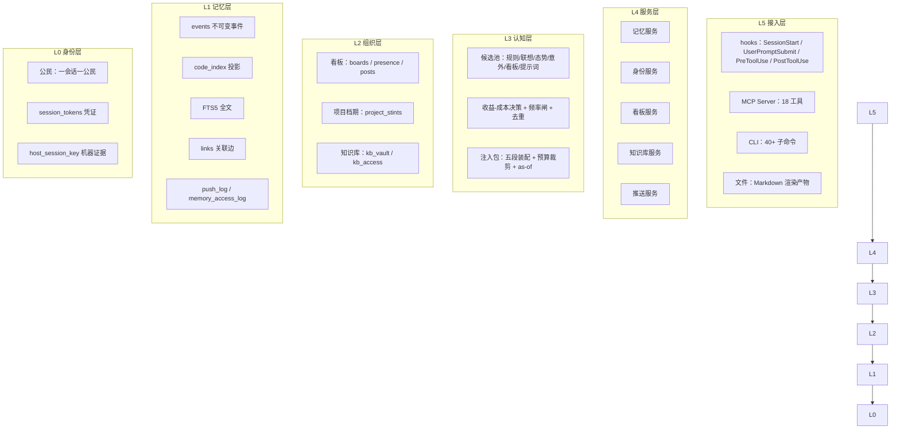
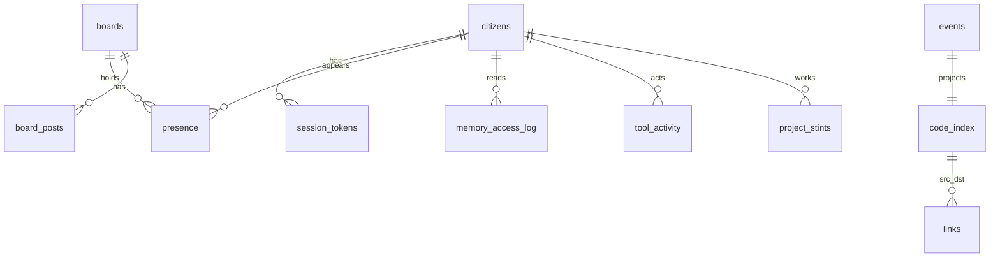
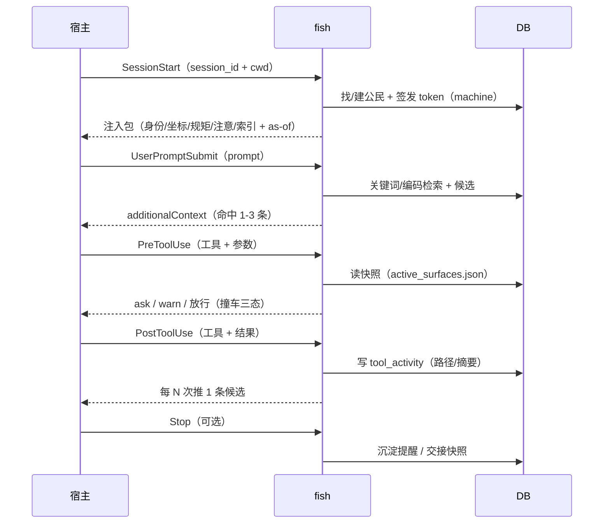

# fish 架构设计

> 本文回答三个问题：**它由哪些层组成**、**每个关键决策为什么这么定**、**哪些方案被否决过**。
> 所有判断的出处是代码与本仓的判据（`p0/test_*.py`），不是事后叙事。

---

## 0. 一句话

fish = **事件溯源的记忆内核** + **会话身份** + **协作现面（看板）** + **主动推送** + **hooks 反射弧**。
它不替模型思考，只负责让模型在**正确的时刻**拿到**正确的上下文**，并且让"拿没拿到、对不对"可被验证。

它是为**多个 AI 共享**设计的：每个 AI 一个公民身份、一个会话一行，共享同一份记忆、同一块看板与同一间知识库——换 agent、换会话，家还在。

---

## 1. 分层



**为什么是这些层而不是"一堆功能"**：每一层的输出都是下一层的输入，且**每层都能独立验证**——
身份层能回答"我们是谁"，记忆层能回答"我们记得什么"，组织层能回答"我们在跟谁协作"，认知层能回答"此刻该说什么"。

---

## 2. 关键设计决策（ADR 风格）

### D1 · 事件溯源：真相不可变，投影可重建

```sql
events(id, event_type, occurred_at, payload, ...)  -- 只 INSERT
code_index(...)   -- 投影，可 DROP + rebuild
memory_fts(...)   -- 投影
links(...)        -- 投影
```

- **约束**：`events` 上有触发器 `RAISE(ABORT, 'events are immutable')`；`UPDATE`/`DELETE` 直接失败。
- **为什么**：记忆系统最贵的错误是"改历史"——改完就再也不知道当时到底记了什么。投影坏了可以重建，历史坏了不能。
- **代价**：所有读写路径必须容忍"投影落后于事件"（读侧永远从投影读，重建幂等）。
- **判据**：`test_*` 里大量"rebuild 后数据一致"的断言；`fish.py rebuild` 是官方的重建入口。

### D2 · 身份：一会话一公民，token 是唯一归属

```
设备 → 宿主 → 账号 → 会话公民（citizen） → 子 agent
```

- **机器证据（machine）**：由宿主签发（hook 知道真实 `session_id` / `cwd`），落 `session_tokens`。
- **自报（self-reported）**：AI 自己 `register` / `session start --alias`，用于跨宿主聚合与"起名"。
- **为什么 token 是唯一来源**：AI 会遗忘、会记错、会在多个通道里漂移。**凭证 = 归属**，其余都是标签。
- **已知事故与修法**：工作区级"身份锚"曾把**所有**会话换绑到同一个公民 → 撞车自撞。修法：锚加**会话白名单**（`fish_identity.json.sessions`），只对列出的会话生效，且公民必须在当前库存在。
- **判据**：`test_identity_p1a/p1b/p1c`（含"新读点必须登记"的精确集合比对）。

### D3 · 记忆：编码坐标系 + 类型衰减 + 关联边

- **编码**：`<项目前缀>-<YYMMDD>-<NN>`（如 `ANYI-261026-07`）。前缀不可改，序号由事务分配。
- **类型**：`identity` / `rule` / `fact` / `episode` / `lesson` / `artifact`，各自半衰期（`episode=21d / fact=60d / lesson=365d`）。
- **检索**：FTS5 + bigram（中文子串）。
- **关联**：`links(src,dst,rel,source,weight)`，`rel ∈ {supersedes, derived, related, precedes}`，`source=auto|manual` 可撤销。
- **为什么不用向量库**：编码坐标系 + 关键词检索是**可解释、可审计、零依赖**的选择；语义检索作为后续能力单独评估（ADR-006）。

### D4 · 看板：数据库做真相，文件做投影

- **表**：`boards`（scope/scope_key/period_key/path）+ `presence`（在场行）+ `board_posts`（动态）。
- **渲染**：`看板-YYYYMMDD.md` 由 `board render` 生成；文件里写明"请勿手工编辑，删了可重建"。
- **会话维度（2026-10-26 升级）**：`presence` 主键从 `(board_id, citizen_id)` 升到
  **`(board_id, citizen_id, session_key)`**——同一公民的两个窗口各占一行，`doing` 不再互相覆盖。
- **撞车检测**：身份键 = `(citizen_id, session_key)`：
  - 同一会话「声明 vs 实际」**不算**撞车（自己写自己声明的面）；
  - 同公民**另一会话**算撞车（两个窗口同改一个文件是真冲突），文案标「你名下的另一会话」；
  - 跨板同一身份键**合并成一条**（否则同一 label 重复出现）。
- **降级开关**：`board.presence_session_rows=false` → 读侧折叠回"一行/公民"（秒级止血，不动数据）。

### D5 · 推送：候选池 +「收益 − 成本」+ 时机层

- **候选来源**：规则（档期/未闭合/看板）、联想（links 邻居/知识遗漏）、态势（同项目高频动作/冲突）、意外（两跳跨项目/冷门）、**提示词（UserPromptSubmit）**。
- **决策**：`benefit = w_rel·相关 + w_gap·新颖 + w_urgent·紧迫`；`cost = w_false·误报 + w_token·token + w_intr·打断`；`推送 ⟺ benefit − cost > 0`。
- **时机层**：开场（SessionStart）/ 工具后（每 N 次）/ 提示词（UserPromptSubmit）/ 即时（冲突）。
- **度量**：`push_log`（含 `candidate_id` / `reaction` / `latency_sec`）；「推了不读」由 `daily_report` 判 ignored。
- **陈旧性**：用**内容年龄**（`occurred_at` / `recorded_at`）而不是 `last_accessed_at`——后者会被"展示"行为刷新，把老事实当新鲜。

### D6 · hooks：唯一能"强制"的通道

- **事实**：MCP tools 由模型决定调用（不调就没有）；hooks 由宿主事件驱动（必达）。
- **支持事件**：`SessionStart` / `UserPromptSubmit` / `PreToolUse` / `PostToolUse` / `Stop` / `SubagentStart` / `SubagentStop`。
- **fish 用到的**：身份注入（SessionStart）、提示词递记忆（UserPromptSubmit）、撞车判定（PreToolUse 的 `ask`/`warn`）、动作采集与推送（PostToolUse）。
- **动作采集只记路径**：`tool_activity(session_key, citizen_id, tool_name, action, path_dir, path_abs, args_digest, seen_at)`——**内容不落盘**，`args_digest` 是 16 位摘要。
- **隐私**：匹配字段与落盘字段分离；命令只留 `bash:<命令名|len>#sha8`；心跳里的 session 是 8 位哈希。
- **方言差异**：不同宿主的 matcher 语义不同（字面 vs 正则）——`install_hooks.py --check` 做**方言契约校验**（只认纯字面备选），非法 matcher 会让**整份配置被拒**（一个事件都不注册）。
- **性能**：hook 是进程外串行命令；PreToolUse 走"不 import 主程序"的快路径（<50ms 量级）。

### D7 · 判据：先证明能失败，再谈通过

- **变异自证**：每条关键判据配一个"把实现改坏"的变异体：基线绿 → 变异红 → 字节级还原 → 复绿。
- **三态分明**：绿 / 跳（SKIP）/ 判不到（缺证据）——缺证据不算通过。
- **外部真值**：判断"配置对不对"用**宿主出厂的 parser**，不用自写的正则镜像（历史事故：自写校验连续两轮打绿，宿主却整份拒收）。
- **不锚定易过期数字**：文档引用读数一律带命令与 `as-of`，不写"固定通过数"。

---

## 3. 数据模型（核心表）



| 表 | 作用 | 关键约束 |
|---|---|---|
| `events` | 不可变事件 | 触发器禁止 UPDATE/DELETE |
| `code_index` | 记忆投影（编码/标题/类型/状态/衰减） | rebuild 幂等 |
| `memory_fts` | 全文（FTS5 + bigram） | 投影 |
| `links` | 关联边（含 `last_reinforced_at`） | `source=auto|manual` |
| `citizens` / `citizens_all` | 公民（热表 + 视图） | 30 天归档可逆 |
| `session_tokens` | 凭证（只存 hash） | 会话级，end 即吊销 |
| `project_stints` | 项目档期 | 同会话至多一个 open |
| `boards` / `presence` / `board_posts` | 协作现面 | presence PK `(board, citizen, session_key)` |
| `tool_activity` | 动作事实（hook 采集） | 只路径/摘要 |
| `push_log` | 推送与反馈 | `channel` / `reaction` |
| `kb_vault` / `kb_access` | 知识库登记与访问 | 默认 `ro` |

---

## 4. 一次会话的生命周期



---

## 5. 扩展点

| 想加什么 | 从哪里下手 |
|---|---|
| 新宿主 | `install_hooks.py` 加一套方言（事件映射 + matcher 契约 + 心跳） |
| 新事件 | `fish_*hook.py` 加入口 → 复用 `hook_io.emit` / `fish_activity` |
| 新推送候选 | `build_push_candidates` 加一类 → `_cand` 打分 → `push_log` 记 channel |
| 新记忆类型/衰减 | `fish.py` 的 `MEM_TYPES` / `DECAY_DAYS` + 判据 |
| 新知识库 | `kb_vault add --mode ro`（写需显式 rw + 备份） |

---

## 6. 已知边界（不装样子）

1. **MCP 不能强制**——只调才有；主动能力必须走 hooks。
2. **hook 观测不到模型思考**，只观测工具与提示词。
3. **单机 SQLite**——不是分布式系统；多机同步是明确的后置项。
4. **方言碎片化**——每个宿主的 matcher/超时/输出 schema 都不同，安装器必须逐宿主校验。
5. **`fish.py` 单文件 ~18k 行**——拆包是已登记的技术债（合并在先，拆包在后）。
6. **`board_seen` 仍按公民**——同公民多会话会互相吞推送（漏推，不误报），下一批处理。

---

## 7. 被否决的方案（为什么不做）

| 方案 | 否决理由 |
|---|---|
| 纯文件记忆（无数据库） | 并发写靠纪律、单个文件会爆、无法原子分配编码 |
| 向量检索优先 | 不可解释、引入外部依赖；编码坐标系 + FTS 已够用，语义检索单独立项 |
| MCP 一把梭（不做 hooks） | 模型不调就等于没有（"强制"做不到） |
| 多进程共享同一份"实时"快照 | 两份会漂的真相；快照只是投影，真相在事实表 |
| 主键用"公民"压扁多会话 | 同公民多窗口会互相覆盖、撞车自己撞自己（本仓修复的现场） |
| 自写 matcher 校验（正则镜像） | 与宿主方言脱钩 → "看起来校验通过，实际整份被拒"（真实事故） |
