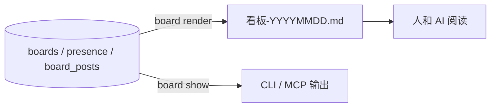

# 03 · 看板与撞车

> 一句话：**看板回答"此刻谁在动哪块"；撞车检测回答"你要动的这块，别人是不是正在动"。**

## 1. 为什么要有看板（不是日志）

- **日志**回答"全程发生了什么"（详、事后）。
- **看板**回答"此刻谁在动哪块"（实时、短、可行动）。
- 用户给它的定位是**催化剂**：它是会被自动触发的环节，能带动 AI 更频繁地使用系统。

**硬语义：未登记 = 未发生。** 看板只认登记与可观测事实；"推断"必须显式标注（`（推断）`）。

## 2. 架构：数据库做真相，文件做投影

- **为什么不是纯文件**：并发写靠纪律、单文件会爆（真实事故：10 天 114 条 → 396KB 超读取上限）。
- **为什么不是纯 DB**：人要读文件、AI 要 `read`。
- 所以：**表和文件不是两份真相，是"真相 + 投影"**——删了文件，`render` 一下就能长回来。

## 3. 会话维度（2026-10-26 的升级）

**问题**：`presence` 主键原来是 `(board_id, citizen_id)`——一个公民一块板只有一行。
多会话共享一个公民时，后写覆盖前写：`doing` 被覆盖、看板看不到"我们有两个窗口"、撞车分不清自己。

**修法**：主键升为 **`(board_id, citizen_id, session_key)`**：

| 场景 | 行为 |
|---|---|
| 同一会话重复签到 | 幂等（1 行，`first_seen_at` 不变，`doing` 更新） |
| 同公民两个窗口 | **两行**，`doing` 互不覆盖，标签带会话短标识（`名字·dsh#88f9`） |
| 旧行/无凭证 | `session_key=''`（"无会话归属"）：`''` 与 `''` 是同一参与方，`''` 与有值不同（标注不吞） |

## 4. 撞车判定

**身份键 = `(citizen_id, session_key)`**，判定分两路：

| 路 | 输入 | 判什么 |
|---|---|---|
| 声明重叠 | `presence.surface`（人写的占用面） | 两个人的声明面有没有交集 |
| 实际重叠 | `tool_activity` 的路径（事实） | 一个人声明、另一个人实际在写 |
| 混合 | 声明 × 实际 | 上面两者交叉 |

**四条纪律**：

1. **同一会话"声明 vs 实际"不算撞车**（自己写自己声明的面）；
2. **同公民另一会话算撞车**（两个窗口同改一个文件是真冲突），文案标「你名下的另一会话」；
3. **窗口不对称**：声明面看 90 分钟（人可能走开）、实际动作看 30 分钟（事实更硬）；
4. **路径匹配按分量**（`min_segments`）：`p0` 这种 1 段面到处都是，不参与判定；`data/x.db` 与 `src/a` 不会互相误配。

**三态开关** `board.collision_ask`：

| 值 | 行为 | 何时用 |
|---|---|---|
| `off` | 不判定、不审计 | 调试 |
| `warn`（默认） | 不阻塞；写审计 + 下一次工具后递一句提醒 | 日常（不打扰） |
| `ask` | 请求宿主批准（**宿主必须允许"需要批准的动作"**，否则等于拒写） | 高风险时段 |

## 5. 可读名（人类面契约）

- **永不含 26 位 ULID**、永不含完整会话键（`dsh:session-…`）——人类面只用 `名字·dsh#88f9`。
- 机器面（`--json`、审计 JSONL）**保留**完整 ID/会话键（脚本要用）。
- 同一公民多会话才加会话短标识；单会话沿用公民名（与升级前逐字节相同）。

## 6. 自动在场

- `SessionStart` / 写记忆 / 有活动 → 自动登记一行（`（自动登记：…）` 占位）。
- **自动行算登记**（用户拍板），但**绝不覆盖**人写的 `doing`。
- 自动行与手工行的区分靠 `doing` 里的「自动登记」标记（不是靠字段），避免"自动刷新把手工声明冲掉"。

## 7. 边界

- 纯 MCP 宿主没有 hook → 活动列为空（标注"依赖宿主 hook"，不是故障）。
- `board_seen` 仍按"公民"粒度 → 同公民多会话会互相吞推送（**漏推**，不是误报）；已登记为下一批。
- 根看板只聚合"在场/动态"，不显示跨项目"在动未签到"（按设计只做项目板）。
