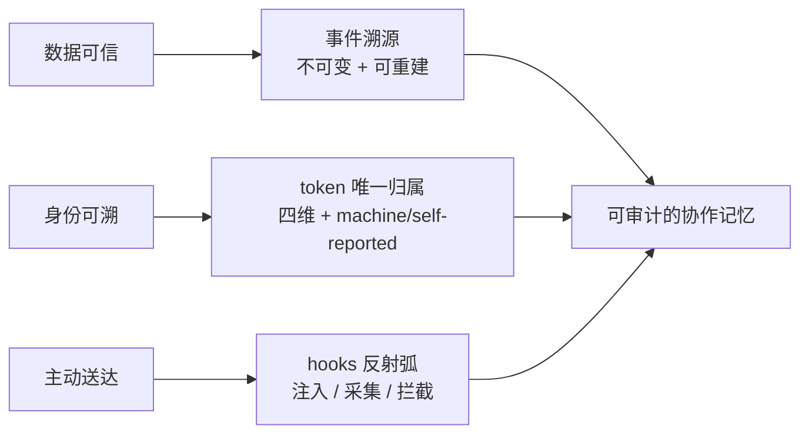

# fish 设计文档索引

> 这里回答的是**「为什么这么设计」**，不是「怎么用」（用法见根 README）。
> 这套设计面向**多个 AI 共享一个家**：每个 AI 有身份与会话，记忆与协作面是共享的。
> 每篇都能独立读；按顺序读大约 20 分钟。

## 三条设计主线

## 阅读顺序

| # | 文档 | 回答的问题 |
|---|---|---|
| 01 | [记忆模型](01-memory-model.md) | 记忆为什么不可变？为什么分六类？为什么会"忘"？ |
| 02 | [身份与会话](02-identity.md) | "我们是谁"由什么决定？多会话共享一个身份会怎样？ |
| 03 | [看板与撞车](03-board-collision.md) | 协作现面怎么做到不撒谎？两个窗口同改一个文件怎么发现？ |
| 04 | [主动服务（hooks）](04-proactive-hooks.md) | 为什么 MCP 不够？fish 怎么在正确的时刻自己出现？ |
| 05 | [推送与取舍](05-push-and-tradeoffs.md) | 什么时候该打断？哪些方案被否决过、为什么？ |
| 06 | [判据与边界](06-verification-and-boundaries.md) | 怎么证明"真的对"？哪些事我们做不到？ |

## 一页设计原则

1. **真相不可变**：只有事件是真相，其余（索引/全文/关联/看板）都是可重建投影。
2. **归属只有一处来源**：token。其余是标签；`machine` 与 `self-reported` 分开标注。
3. **未登记 = 未发生**：协作面只认登记与可观测事实，推断必须显式标注。
4. **判据必须能失败**：每条关键判据配一个"把实现改坏"的变异体。
5. **主动服务优先**：凡是"AI 想起来才做"的能力，尽量补一条 hook 通道让它自动发生。

> 更精简的系统总览见 [../ARCHITECTURE.md](../ARCHITECTURE.md)；**可交互架构图**见 [../diagrams/fish-architecture.html](../diagrams/fish-architecture.html)；代码与 1166 条判据在 `p0/`。
