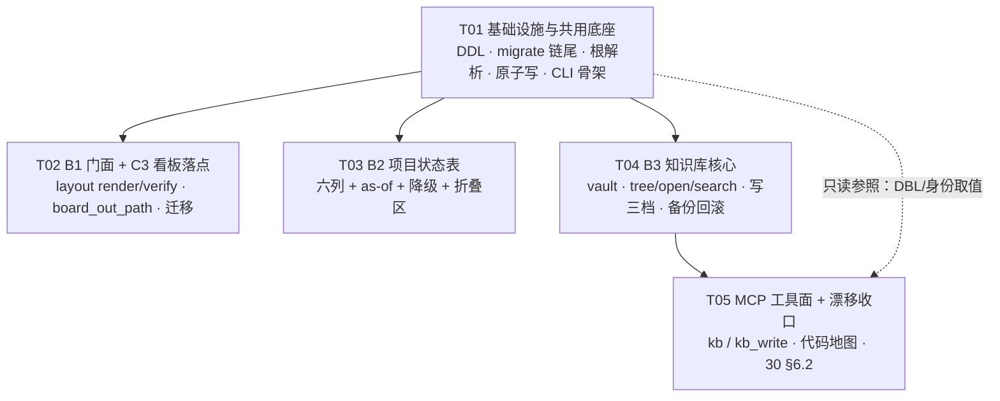

# 架构设计 · B1 / B2 / B3 增量 v0.1

> 架构师：高见远｜日期：2026-10-26｜基线：`dev/fish-devA` @ `b23a63f`（`fish-devA` 副本）
> 上游：`docs/PRD-B1B2B3-增量-v0.1.md`（v0.1）+ **`docs/主理人裁决-B1B2B3.md`（优先于 PRD）**
> 本文件只做设计，**不改代码、不碰主工作树**。读数 as-of 2026-10-26 02:0x（Asia/Shanghai）。
> 配套图源（本批新建，不改既有的 `class-diagram.mermaid` / `sequence-diagram.mermaid`——那两份是 `10-架构设计-平台化-v0.2` 的图源）：
> [`类图-B1B2B3-v0.1.mermaid`](类图-B1B2B3-v0.1.mermaid)、[`时序图-B1B2B3-v0.1.mermaid`](时序图-B1B2B3-v0.1.mermaid)

---

## 0.0 本轮复核（as-of 2026-10-26T02:0x–02:2x，我在副本内实测，不抄 PRD 行号）

| 复核项 | 结果 | 与本文件的关系 |
|---|---|---|
| `fish.py` / `mcp_server.py` 行数 | **8972 / 1520** | 与 §1.2 一致 |
| `migrate()` 链尾 | 末两行是 `_ensure_name_tables` → `_ensure_board_tables` → `conn.commit()`（L993-996） | 新增结构只能接在这之后（§2.5） |
| `main()` 尾部 | `args = ap.parse_args()` → `args.func(args)`（L8967-8968），**返回值被丢弃** | 新命令必须 `raise SystemExit`（§3.1）；本文件已纠正"`cmd_archive` 有 `return 1`"这一错误说法（实测全库只有 `return 2`） |
| `board_render` 写盘点 | `p = root / board["path"]`（L8457）、根板 L8370 | C3 的改动面＝落点解析 + path 口径（§2.4/§6.2） |
| `board_render` 调用点 | fish.py 共 **7 处**（L4625 `cmd_project_add`、L8414、L8467、L8493、L8557、L8569、L8575）+ mcp_server.py **2 处**（L1251、L1284） | 全部是位置调用 → 签名保持兼容（§6.2）；**L4625 是本文件上一版漏列的第 9 处** |
| `boards` 现状 | **7 行**；路径全是旧口径（`projects/<k>/看板-<pk>.md` × 4、根板 `看板-<pk>.md` × 2、`EVAL/261026` 无文件） | 迁移改动的是**值**（7 行全变），不是"7 行里有一部分"（§2.4 已给逐行 before/after） |
| 看板渲染文件 | 磁盘 **6 个**；git 已跟踪 **4 个**（根板 2 个被 `p0/data/看板-*.md` 忽略） | 与 §2.4 步骤 3/5 一致 |
| MCP 工具面 | `len(TOOLS)=16`（名单见 §7.2 T05）、`len(RESOURCES)=2`；`tools/call` 的 `isError` 兜底在 **L1462-1466** | 与 §3.3/§7.2 一致（L1467 是上一版的 off-by-one） |
| `count_tokens` | L5112-5123：`tiktoken` 可用则精确，否则 `int(len*1.2)`；**本机 tiktoken 0.13.0 可用**，`"记忆"*500 → 1500 token`（比值 1.5） | §7.6 的预算矛盾成立 |
| 测试底盘 | **41 个 `test_*.py` / 467 个 `def test_`**；临时根一律 `Path(mkdtemp())/"data"`（26 个文件），teardown `rmtree(self.root.parent)` | 决定 `resolve_home_root` 兜底规则能保住隔离（§1.4） |
| vault 现状（只读） | 排除 `.obsidian`/`.trash` 后 **2492 文件 / 297 篇 md**；`>2 MiB` **1143**、`>10 MiB` **315**、`>100 MiB` **10**、最大 **641.2 MB**；walk+stat **652 ms**；抽样 60 篇 → **0 BOM / 52 CRLF / 8 LF**；同名笔记 **2 组**（`拆解报告2.md`、`拆解报告5.md`） | A15/A16 的"两个阈值"与 §5.3 的判断依据全部复核为真 |

> 这一节的作用是把"文档里的数字"和"树里的事实"钉在一起：**任何读数都带 as-of 与取法**，跑一次当场可比（复跑命令见附录 B）。
> 本轮**唯一**发现并修掉的结构性矛盾是**分支看板的路径深度**（`10-项目库/_分支/<k>/…` = 4 层，撞 HOME-1 的"≤3 层"）→ 见 §2.4 的新口径 `_分支-<k>`。

### 0.0.1 任务书九项交付 ↔ 本文件章节（给主理人核对用）

| # | 任务书要求 | 本文件落点 | 状态 |
|---|---|---|---|
| 1 | 模块划分（进 fish.py / mcp_server.py / 是否拆 fishlib；结论 + 理由） | **§1.2**（结论：不拆；三条证据 + 拆包触发条件）、§1.3（分区表）、§1.5（新增符号全景） | ✅ |
| 2 | 最终 DDL + 幂等迁移 + `boards.path` 迁移 SQL（逐行可执行） | §2.2（`kb_vault`）、§2.3（`kb_access` + 索引 + 视图）、**§2.4 / §2.4.1**（迁移 SQL + 回滚 SQL + 七行 before/after）、§2.5（链尾挂载）、§2.6（执行序 m0-m5） | ✅ |
| 3 | 接口契约：CLI 参数/输出/exit code；MCP schema；函数签名 + 返回 dict 形状 | §3.1（退出码/错误模型/as-of）、§3.2（三族 CLI）、§3.3（两个 MCP schema）、§3.4（**49 个函数签名**）、§3.5（三个返回样例） | ✅ |
| 4 | 关键流程：tree/open/search/write/rollback/layout render/verify/project status | §4.1-§4.8（八条，每条带"判据锚点"） | ✅ |
| 5 | 安全：realpath+commonpath+junction、大小/编码/媒体、忽略规则、备份与原子写、隐私 | §5.1（路径，含 `_kb_first_reparse` 完整实现）、§5.2、§5.3、§5.4、§5.5、§5.6（meta 白名单）、§5.7（凭证扫描）、§5.8（失败矩阵） | ✅ |
| 6 | 兼容与回归：逐文件列必改测试与理由、`board_render` 签名兼容、保证不写 `p0/data` | §6.1（**4 文件 / 9 处断言**，逐行给理由）、§6.2（签名兼容策略 + 已知行为变化）、§6.3（4 处既有函数改动）、§6.4（三重保证） | ✅ |
| 7 | 任务分解：3 个 Wave，每任务 ID/标题/允许写文件/只读参照/依赖/验收命令（含期望退出码）/判红方式 | §7.2（T01-T05，每任务六项齐）、§7.3（K1-K12 共享知识）、§7.4（Wave）、§7.5（依赖图）、§7.6（预算口径矛盾） | ✅ |
| 8 | 风险清单：能防什么/防不住什么/真兜底 | §8（R1-R10，三列齐全） | ✅ |
| 9 | 明确不做 | §9（16 条，每条带"什么时候再看"） | ✅ |

> 另配两张图源（本批专用，不改 `10-架构设计-平台化-v0.2` 的两份图）：`类图-B1B2B3-v0.1.mermaid`（19 个类/结构体 + 关系）、`时序图-B1B2B3-v0.1.mermaid`（8 条关键流程）。

---

## 0. 口径与边界（先读这一节，否则后面每节都要重述）

| 项 | 值 |
|---|---|
| 真相根 `data_root` | `p0/data`（`fish.py::DEFAULT_ROOT`）。**B1/B2 只读，一字不写** |
| 门面根 `home_root` | `<项目根>/fish-home`（与 `p0/` 同级，裁决 Q3）。**生成物，可删可重建** |
| 知识库根 `vault` | 用户登记的**任意绝对路径**（本机 `E:\Obsidian\安逸知识库`），原地不动 |
| 代码落点 | `p0/fish.py`（核心 + CLI）+ `p0/mcp_server.py`（工具面）。**本批不引入 `p0/fishlib/`**，理由见 §1.2 |
| 新依赖 | **零**。只用 Python 3.11 标准库（现状 `fish.py` 顶层 import 只有 argparse/datetime/hashlib/json/os/re/shutil/secrets/sqlite3/sys/uuid/pathlib） |
| 新增表 | 2 表 + 1 视图（`kb_vault` / `kb_access` / `kb_path_stats`），**挂在 `migrate()` 链尾** |
| 语义变更 | 仅 `boards.path`（裁决 C3）。既有表其余列一个不动 |
| 工具面 | 16 → **18**（`kb` 读 / `kb_write` 写） |
| 退出码 | **新命令族**用 `raise SystemExit(code)` 表达非零；**不改 `main()`**（见 §3.1 的既有缺陷说明） |

**本设计的三条硬约束**（每条都在 §6/§7 有对应判据）

1. `layout render` 前后对 `data_root` 做 `(path,size,mtime_ns)` 快照必须零变更（HOME-6）。
2. 知识库内容不进 `memory_fts` / 不进 `recall` / 不进 `inject`（KB-10，永久边界）。
3. 任何写入必有备份、必可回滚、写后重读校验（KB-7/KB-15）。

---

## 1. 总览

### 1.1 三块各自回答什么（正交，可分别判）

| 块 | 一句话 | 产物形态 | 数据方向 |
|---|---|---|---|
| **B1 门面** | 陌生人只看 `fish-home/` 就知道三库各是什么、正文在哪、谁在写 | 文件（五目录 + README + 索引 + 系统页） | `data_root` **→** `fish-home`（只读投影） |
| **B2 状态表** | 项目状态一屏到底，每个值可追溯到表且带 as-of | 一个 md + 一个 CLI | `code_registry`/`code_index`/`boards`/`presence`/`project_stints` **→** 投影 |
| **B3 知识库** | 十年级积累能被浏览/打开/搜/写，且绝不污染记忆面 | CLI 族 + 2 个 MCP 工具 + 2 张表 | 文件系统 **↔** fish（双向，写有备份） |

三者互不蕴含：门面做全但知识库不可读 → G3 仍红；知识库能读但正文被复制进门面 → HOME-3 红。

### 1.2 结论：**保持单文件，不引入 `p0/fishlib/` 子包**

三条证据（不是偏好）：

1. **调用面已经是"模块级函数"契约**：`mcp_server.py` 直接 `import fish` 并调 `fish.board_render` / `fish.build_injection_pack` / `fish.validate_session_token`（实测 `mcp_server.py` L42-43、L1244-1251）；467 个测试里有大量 `fish.board_render(...)` / `fish.connect(...)` 直接调用（如 `test_board.py` L119）。拆包后这些全是隐式 re-export，**一旦漏一个，失败方式是 `AttributeError` 而不是编译期错误**。
2. **现有代码没有拆包习惯**：`p0/` 下 76 个 `.py`，除 `fish.py` / `mcp_server.py` 外全是 hook / 一次性治理脚本 / 测试；无子包、无 `__init__.py`。`10-架构设计-平台化-v0.2` 里出现的 `fishlib/mutate.py` 是**未落地的提案**（全仓 grep 无 `fishlib/` 目录）。
3. **本批新增量可控**：B1~B3 合计新增约 1,300–1,600 行（DDL 80 + 门面 450 + 状态表 220 + 知识库 650 + CLI 120）。`fish.py` 从 8,972 → ≈10,400 行，仍在"单文件可 grep"范围。**拆包会把"这轮最大的风险（改坏 467 个测试）"从改动面转移到结构面**，收益不成比例。

**但给出拆包触发条件（写在文件里，不写在脑子里）**：新增段（§1.3 的 ⑤）超过 **1,800 行**，或 `fish.py` 超过 **12,000 行**，下一批必须先做"抽 `fishlib/kb/` + `fish` 侧 shim 转发"，并且**先补一组 import 面判据**（`test_public_surface.py`：断言 `dir(fish)` 里仍存在全部被外部引用的符号）再动。

### 1.3 `fish.py` 内的分区（新增代码一律追加，不改既有段落）

| 分区 | 现有行段 | 本批动作 |
|---|---|---|
| ① 基础（`ulid`/`now_utc`/`local_date`） | L134-170 | 追加 `iso_local()`（as-of 用，带时区） |
| ② DDL 常量区（`_*_DDL` / `_*_SCHEMA` / `SCHEMA`） | L173-672 | 追加 `_KB_VAULT_DDL` / `_KB_ACCESS_DDL` / `_KB_INDEXES` / `_KB_PATH_STATS_VIEW`、`KB_SCHEMA`，并把 `KB_SCHEMA` 拼进 `SCHEMA`（新库路径） |
| ③ migrate 链 | L948-996 | **只在链尾**追加两行：`_ensure_kb_tables(conn)`、`_ensure_boards_home_paths(conn)`（顺序：KB 表 → 看板迁移） |
| ④ 既有业务段 | L999-8591 | 本批只改 4 处已知点（见 §6.3 / §6.4） |
| ⑤ **新增段**（本批主体） | 追加在 `cmd_archive` 之前 | `# === B1/B2/B3：门面 · 状态表 · 知识库 ===` 一个连续块，内含 5 个子段：5.1 路径与根解析、5.2 原子写/备份/摘要、5.3 门面渲染（layout）、5.4 项目状态表、5.5 知识库（KB） |
| ⑥ CLI 区 | L8647-8972 | `main()` 里追加 `layout` / `kb` 两个新 parser 族 + `project` 下追加 `status`；现有 parser 一行不动 |

`mcp_server.py` 只动三处：`TOOLS` 列表尾（+2 项）→ `call_tool` 的 `table` 字典（+2 行）→ 新增 `tool_kb` / `tool_kb_write` 两个方法（放在 `tool_board` 之后、`tool_healthcheck` 之前）。

### 1.4 三个根与解析规则（本批最容易写错的一处）

```python
HOME_DIRNAME = "fish-home"
LAYOUT_TOP = ("00-首页", "10-项目库", "20-记忆库", "30-知识库", "90-系统")

def resolve_home_root(data_root, *, override=None) -> Path:
    """门面根解析。四档，顺序固定，每档都可解释（档位越高优先）。

    ⓪ override（CLI `--home`）——绝对路径；相对路径按 data_root 解析
    ① config layout.home_root —— 同上（给"换布局"与"故意指错"两个用途）
    ② 标准布局：data_root.name == 'data' 且 data_root.parent.name == 'p0'
                → data_root.parent.parent / 'fish-home'        （= <项目根>/fish-home，裁决 Q3）
    ③ 兜底：data_root.parent / 'fish-home'                     （= data_root 的**兄弟**目录）
    最后一律 .resolve()，并断言：home 不是 data_root、也不在 data_root 内（否则 raise）
    """
```

**为什么不用 `data_root.parent / "fish-home"` 一条规则**：真实布局是 `<项目根>/p0/data`，`data_root.parent` 是 `p0`，会得到 `p0/fish-home`——**违反裁决 Q3**（与 `p0/` 同级）。
**为什么规则 ③ 不做成 `parent.parent`**：实测 **26 个测试文件**的临时根都是 `Path(tempfile.mkdtemp()) / "data"`（`test_board.py` L43、`test_root_board.py` L40、`test_p0.py` L25-27…），`parent.parent` 会写到系统临时目录根上，直接毁掉隔离性。规则 ② 只在"名字真的是 data/p0"时生效，测试目录名不叫 `p0` → 走 ③ → `<tmp>/fish-home`；而既有 teardown 是 `shutil.rmtree(self.root.parent)`（`test_board.py` L56、`test_root_board.py` L56、`test_board_archive.py`、`test_board_tool.py`）或 `rmtree(self.base)`（`test_board_feedback2.py` / `3`）→ **`<tmp>/fish-home` 会被一起清掉**，不留垃圾。这条"home 落在会被清理的那一层"是规则 ③ 选 `parent` 而不是 `parent.parent` 的**唯一理由**，写在这里是为了下一批改 teardown 时不被误改。
**为什么允许 config / `--home` 覆盖**：将来换布局（`p0/fish-home`）不必改代码；同时它给了判据一个"故意指错"的变异入口（变异：`layout.home_root = <data_root>/home` → `resolve_home_root` 必须 raise，`test_home_root_refuses_inside_data` 红）。

**三条断言（写在 `resolve_home_root` 里，不是写在文档里）**：

- `home_root` 解析后**不得等于或位于 `data_root` 内**（否则直接 `raise`）——这是 HOME-6 的第一道闸；
- `home_root` 不得位于任何已登记 vault 内（否则门面会污染知识库）；
- 返回值一律 `resolve()` 过（`..` 与 junction 别名提前消掉）。

### 1.5 新增符号全景（给工程师的"改哪些名字"清单）

| 层 | 新增符号 | 数量 |
|---|---|---|
| 常量 | `HOME_DIRNAME` `LAYOUT_TOP` `LAYOUT_MAX_BYTES` `README_MARKERS` `PST_COLUMNS` `PST_OPEN_WINDOW_DAYS` `PST_OWNER_FALLBACK_DAYS` `KB_*`（见 §5.3/§5.4） | ~22 |
| 异常 | `KBError` | 1 |
| 门面 | `resolve_home_root` `layout_paths` `render_layout` `render_readme` `render_memory_index` `render_memory_recent` `render_system_pages` `verify_layout` `_vaults_projection` `_layout_write` | 10 |
| 状态表 | `project_status_rows` `render_project_status` `_owners_of` `_board_entry_of` `_last_active_of` `_open_loops_of` `_registry_rows` | 7 |
| 知识库 | `kb_vault_add/list/get/set_default/remove/scan/set_mode`、`kb_resolve_target` `kb_read_text` `kb_detect_text` `kb_tree` `kb_open` `kb_search` `kb_write` `kb_rollback` `kb_stats` `kb_doctor` `kb_backup` `kb_atomic_write` `kb_sha256_bytes` `kb_log_access` `_kb_ignored` `_kb_walk` `_kb_merge_frontmatter` `_kb_split_frontmatter` `_kb_detect_eol` `_kb_obsidian_cli` | 24 |
| 迁移 | `_ensure_kb_tables` `_ensure_kb_views` `_ensure_boards_home_paths` `board_out_path` | 4 |
| CLI | `cmd_layout` `cmd_project_status` `cmd_kb` | 3 |
| MCP | `tool_kb` `tool_kb_write` | 2 |
| 既有签名变更 | `_open_loop_rows(..., project=None)`、`board_render(..., home_root=None)`、`board_render_root(..., home_root=None)` | 3 |

---

## 2. 数据模型

### 2.1 变更总览

| 变更 | 对象 | 谁写 | 可回滚 |
|---|---|---|---|
| 新增表 | `kb_vault` | `kb vault add/set-default/remove/scan/set-mode` | 是（注册行，磁盘不动） |
| 新增表 | `kb_access` | 所有 kb 读写路径（含拒绝） | 否（审计流水，只增） |
| 新增视图 | `kb_path_stats` | 派生 | N/A（可重建） |
| 语义变更 | `boards.path` | `board_ensure` / 迁移 | 是（§2.4 回滚 SQL） |
| **不动** | `events` / `code_index` / `code_registry` / `project_stints` / `boards` 其余列 / `presence` / `board_posts` / `memory_fts` / `memory_access_log` / `push_log` / `links` / `citizens*` / `workspace_map` / `name_aliases` | — | — |

**登记纪律（防重复造）**：本批之后 `p0` 侧业务表 = 17 张（原 15 + 2），视图 3 个。任何"顺手再加一张"必须先在 `17-新增表登记-ADR建议.md` 登记并说明为什么现有表放不下——B1/B2 全是投影，**不需要任何新表**。

### 2.2 `kb_vault`（最终 DDL）

```sql
CREATE TABLE IF NOT EXISTS kb_vault (
  vault_id       TEXT PRIMARY KEY,              -- ulid()；**不用路径做主键**（改名/搬家不换 id）
  name           TEXT NOT NULL UNIQUE,          -- 人给的名字（默认取根目录名）
  path           TEXT NOT NULL,                 -- 绝对路径，**存原样**（给人看、给 Obsidian 看）
  path_key       TEXT NOT NULL,                 -- normcase(realpath(path))：去重口径
  mode           TEXT NOT NULL DEFAULT 'ro' CHECK (mode IN ('ro','rw')),
  ignore_globs   TEXT NOT NULL DEFAULT '[".obsidian/**",".trash/**"]',
  max_open_bytes INTEGER NOT NULL DEFAULT 2097152,
  is_default     INTEGER NOT NULL DEFAULT 0,
  last_scan_at   TEXT,
  last_scan_files   INTEGER,
  last_scan_notes   INTEGER,
  last_scan_bytes   INTEGER,
  note           TEXT,
  status         TEXT NOT NULL DEFAULT 'active',
  created_at     TEXT NOT NULL,
  updated_at     TEXT NOT NULL
);
CREATE UNIQUE INDEX IF NOT EXISTS ux_kb_vault_path    ON kb_vault(path_key);
CREATE UNIQUE INDEX IF NOT EXISTS ux_kb_vault_default ON kb_vault(is_default) WHERE is_default = 1;
```

三处对 PRD §5.2 的**修正**（都是实测驱动，不是口味）：

1. **`path` 去掉 `UNIQUE`，改由 `path_key` 唯一**。理由：SQLite 的 `UNIQUE` 是二进制比较，Windows 上 `E:\Obsidian\X` 与 `e:\obsidian\x` 会被当成两个库——同一次 `kb vault add` 用不同大小写写两次就出现两个 vault，而后者只是盘符大小写。`path_key = os.path.normcase(os.path.realpath(p))` 把大小写、短名（`PROGRA~1`）、junction 别名一起归一。判据：`kb_vault_add` 用 `E:\...` 与 `e:\...` 各 add 一次 → 行数不增（KB-1 幂等的加强版）。
2. **`mode` 保留 CHECK**。项目既有纪律是"词表不设 CHECK"（`citizens.kind` 的注释写得很清楚），但 `session_tokens` 上的 CHECK 锁的是**权限升级路径**。`mode='rw'` 就是"允许 AI 写人的十年笔记"，属权限位 → 设 CHECK（与既有决策同构）。
3. **`last_scan_*` 只在显式 `kb vault scan` 写**。读路径（tree/open/search）**不写库**——否则 `kb tree` 会变成写操作，与"读路径尽量轻"冲突，也让 KB-2 的"渲染期间零 open"判据失去意义。

### 2.3 `kb_access` + 索引 + 视图（最终 DDL）

```sql
CREATE TABLE IF NOT EXISTS kb_access (
  id          INTEGER PRIMARY KEY AUTOINCREMENT,
  vault_id    TEXT NOT NULL,                    -- 不设 FK：vault 被 remove 后审计仍要能读
  path        TEXT NOT NULL,                    -- vault 内相对路径，分隔符统一 '/'；''=整个库级动作
  citizen_id  TEXT NOT NULL DEFAULT 'unattributed',
  account_id  TEXT,
  action      TEXT NOT NULL,                    -- vaults|tree|open|search|search_hit|create|append|update|rollback|reject|scan
  result      TEXT NOT NULL DEFAULT 'ok',       -- ok|denied|not_found|too_large|bad_encoding|offline|media|ignored|stale_base
  via         TEXT NOT NULL,                    -- cli:kb|mcp:kb|mcp:kb_write
  ts          TEXT NOT NULL,
  bytes       INTEGER,
  sha256      TEXT,                             -- 写：写后 hash；读：读到的 hash
  backup_path TEXT,                             -- 写：备份目录（回滚入口）
  meta        TEXT                              -- JSON ≤1KB：见 §5.6 白名单
);
CREATE INDEX IF NOT EXISTS ix_kb_access_path    ON kb_access(vault_id, path, ts DESC);
CREATE INDEX IF NOT EXISTS ix_kb_access_citizen ON kb_access(citizen_id, ts DESC);
CREATE INDEX IF NOT EXISTS ix_kb_access_action  ON kb_access(action, ts DESC);

CREATE VIEW IF NOT EXISTS kb_path_stats AS
SELECT vault_id,
       path,
       COUNT(*)                                                    AS hits,
       MAX(ts)                                                     AS last_at,
       SUM(CASE WHEN action='open' THEN 1 ELSE 0 END)               AS open_count,
       SUM(CASE WHEN action IN ('create','append','update') THEN 1 ELSE 0 END) AS write_count,
       SUM(CASE WHEN action='rollback' THEN 1 ELSE 0 END)           AS rollback_count,
       COUNT(DISTINCT citizen_id)                                   AS readers
FROM kb_access
GROUP BY vault_id, path;
```

**`action` / `result` / `via` 不设 CHECK**（词表会随需求长，同 `citizens.kind` 的处理）；词表以本文件的常量元组为唯一来源：`KB_ACTIONS` / `KB_RESULTS` / `KB_VIAS`，写入前校验成员资格，非法值 `raise KBError('bad_action')`——**校验在 Python 层，不在库层**，这样加一个词只改一处常量。

**与 `16 §4.2` 的关系**：16 只要 `(path, citizen_id, last_opened_at, open_count)`，本设计是"事件流水 + 聚合视图"，视图正是那个形态（`hits/last_at/open_count`）。加宽的三条理由（审计/回滚/未读判定）PRD §5.3 已写，架构上确认：**只有事件流水能回答"谁在何时改过哪篇 + 备份在哪"**，聚合表答不了，而回滚是用户拍板的硬需求。

**视图自愈**（照 `_ensure_citizens_all_view` 的模式，L827-856）：`_ensure_kb_views(conn)` 用 `PRAGMA table_info(kb_path_stats)` 读真实列，与 `_KB_PATH_STATS_COLUMNS` 不符才 `DROP VIEW` + 重建。**不无条件 DROP**：无条件 DROP 会在多进程并发打开时把别人的查询打断（`DROP` 拿写锁）。

### 2.4 `boards.path` 迁移（裁决 C3 / §四.1 / §四.2）

**语义**：`boards.path` 从"相对 `data_root`"改为"相对 `home_root`"，渲染写 `home_root / path`。

新口径（**唯一入口仍是 `board_relpath`**，L7725）：

| scope | 旧 path | 新 path | 深度 |
|---|---|---|---|
| `root` | `看板-261026.md` | `00-首页/看板-261026.md` | 2 |
| `project` | `projects/anyi-studio/看板-261025.md` | `10-项目库/anyi-studio/看板-261025.md` | 3 |
| `branch` | `boards/branch/<k>/看板-261025.md` | **`10-项目库/_分支-<k>/看板-261025.md`** | 3 |

**⚠️ 本轮修掉的第一个结构矛盾：分支看板不能放 `10-项目库/_分支/<k>/`。**
PRD §5.4 的新口径是 `10-项目库/_分支/<k>/看板-….md` → 相对 `home_root` 是 **4 层**，直接撞 HOME-1（P0，`任何文件深度 ≤3`）与 §3.2 `verify` 的 `depth_exceeded` 检查——**verify 会把自己刚渲染出来的分支看板判成 error**。三条事实让修正几乎零成本：

1. 实测生产库 `scope='branch'` 是 **0 行**（7 行只有 root/project）→ 改动**不迁移任何既有数据**；
2. 文件名里的 `_分支-<k>` 与目录名 `_分支/<k>` 的信息量相同（`<k>` 就是分支名），只是把两级压成一级；
3. 深度是判据可机器判的，命名是可读性偏好 → **判据优先**。

若下一批确实需要分支层级的二级结构，正确做法是放宽 HOME-1 到"≤4 层但 `20-记忆库` 仍 ≤2"，**而不是**在文档里留一个"应该不会有人放分支看板"的假设。

### 2.4.1 七行的 before / after（实测，as-of 2026-10-26T02:1x）

迁移改的是**值**，不是"7 行里只有一部分需要改"：

| id | scope | scope_key | period_key | before（现值） | after（迁移后） |
|---|---|---|---|---|---|
| 1 | project | anyi-studio | 261025 | `projects/anyi-studio/看板-261025.md` | `10-项目库/anyi-studio/看板-261025.md` |
| 2 | project | EVAL | 261025 | `projects/EVAL/看板-261025.md` | `10-项目库/EVAL/看板-261025.md` |
| 3 | root | `` | 261025 | `看板-261025.md` | `00-首页/看板-261025.md` |
| 5 | project | 大肥鱼生命系统 | 261025 | `projects/大肥鱼生命系统/看板-261025.md` | `10-项目库/大肥鱼生命系统/看板-261025.md` |
| 6 | project | 大肥鱼生命系统 | 261026 | `projects/大肥鱼生命系统/看板-261026.md` | `10-项目库/大肥鱼生命系统/看板-261026.md` |
| 7 | root | `` | 261026 | `看板-261026.md` | `00-首页/看板-261026.md` |
| 8 | project | EVAL | 261026 | `projects/EVAL/看板-261026.md` | `10-项目库/EVAL/看板-261026.md` |

（id 4 缺失——历史上被删过一次。**这属于既有事实，不修正、不补号**：`boards.id` 是 `AUTOINCREMENT` 的投影行号，补号没有任何收益。）

**逐行可执行迁移 SQL（等价参考；运行实现走 Python，见下）**

```sql
-- m3-① 迁移（幂等：只改还不符合新口径的行；未知 scope 一行不碰）
UPDATE boards SET path =
  CASE scope
    WHEN 'root'    THEN '00-首页/看板-' || period_key || '.md'
    WHEN 'project' THEN '10-项目库/' || scope_key || '/看板-' || period_key || '.md'
    WHEN 'branch'  THEN '10-项目库/_分支-' || scope_key || '/看板-' || period_key || '.md'
    ELSE path
  END
WHERE scope IN ('root', 'project', 'branch')
  AND path NOT IN (
    '00-首页/看板-' || period_key || '.md',
    '10-项目库/' || scope_key || '/看板-' || period_key || '.md',
    '10-项目库/_分支-' || scope_key || '/看板-' || period_key || '.md'
  );

-- m3-② 回滚（只改新口径的行，旧口径行不动）
UPDATE boards SET path =
  CASE scope
    WHEN 'root'    THEN '看板-' || period_key || '.md'
    WHEN 'project' THEN 'projects/' || scope_key || '/看板-' || period_key || '.md'
    WHEN 'branch'  THEN 'boards/branch/' || scope_key || '/看板-' || period_key || '.md'
    ELSE path
  END
WHERE path LIKE '00-首页/看板-%'
   OR path LIKE '10-项目库/%/看板-%';

-- 判据（迁移前后各跑一次，数字必须对得上）
--   迁移后：SELECT COUNT(*) FROM boards WHERE path LIKE '00-首页/%' OR path LIKE '10-项目库/%';  → 7
--   回滚后：SELECT COUNT(*) FROM boards WHERE path LIKE 'projects/%' OR path LIKE '看板-%';      → 7
```

**为什么不照抄 PRD §5.4 的 `REPLACE(path,'projects/','10-项目库/')`**：

1. 字符串手术对 `scope_key` 里含 `projects/` 的情况会改错（虽然当前无此数据，但这是**无校验的假设**）；
2. PRD 的 branch 分支用 `substr(path, length('boards/branch/'||scope_key||'/')+1)`，表达式里出现两次 `scope_key`，`scope_key` 一变就错位；
3. 最硬的理由：**实测生产库 `scope='branch'` 是 0 行**（7 行全是 root/project）。分支分支在真库上**从未被执行过**，字符串手术的 bug 会一直潜伏到第一次有人开分支看板。`'10-项目库/_分支-' || scope_key || '/看板-' || period_key || '.md'`（**注意是 `_分支-` 一级，不是 `_分支/` 两级**，理由见上）与 `board_relpath` 同一公式，可被单元测试逐 scope 钉住。

**实现**（挂在 `migrate()` 链尾，幂等）：

```python
def _ensure_boards_home_paths(conn):
    """幂等：把 boards.path 归一到『相对 fish-home』口径。

    判据式实现（不扒 sqlite_master、不做字符串手术）：**用 board_relpath 重算，对比才改**。
    重复执行零写入（第二次 SELECT 出来全部 already_ok）。
    返回本次改了几行——供 `layout render`/交付报告引用，不写库。
    """
    changed = []
    for row in conn.execute("SELECT id, scope, scope_key, period_key, path FROM boards"):
        want = board_relpath(row[1], row[2], row[3])   # 唯一入口，与 board_ensure 同源
        if row[4] != want:
            conn.execute("UPDATE boards SET path=? WHERE id=?", (want, row[0]))
            changed.append({"id": row[0], "from": row[4], "to": want})
    conn.commit()
    return changed
```

**旧渲染文件的处置（§四.1 逐条落实，T02 执行）**

| 步骤 | 动作 | 证据留存 |
|---|---|---|
| 1 | 迁移前扫 `p0/data/**/看板-*.md`，记录 `相对路径 + 字节数 + sha256` | 写 `docs/看板落点迁移记录-<ts>.md` |
| 2 | `board render --all` 重新渲染到 `fish-home/` | 命令输出 + 渲染清单 |
| 3 | 逐条删除 `p0/data/看板-*.md` 与 `p0/data/projects/*/看板-*.md` | 同一记录文件（删除前已记 hash） |
| 4 | `.gitignore` 增 `p0/data/projects/**/看板-*.md` | 文件 diff |
| 5 | 4 个已误提交的看板文件 `git rm --cached`（保留磁盘） | `git status --porcelain` 不再出现它们 |

实测底盘（as-of 2026-10-26 02:0x）：`boards` **7 行**、磁盘 6 个看板文件（`p0/data/` 下 2 个、`p0/data/projects/**` 下 4 个）、git 已跟踪 4 个（`.gitignore` 现有 `p0/data/看板-*.md` 只管住了根下那两个）。第 7 行 `EVAL/261026` 的渲染文件尚不存在 → 步骤 3 是"删存在的、重建全部"。

> ⚠️ **删文件是不可逆动作**。因此设计把它从"顺手删"改成"**先记录 sha256 → 渲染成功 → 才删**"，且删除对象**仅限** `board_render` 的产物形态（`看板-<YYMMDD>.md` / `看板-<YYMMDD>-<n>.md`）。任何其它文件名一律不动，交人判。

### 2.5 `migrate()` 链尾挂载（顺序是硬纪律）

```python
    # 名字治理（2026-10-25 · 阶段 D）：别名表。……（现有，L991-993）
    _ensure_name_tables(conn)
    # 看板（P1-b · 2026-10-25）：三张表 + 索引。（现有，L994-995）
    _ensure_board_tables(conn)
    # ── 2026-10-26 · B1/B2/B3（新增，**只加在链尾**）
    _ensure_kb_tables(conn)        # kb_vault / kb_access / 索引 / 视图（幂等）
    _ensure_boards_home_paths(conn) # boards.path 归一（幂等；依赖 board_relpath 已改新口径）
    conn.commit()
```

**为什么 `_ensure_kb_tables` 必须在 `_ensure_board_tables` 之后**：`kb_vault` 的读取路径与 boards 无依赖，但"新增结构永远加在链尾、不改前人顺序"是既有纪律（`_ensure_name_tables` / `_ensure_board_tables` 的注释都写了这条）。**为什么 `_ensure_boards_home_paths` 在 KB 之后**：它是**数据迁移**（改行），不是结构；数据迁移永远排在所有结构升级之后，否则"列还没补齐就改值"会在旧库上炸（`citizens.is_owner` 事故的同构教训）。

**旧库升级顺序（幂等性的证明方式）**：

- 新库：`executescript(SCHEMA)`（已含 `KB_SCHEMA`）→ `migrate()` → `_ensure_kb_tables` 里的 `CREATE TABLE IF NOT EXISTS` 全是空操作 → 视图列已对 → `_ensure_boards_home_paths` 扫 0 行。
- 旧库（无 kb 表、旧 path）：`executescript(SCHEMA)` 只补没有的表 → `migrate()` 到链尾建 kb 表 + 改 7 行 → 再跑一次 `migrate()` 零变更。

### 2.6 迁移步骤清单（执行序，可复跑）

| # | 步骤 | 命令/动作 | 失败可回滚 |
|---|---|---|---|
| m0 | 备份数据库 | `python daily_report.py`（既有 `backup_database`，L142）或 `sqlite3 .backup` | — |
| m1 | 结构升级 | 任意命令触发的 `migrate()`（`fish healthcheck` 最轻） | 表可 DROP（无数据） |
| m2 | 视图 | 同 m1（`_ensure_kb_views`） | `DROP VIEW` |
| m3 | `boards.path` 归一 | 同 m1（`_ensure_boards_home_paths`） | §2.4 回滚 SQL |
| m4 | 旧渲染文件处置 | T02 手工步骤（§2.4 表） | 记录里有 sha256；`board render --all` 可重建 |
| m5 | 注册 vault | `fish kb vault add --name 安逸知识库 --path "E:\Obsidian\安逸知识库" --mode rw --default` | `kb vault remove`（不动磁盘） |

**回滚总口径**：m1/m2 删表删视图即可（无业务数据）；m3 用回滚 SQL；m4 **不提供自动回滚**（文件已删），兜底是"看板文件是投影，重建即可"，且删除前留了 sha256 供核对。

---

## 3. 接口契约

### 3.1 通用：退出码、错误模型、as-of

**退出码（新命令族统一）**

| 码 | 含义 | 适用 |
|---|---|---|
| `0` | 成功（可能含降级段，但写成功/判完） | 全部新命令 |
| `1` | 域错误：判定不通过 / 拒绝写入 / 路径非法 / 编码 / 超限 / 离线 / 备份缺失 | `layout verify` / `kb *` |
| `2` | 用法错误：缺参数、互斥参数、未知取值、未知子命令 | 全部（argparse 默认行为一致） |

> ⚠️ **既有事实（PRD 未列，必须写清，本轮已逐行核对）**：`main()` 结尾是 `args.func(args)`（L8967-8968），**返回值被丢弃**。而库里现在的非零返回**全部**是 `return 2`，共 6 处：
> `_render_project_plan` L4799（docstring 明写"返回退出码 0/2"）· `cmd_project` L4823 · `cmd_board` L8542 / L8548 / L8568 · `cmd_archive` L8620。
> **全文件没有任何 `return 1`**（上一版本文件写过"`cmd_archive` 的 `return 1`（L8642）"，那是错的：L8642 是 `cmd_archive` 里一段 docstring 之后的行，不是 `return`）。结论不变但更硬：**这些返回值今天一律退出 0**，`_render_project_plan` 的 docstring 还以为自己在设退出码——**文档与实现的语义已经漂了很久，只是没人看得见**。
> 所以"`layout verify` 有问题 exit≠0"**不能**靠 `return 1` 实现。
> **设计**：新命令族在需要非零时 `raise SystemExit(code)`。**不改 `main()`**——改成 `sys.exit(args.func(args) or 0)` 会让既有命令的退出码语义突变（X-4 不允许），且可能打红今天依赖 `exit 0` 的脚本。这条单独立一个判据（`test_exit_codes.py`：`cmd_layout` 在坏门面上抛 `SystemExit(1)`；`main()` 源码里仍是 `args.func(args)`）。

**错误模型**（唯一异常类，`KBError` 同时供 CLI 与 MCP 用）

```python
class KBError(Exception):
    def __init__(self, code, message, *, hint=None, detail=None):
        self.code, self.message, self.hint, self.detail = code, message, hint, detail
    def __str__(self):   # CLI 与 MCP 导出的唯一文案形态
        return self.message + (f"\n  下一步：{self.hint}" if self.hint else "")
```

`code` 词表（**判据认这个码，不认中文文案**）：`bad_usage` `path_invalid` `outside_vault` `reparse_point` `ignored` `not_found` `offline` `too_large` `media` `bad_encoding` `not_writable` `exists` `stale_base` `backup_missing` `content_too_large` `vault_missing` `mode_ro` `bad_action` `bad_frontmatter`。

MCP 侧不新增错误通道：`call_tool` 已把任何 `Exception` 转成 `isError=True` 的文本（`mcp_server.py` L1462-1467），`KBError.__str__` 自带"下一步"，直接可用。

**as-of**

```python
def iso_local(dt=None) -> str:
    """`2026-10-26T02:05:11+08:00`：人读友好、带时区、可 fromisoformat 回读。"""
```
- 数据库时间戳**一律不变**（仍是 UTC + `Z`，`now_utc()`）；as-of 是**输出层**的东西。
- 所有渲染函数签名带 `as_of: datetime`（默认 `now()`），**窗口计算一律以 `as_of` 为准**（未了事项 30 天、最近 30 条、索引月份）。这不是风格问题：否则"同一 as-of 两次渲染字节全等"的判据无法成立。
- `--as-of` 接受 `2026-10-26T00:00:00Z` / `...+08:00` / 无时区（按本地时区补）。解析失败 → `exit 2`。

### 3.2 CLI 契约

> 全局 `--root` 语义**不变**（仍指 `data_root`）。新增可选 `--home <path>`（只挂在 `layout` / `project status` 上；缺省走 `resolve_home_root`）。

#### `fish layout`

```
fish layout render --all [--as-of <ISO8601>] [--home <path>] [--force-readme]
fish layout verify [--json] [--home <path>]
```

| 项 | 契约 |
|---|---|
| `render --all` | 渲染五目录全部产物（见 §4.6）；`--all` 必填（缺 → exit 2；`--only` 是 P2/本批不做，parser **不提供**该参数，argparse 报 unrecognized → exit 2） |
| `--force-readme` | 覆盖已存在的五个一级 README（缺省：**存在即不覆盖**，裁决 C5） |
| `--as-of` | 冻结时间；同一 `--as-of` 连跑两次，产物**逐字节全等**（0 行差异） |
| 输出 | 每目录一行：`<相对路径>\t<字节>\t<sha256 前 12>`；末尾三行：改了 N 个文件 / 跳过 M 个已存在的 README / 重建命令 |
| 退出码 | `0` 写成功（含"数据源不可用"降级段，会在输出显式列出）；`1` 有目录写入失败（逐条列出 path + 原因）；`2` 用法错误 |
| 不变量 | 运行前后 `data_root` 的 `(path,size,mtime_ns)` 快照零变更 |

```
fish layout verify [--json]
```

检查项（**每一项都有独立 code**，`--json` 输出同一套 code）：

| code | 判据 | 级别 |
|---|---|---|
| `top_dir_missing` / `top_dir_extra` | 一级目录集合 ≠ 五元组 | error |
| `readme_missing` | 某一级目录无 `README.md` | error |
| `readme_element_missing` | README 缺四要素之一（`## 这是什么` / `## 能做什么`（含"不能"）/ `## 谁在写` / `生成时刻：`+"手改会被覆盖"） | error |
| `depth_exceeded` | 任何文件相对 `home_root` 深度 > 3 | error |
| `orphan_file` | 存在不在五目录内的条目 | error |
| `link_broken` | `00-首页/README.md` 或 `10-项目库/项目状态表.md` 里的相对链接目标不存在 | error |
| `memory_body_copy` | `20-记忆库/**` 出现正文形态文件名（见下）**或**其 md 的 sha256 与 `data_root/projects/**/*.md` 有交集 | error |
| `credential_like` | `90-系统/**` 命中 `fsh_[A-Za-z0-9_-]{20,}` / `token\s*=` / `BEGIN [A-Z ]*PRIVATE KEY` | error |
| `degraded_source` | 某产物含"数据源不可用：…" | warning |
| `board_entry_missing` | 状态表某行的看板入口目标文件不存在 | warning |
| `stale_render` | 产物 as-of 早于数据最后变更（`max(events.ts)` / 当日看板存在） | warning |

输出：人读 = 逐条 `[error|warning] <code> <相对路径> —— <说明>；修法：<...>`；末尾 `共 N 条 error / M 条 warning`。
退出码：**有 error → 1；只有 warning → 0**（判据认退出码 + code 列表，不认文案）。
`--json`：`{"home_root": "...", "as_of": "...", "errors": N, "warnings": M, "items": [{"level","code","path","message","fix"}]}`。

`memory_body_copy` 的**文件形态判据**（裁决保留 PRD 的双重判据）：文件名匹配 `^[A-Z\u4e00-\u9fff]{2,8}-\d{6}-\d{2,3}__.+\.md$` 或 `^[A-Z\u4e00-\u9fff]{2,8}-\d{6}-\d{2,3}\.md$`（与 `body_relpath` / 实际正文命名 `编码__slug.md` 同源）；**再加** sha256 集合比对（复制后改名也抓得到）。

#### `fish project status`

```
fish project status [--include-retired] [--as-of <ISO8601>] [--home <path>] [--json]
```

| 项 | 契约 |
|---|---|
| 缺省 | 渲染 `10-项目库/项目状态表.md` 到 `home_root`，并把渲染路径与 sha256 打到 stdout；`retired` 收进文末折叠区（PST-7） |
| `--include-retired` | 把 retired 项目也放进主表（裁决 Q7 的可选逃生口） |
| `--json` | 打印 `{"as_of","home_root","path","columns":[…] ,"rows":[…],"degraded":[…]}` 到 stdout，**不写文件** |
| 退出码 | `0` 正常（含降级段）；`1` 数据库不可用（connect 失败）；`2` 用法错误 |
| 幂等 | 同一 `--as-of` 两次渲染，除 as-of 行外字节全等（PST-4） |

> **范围标注**：`--json` 对应 PRD 的 PST-9（P2）。**裁决 §三把 PST-9 列为不做**，而主理人任务书把它写进本批。设计上按"**默认做**，但可无损砍掉"处理：`project_status_rows()` 的每一行**天然带 `sources`**（PST-9 的全部内容），`--json` 只是 `json.dumps` 那 3 行。若主理人最终按裁决砍掉，删一个 `add_argument` + 8 行即可，判据 `test_project_status_json` 同步删除，不影响其它任何产物。

#### `fish kb`

```
fish kb vault add --name <n> --path <绝对路径> [--mode ro|rw] [--ignore <glob>]... [--default] [--note <s>]
fish kb vault list
fish kb vault set-default <name|id>
fish kb vault set-mode <name|id> <ro|rw>
fish kb vault scan [<name|id>]
fish kb vault remove <name|id>
fish kb tree   [<path>] [--vault <n>] [--depth 2] [--max-chars 8000] [--json]
fish kb open   <path>   [--vault <n>] [--max-chars 64000] [--json]
fish kb search <query>  [--vault <n>] [--limit 10] [--json]
fish kb write  <path> (--create | --append | --update --base-sha256 <h>)
                       --content-file <f> [--frontmatter k=v]... [--reason <s>] [--vault <n>]
fish kb rollback <write_id> [--force]
fish kb stats  [--vault <n>] [--json]
fish kb doctor [--json]
```

| 命令 | 关键契约 | 退出码 |
|---|---|---|
| `vault add` | 同路径（按 `path_key`）重复 add → **不新增行**，只更新 `name/mode/ignore/max_open/updated_at`；`--mode` 非 `ro|rw` → 2；路径不存在/不是目录 → 1；`--default` 设置时把其它行 `is_default` 置 0（同一事务） | 0/1/2 |
| `vault scan` | walk+stat 汇总，写 `last_scan_*`；不读正文 | 0/1/2 |
| `vault remove` | 只删注册行，**不动磁盘**；删后 `kb_access` 仍可读 | 0/1/2 |
| `tree` | 默认深度 2；**不 open 任何文件**；输出含生效忽略规则 + as-of + 合计 | 0/1/2 |
| `open` | 必给显式相对路径；三句声明固定；`> max_open_bytes` → 1 + 字节数 + 建议 | 0/1/2 |
| `search` | 只在已登记 vault 内、只扫 `.md`；回执含"来源=知识库（未建索引）"+"扫描 N 文件/M 字节/x ms"；每条给**全路径**+行号+上下文 | 0/1/2 |
| `write` | 三档互斥必选一；`--content-file` 必填（`create/update`）；写前备份、原子写、写后校验；回执给 `write_id` + 备份路径 + 撤销命令 | 0/1/2 |
| `rollback` | 目标被他人改动 → 1（`--force` 才继续，且**先再备份一次**） | 0/1/2 |
| `stats` | 未读清单（从无 `open` 的 md / 总数）、最近变更、每 vault 读写计数、`kb_access` 总行数 | 0/1/2 |
| `doctor` | 每 vault：存在/可写/忽略规则/条目统计/同名笔记/超限文件/`obsidian_cli=available|unavailable` | 0（诊断不因"发现问题"失败）/2 |

**stdout 三段式（所有写命令）**：① 改了什么（path + 动作 + 字节）② 备份在哪（`backup_path`）③ 怎么撤（`fish kb rollback <write_id>`）。

### 3.3 MCP 工具 schema（`mcp_server.py`，token 由 `_attach_token` 补）

**`kb`（读）**

```json
{
  "name": "kb",
  "title": "知识库",
  "description": "只读访问已登记的知识库（Obsidian vault）：看目录、读单文件、在知识库范围内检索。返回内容来自「知识库」，不是 fish 记忆，也不进 recall / 全文索引；知识库默认整库跳过检索，只有你显式调用才会读到。找 fish 记忆请用 recall，找编码请用 resolve_code。",
  "inputSchema": {
    "type": "object",
    "properties": {
      "action": {"type": "string", "enum": ["vaults", "tree", "open", "search"]},
      "vault":  {"type": "string", "description": "vault 名字或 id；缺省=默认 vault"},
      "path":   {"type": "string", "description": "vault 内相对路径，用 / 分隔；open 必填；tree 可选起点"},
      "query":  {"type": "string", "description": "search 必填；字面匹配（非语义），大小写不敏感"},
      "depth":  {"type": "integer", "minimum": 1, "maximum": 4, "default": 2},
      "limit":  {"type": "integer", "minimum": 1, "maximum": 30, "default": 10},
      "max_chars": {"type": "integer", "default": 8000}
    },
    "required": ["action"]
  }
}
```

返回文本头部固定三行（判据认这三行）：

```
source=知识库（未建索引）
as_of=<ISO8601±HH:MM>
scan=<N files / M bytes / x ms>            # open 时为 truncated=true|false, shown=A/B bytes
```

**`kb_write`（写）**

```json
{
  "name": "kb_write",
  "title": "写知识库",
  "description": "在已登记的知识库里新建/追加/显式更新一篇 Markdown（Obsidian 兼容：UTF-8 无 BOM、frontmatter 只增改给定键、[[双链]] 不改写）。每次写入前自动备份，可用 fish kb rollback <write_id> 撤回。不允许删除/移动/重命名；update 必须带 base_sha256（先 kb open 拿到）；vault 必须是 mode=rw；同名笔记先报冲突，不自动改写别人的文件。",
  "inputSchema": {
    "type": "object",
    "properties": {
      "action": {"type": "string", "enum": ["create", "append", "update"]},
      "vault":  {"type": "string"},
      "path":   {"type": "string", "description": "vault 内相对路径，用 / 分隔（必填）"},
      "content": {"type": "string", "description": "Markdown 正文（UTF-8，不含 frontmatter）；create/update 必填"},
      "frontmatter": {"type": "object", "description": "只增/改这些键（值必须是标量）；已有未知键保留"},
      "base_sha256": {"type": "string", "description": "update 必填：你读到的文件 sha256（乐观锁）"},
      "reason": {"type": "string", "description": "为什么写（进 kb_access.meta.reason，≤200 字）"}
    },
    "required": ["action", "path"]
  }
}
```

**两条硬纪律**（`_attach_token` 已强制其中第二条）：

1. 两个 schema **都没有 `token` 字段**，也都不把 `token` 写进 `required`（L119 的纪律："只写 properties，绝不碰 required"）；
2. `_attach_token` 见到同名 `token` 直接 `raise`（L126-127）——所以**任何手抄 token 定义的提交都会在 import 期炸**，这是一条免费的回归判据。
3. `HINT_SELF_EXPLAINED`（L102）**不加** `kb` / `kb_write`：它们需要归属提示（`kb_access.citizen_id` 就是靠这个提示督促 AI 带 token 的）。

### 3.4 `fish.py` 函数签名清单

> 约定：`conn` 是 `sqlite3.Connection`；`root` 是 `data_root`（`Path`）；`home_root` / `vault` 是解析后的绝对 `Path`；返回一律 `dict`（`--json` 与测试共用同一形状）。

**共用底座**

```python
def iso_local(dt=None) -> str
def resolve_home_root(data_root, *, override=None) -> Path
def kb_sha256_bytes(data: bytes) -> str
def kb_sha256_file(path) -> str
def kb_atomic_write(path, data: bytes, *, eol="lf") -> dict
    # → {"path","bytes","sha256","eol"}
def kb_detect_eol(data: bytes) -> str            # "lf" | "crlf"
def kb_backup(data_root, vault_row, rel, data: bytes, meta: dict) -> dict
    # → {"write_id","backup_path","bytes","sha256"}
```

**迁移**

```python
def _ensure_kb_tables(conn) -> None
def _ensure_kb_views(conn) -> None
def _ensure_boards_home_paths(conn) -> list[dict]   # 改了哪几行（幂等时可空）
def board_out_path(data_root, board, *, home_root=None) -> Path   # 渲染落点（唯一入口）
```

**门面（B1）**

```python
def layout_paths(home_root) -> dict
    # → {"home":"…","top":{name:Path},"status_table":Path,"recent":Path,
    #     "index_current":Path,"system":{...}}
def render_layout(conn, data_root, *, as_of, home_root=None, only=None,
                  force_readme=False) -> dict
    # only：**函数层预留，CLI 不暴露**（HOME-10 是 P2，裁决 §三不做；留着签名是为了
    #       下一批加 `--only` 时不用改调用面）
    # → {"as_of","home_root","written":[{"path","bytes","sha256"}],
    #     "skipped":[{"path","reason"}],"degraded":[{"source","reason"}],"changed_boards":[...]}
def render_readme(home_root, top_name, *, as_of, force=False) -> dict | None   # None=已存在未覆盖
def render_memory_index(conn, home_root, *, as_of) -> dict
def render_memory_recent(conn, home_root, *, as_of, limit=30) -> dict
def render_system_pages(conn, data_root, home_root, *, as_of, written) -> list[dict]
def verify_layout(conn, data_root, *, home_root=None) -> dict
    # → {"home_root","as_of","errors","warnings","items":[{"level","code","path","message","fix"}]}
def _layout_write(home_root, relpath, text) -> dict   # 断言不越界、不写 data_root
```

**状态表（B2）**

```python
def project_status_rows(conn, data_root, *, as_of, home_root=None,
                        include_retired=False) -> dict
    # → {"as_of","columns":[…6…],"rows":[…],"retired":[…],"degraded":[…],"footnotes":[…]}
    # 每行：{"prefix","namespace","status","status_label","last_active","last_active_source",
    #        "board_entry","board_entry_source","owners","owners_source",
    #        "open_loops","sources":{"status":"…","last_active":"…","board_entry":"…",
    #                                "owners":"…","open_loops":"…"}}
def render_project_status(conn, data_root, home_root, *, as_of,
                          include_retired=False) -> dict   # → {"path","bytes","sha256","rows":N,"degraded":[…]}
def _registry_rows(conn) -> list[dict]
def _last_active_of(conn, prefix) -> tuple[str, str]        # (值, 来源)
def _board_entry_of(conn, prefix, as_of) -> tuple[str, str] # (相对链接或 —, 来源)
def _owners_of(conn, prefix, as_of) -> tuple[str, str]      # (显示名串, 来源)
def _open_loops_of(conn, prefix, as_of) -> tuple[int, str]
```

**知识库（B3）**

```python
def kb_vault_add(conn, *, name, path, mode="ro", ignore=(), is_default=False,
                 note=None, max_open_bytes=None) -> dict
def kb_vault_list(conn) -> list[dict]
def kb_vault_get(conn, key=None) -> dict        # key=name|vault_id|None→默认；无则 KBError('vault_missing')
def kb_vault_set_default(conn, key) -> dict
def kb_vault_set_mode(conn, key, mode) -> dict
def kb_vault_remove(conn, key) -> dict
def kb_vault_scan(conn, key=None) -> dict

def kb_resolve_target(vault_row, rel, *, for_write=False) -> dict
    # → {"ok":True,"abs":Path,"rel":"a/b.md","ignored":False}
    # 失败抛 KBError（path_invalid / outside_vault / reparse_point / ignored / not_found）
def kb_detect_text(data: bytes, *, ext="") -> dict
    # → {"is_text":bool,"encoding":"utf-8|utf-8-sig|gb18030|None","media":bool,"reason":str|None}
def kb_read_text(vault_row, rel, *, max_bytes) -> dict
    # → {"data":bytes,"text":str,"encoding":str,"sha256":str,"bytes":int}

def kb_tree(conn, vault_row, *, rel="", depth=2, max_chars=8000, max_tokens=1200,
            citizen_id=None, via="cli:kb") -> dict
def kb_open(conn, vault_row, rel, *, max_chars=64000, citizen_id=None,
            via="cli:kb") -> dict
def kb_search(conn, vault_row, query, *, limit=10, max_chars=8000, max_tokens=1800,
              citizen_id=None, via="cli:kb") -> dict
def kb_write(conn, data_root, vault_row, rel, *, action, content=None, frontmatter=None,
             base_sha256=None, reason=None, citizen_id=None, via="cli:kb") -> dict
def kb_rollback(conn, data_root, write_id, *, force=False, citizen_id=None,
                via="cli:kb") -> dict
def kb_stats(conn, key=None) -> dict
def kb_doctor(conn) -> dict
def kb_log_access(conn, vault_row, *, rel, action, result="ok", citizen_id=None,
                  account_id=None, via, bytes_=None, sha256=None,
                  backup_path=None, meta=None) -> int
def _kb_ignored(rel_posix, globs) -> str | None   # 命中的规则（便于在回执里显示"为什么少了一堆"）
def _kb_walk(vault_row, start_abs) -> Iterator[dict]   # {"rel","abs","is_dir","size","mtime"}
def _kb_split_frontmatter(text) -> dict           # {"head":[...],"body":str,"ok":bool}
def _kb_merge_frontmatter(head, updates) -> list[str]
def _kb_obsidian_cli() -> dict                    # {"available":bool,"path":…,"version":…}
```

### 3.5 返回形状（三个关键样例，判据直接读这些字段）

```python
# kb_tree
{"vault":{"name":"安逸知识库","id":"…","mode":"ro"},
 "as_of":"2026-10-26T02:05:11+08:00",
 "root":"", "depth":2,
 "ignore_globs":[".obsidian/**",".trash/**"],
 "dirs":[{"rel":"00-首页","notes":3,"attachments":0,"bytes":8123,
          "mtime":"2026-10-25T08:11:02+08:00","children":[…最多 20 项…],
          "more":0}],
 "scan":{"files":2492,"bytes":11764…,"ms":586,"stale":False},
 "text":"…", "chars":7931, "tokens":1187, "truncated":True,
 "truncated_reasons":["tokens"]}

# kb_open
{"rel":"20-PPT/示例.md","abs":"E:\\…","bytes":40123,"sha256":"…","encoding":"utf-8",
 "eol":"crlf","truncated":False,"shown":40123,"limit":64000,
 "statements":["来源=知识库（未建索引），不是 fish 记忆","本库未建索引，检索按需扫描",
               "未截断（40123/67108864 B）"],
 "text":"…"}

# kb_write（回执）
{"write_id":"17-9f3c1a2b","action":"update","rel":"20-PPT/示例.md",
 "bytes_before":40123,"bytes_after":41203,"sha256_before":"…","sha256_after":"…",
 "backup_path":"p0/data/_backups/kb/01K…/20261026T020511Z-20-PPT_示例",
 "verified":True,"eol":"crlf","same_name_warnings":[{"rel":"40-教程/示例.md"}],
 "undo":"fish kb rollback 17-9f3c1a2b"}
```

`write_id` 格式 = `<kb_access.id>-<8hex>`：**前缀是可解析的整数主键**，回滚靠它精确找到那次写（`SELECT … WHERE id=? AND action IN ('create','append','update')`），后缀防跨库/跨年碰撞。**不新增表**（裁决只批 2 表），也不做 `meta` 字符串匹配。

---

## 4. 关键流程

> 完整 8 张时序图见 `时序图-B1B2B3-v0.1.mermaid`；此处给"步骤 + 判据锚点"，图只画两条最易错的。

### 4.1 `kb tree`（只统计、不读正文、预算受限）

1. `kb_vault_get(key)` → vault 行（含 `ignore_globs` 解析、`max_open_bytes`）；`vault.status!='active'` → `KBError('vault_missing')`。
2. 若 `vault.path` 不存在 → `KBError('offline')`（附 `last_scan_at`），**tree 仍可用旧扫描数据渲染并标 `stale=True`**（PRD §7.6 降级矩阵）；无旧数据则 exit 1。
3. `kb_resolve_target(vault, rel)` 校验起点（空 `rel` = 根；非空必须合法且未被忽略）。
4. `_kb_walk` 从起点做**有界 BFS**：`os.scandir` + `entry.stat()`；**不 `open()` 任何文件**；只累加 `notes`（`.md` 计数）/`attachments`（其余计数）/`bytes`/`mtime`；深度 `> depth` 不再下钻。
5. 每个目录子项排序：`mtime DESC, rel ASC`（确定性）→ 截到 20 项，余下记 `more=N`。
6. 渲染文本；按 `max_chars` 截（先字符）→ 若 `count_tokens(text) > max_tokens` 再按行截到满足 token 预算，并设 `truncated_reasons`。
7. `kb_log_access(action='tree', rel=起点, via, bytes_=len(text), meta={depth,limit_chars,tokens,ms})`（**失败静默**：审计写不进不影响 tree）。
8. 返回 §3.5 的形状。

**判据锚点**：`builtins.open` 计数 = 0（KB-2）；`chars ≤ max_chars and tokens ≤ max_tokens`；`scan.files > 0`；输出含"生效忽略规则"。

### 4.2 `kb open`

1. vault 解析（同 4.1 ①）。
2. `kb_resolve_target(vault, rel, for_write=False)`：空路径/绝对路径/盘符/UNC/`\\?\`/`..`/junction/忽略目录 → 各自 `KBError`（§5.1）。
3. `st_size > max_open_bytes` → `KBError('too_large', 附字节数, hint="长文档请分段：kb open <path> --max-chars，或直接用文件工具读")`。
4. `kb_detect_text`：扩展名 → 媒体黑名单命中即 `KBError('media')`；再读**首 8 KB** 做魔数/二进制判定（§5.3）；`\x00` 命中 → `media`。
5. 读字节 → 解码（utf-8 → utf-8-sig → gb18030），全失败 → `KBError('bad_encoding', hint="另存为 UTF-8 再读")`。
6. 截到 `max_chars`（默认 64 K 字符）→ `truncated/shown/limit`。
7. 三句声明（**固定文案**，判据认）：来源是知识库不是 fish 记忆 / 未建索引 / 是否截断 + 字节比例。
8. `kb_log_access(action='open', rel, bytes_=len(data), sha256=…)`。**不写 `events`**（KB-8 判据：open 前后 events 行数不变）。
9. 返回正文 + 元数据。

### 4.3 `kb search`（按需扫描，不建索引）

1. vault 解析；`query.strip()` 为空 → `KBError('bad_usage')`。
2. `_kb_walk` 全库（跳过 ignore）；收集 `*.md` 且 `size ≤ KB_SEARCH_MAX_FILE_BYTES`（2 MiB）的候选；计数 `scanned_files/scanned_bytes/skipped_large/skipped_binary`。
3. 逐个读字节 → 解码（失败计入 `skipped_encoding`）→ 按行 `casefold()` 匹配 `query.casefold()`；每条命中记 `(rel, abs, lineno, context)`，上下文 = 命中行前后各截 120 字符。
4. 排序 `(-occurrences, -mtime, rel)`（**确定性**，不引入相关性评分）→ 取 `limit`（≤30）。
5. 预算：`max_chars`（8000）→ `max_tokens`（1800）→ 截断并明示 `hits=N, shown=M`。
6. `kb_log_access(action='search', rel='', meta={query_hash,qlen,limit,scan_ms,scanned})`；每个命中再写一行 `action='search_hit', rel=<命中路径>`（**不写正文、不写 query 原文**）。
7. 回执头部三行 + 每条 `全路径:行号` + 上下文 + "来源=知识库（未建索引）"+ "扫描 N 文件 / M 字节 / x ms"。

**判据锚点**：独特词只被 `kb search` 命中、`recall` 0 命中（KB-10）；`memory_fts` 行数前后 diff=0。

### 4.4 `kb write`（create / append / update 三档）

```
CLI/MCP → kb_write(conn, data_root, vault, rel, action=…)
  1. vault 解析 + mode 校验（ro → KBError('mode_ro', hint="fish kb vault set-mode <n> rw")）
  2. kb_resolve_target(for_write=True)（写路径多一条：目标父目录链不得含 junction/reparse）
  3. 目标状态判定
       create : 存在 → KBError('exists', hint="改用 --update（先 kb open 取 sha256）")
       append : 不存在 → KBError('not_found')
       update : 不存在 → not_found；存在但 base_sha256 缺失 → stale_base（"update 必须带 base_sha256"）；
                不匹配 → KBError('stale_base', hint="文件已被改动，先 kb open 重新读再写")
  4. 读现有字节（append/update）→ kb_detect_text（媒体/编码不过 → 拒绝）
  5. kb_backup(data_root, vault, rel, before_bytes, meta)   ← **写之前**
       create: before_bytes=None，备份目录里写 meta.json 并留空 payload（回滚=删新建文件）
  6. 组装新字节
       create : frontmatter（若有）+ "\n" + content
       append : 现有字节 + （必要时补换行）+ content 的 EOL 归一
       update : 新 frontmatter（合并未知键）+ "\n" + content
       *EOL：update/append 沿用现有文件（kb_detect_eol）；create 用 "lf"
       *content 以 "---" 开头 → KBError('bad_frontmatter', hint="正文不要带 frontmatter，用 frontmatter 参数")
  7. 大小校验（content > 512 KiB → content_too_large）
  8. kb_atomic_write：同目录临时文件 → fsync → os.replace
  9. **重读校验**：kb_sha256_file(abs) == 回执 sha256，否则 KBError（KB-15）
 10. kb_log_access(action=create|append|update, result='ok', bytes_, sha256, backup_path, meta.write_id)
 11. 同名笔记扫描（仅 create）→ same_name_warnings（不阻断）
 12. 返回回执（含 undo 命令）
```

**幂等/安全要点**：步骤 5 在 8 之前（备份先行）；9 不是可选（铁律 14：异步 200 ≠ 成功）；失败时**已写入的字节不自动回滚**——因为 8 是原子的，失败只可能发生在 8 之前或 9（9 失败时文件已换，需人工/`rollback` 处理，回执里给出 `write_id`）。

### 4.5 `kb rollback`

```
kb_rollback(conn, data_root, write_id, force=False)
  1. 解析 write_id → access_id → SELECT kb_access WHERE id=? AND action IN ('create','append','update')
     无行 → KBError('not_found', hint="write_id 形如 17-9f3c1a2b")
  2. 读 backup_path（目录）；不存在/被清理 → KBError('backup_missing', hint="备份已被清理，无法回滚")
  3. 读当前文件 sha256：
       == 该行 sha256（写后值）→ 继续
       否 → force=False: KBError('stale_base', hint="文件在那之后被改过；确认要覆盖请加 --force")
            force=True : **先把当前内容再备份一次**（新 write_id），再继续
  4. 按 action 恢复：
       create   → 若当前 sha == 写后 sha → 删除该文件（撤销"新建"）；否则同 3 的 stale 分支
       append/update → 用备份 payload 字节覆盖（原子写）
  5. 重读校验 sha256 == 备份里的 sha256_before（create 则为"文件不存在"）
  6. kb_log_access(action='rollback', rel, sha256=恢复后值, backup_path=本次用的备份,
                   meta={write_id, undo_action})
  7. 返回 {"restored":bool,"sha256":…,"removed":bool,"bytes":N}
```

**设计决断（PRD 未答，这里必须答）**：`create` 的回滚 = **删除自己刚创建、且此后无人改动**的文件。这不违反"禁删"——"禁删"约束的是 AI 对既有笔记的写面；不删则 create 的回滚没有任何语义。边界写死三条：① 只删 `kb_access` 里那次 create 记录的文件；② 当前 sha 必须等于写后 sha；③ `--force` 时不删而是把当前内容备份后覆盖为空文件以外的东西？——不，`--force` 对 create 的语义是"仍按 stale 处理：先备份现值，再删除"，并在回执里明说"已把改动后的版本备份到 <path>"。

### 4.6 `layout render --all`

```
render_layout(conn, data_root, as_of)
  as_of = parse(--as-of) or now();  home = resolve_home_root(data_root, override=--home)
  断言 home 不在 data_root 内
  ① 10-项目库/项目状态表.md   ← render_project_status(...)   （B2 的唯一产物入口）
  ② 20-记忆库/索引-<YYYY-MM>.md  ← code_index（as_of 当月）
  ③ 20-记忆库/最近.md            ← code_index（as_of 前 30 条）
  ④ 30-知识库/vaults.md          ← kb_vault（名字/绝对路径/模式/忽略/最近扫描/条目数）
  ⑤ 90-系统/{IDENTITY,CAPABILITIES,渲染清单}.md
  ⑥ 五个一级目录 README.md      ← 存在且未 --force-readme → 跳过（记 skipped）
  ⑦ 目录骨架：五个一级目录 + 10-项目库/<prefix>/（仅 mkdir，不渲染看板）
  每步输出 {"path","bytes","sha256"}；异常按源记 degraded 而不中断（HOME-9）
  返回 §3.4 的 dict；CLI 打印清单
```

**看板文件不在 render 的职责里**（重要边界）：看板由 `board_render` / `board_checkin` / `board_post` / `board render --all` 写，落点自动变成 `home_root`（`board_out_path`）。`layout render` **不碰看板内容**——否则两次 `--as-of` 渲染会因看板里的 `last_seen_at` 变化而不等，HOME-4 的判据当场失效。`layout verify` 只**检查**状态表里看板入口的目标是否存在（`board_entry_missing` 记 warning，因为"今天没人开工"是合法状态）。

### 4.7 `layout verify`

1. `home` 解析；不存在 → 报 `top_dir_missing × 5` 并 exit 1（不自动建目录——verify 不改盘）。
2. `os.walk` 一遍收集 `(rel, size, depth)`；一级集合比对（missing/extra）。
3. 每个一级目录 `README.md` 存在性 + 四要素正则（见 §3.2 表）。
4. 深度 > 3 的条目逐条报（**注意 `10-项目库/anyi-studio/看板-261026.md` 恰好 3 层，是上限不是超限**）。
5. 链接检查：解析 `00-首页/README.md` 与 `10-项目库/项目状态表.md` 里的 `](目标)`，跳过 `http(s)://`、`#`、`mailto:`，其余按"相对当前文件"解析并 `exists()`。
6. `20-记忆库` 双重判据（文件名形态 + sha256 交集，后者需读 `data_root/projects/**/*.md` 算 hash——**只读**）。
7. `90-系统/**` 凭证形态正则扫描。
8. 汇总 → 人读列表 / `--json`；有 error → `raise SystemExit(1)`。

**性能**：`data_root/projects` 现状 420 篇正文、约 4 MB，全量 sha256 约 20 ms 级；可接受。若将来上万篇，加 `--skip-hash`（本批不做，超出范围）。

### 4.8 `project status`

1. `_registry_rows`：`SELECT prefix, namespace, status FROM code_registry ORDER BY status, prefix`（异常 → `degraded`，不吞）。
2. 逐行取六列值（每列一个 `_*_of`，**各自 try/except sqlite3.Error → 记 degraded + 该列 `—（数据源不可用）`**）。
3. `retired` 分到 `retired[]`（除非 `--include-retired`）。
4. 渲染 markdown：标题 + `as-of` 行 + `生成器：fish project status` + 六列表格 + 降级段（若有）+ 脚注 + 折叠区 `<details><summary>已退役（N）</summary>`。
5. 写 `home_root/10-项目库/项目状态表.md`（经 `_layout_write`，做越界/非 data_root 断言）。
6. 返回 `{"path","bytes","sha256","rows","degraded"}`。

**六列取值口径**（每格都必须带来源，`--json` 里可见）

| 列 | 取值 | 缺数据 |
|---|---|---|
| 项目 | `namespace or prefix`，并标 `` `prefix` `` | registry 空 → 表只有一个"（无项目）"说明行 + 脚注 |
| 状态 | `active→进行中` / `closed→已闭合` / `retired→已退役` | 未知状态 → 原样显示 + 脚注"未登记状态" |
| 最近活跃 | `max(code_index.recorded_at) WHERE project=prefix`，显示 `YYYY-MM-DD` | `—（无记忆）` |
| 看板入口 | `boards` 中该项目 `period_key=as_of 当日` 或最近一条 open 板的 `path` → 相对链接 | `—（今日无看板）` |
| 主责 AI | ① `project_stints WHERE project=? AND to_ts IS NULL` → `citizens_all.display_name`（多名：前 2 + `等 N 人`）② 无 → 最近 7 天内该项目记忆的 `owner`（标来源 `recent_owner`）③ 都无 → `—（无开档期）` | 同左 |
| 未了事项 | `_open_loop_rows(conn, since_z, limit, project=prefix)` 计数（`since_z = as_of - 30 天`） | 0 → `—` |

脚注固定写清：`—（无记忆）`= 该项目在 `code_index` 无 active 记忆；`—（今日无看板）`= 今日无 open 板（**不等于**没人干活，可能是没签到）；`—（无开档期）`= 既无开档也无近 7 天记忆；`—`= 未了事项为 0；窗口 = `as_of` 前 30 天、词表 8 个（列出原词）；**正文目录里非前缀目录（如 `_retired-ANYI-*`）只计数不列表**（裁决 Q6/Q18）。

---

## 5. 安全设计

### 5.1 路径校验（Windows 实现，逐条可测）

```python
def kb_resolve_target(vault_row, rel, *, for_write=False):
    root = Path(vault_row["path"])
    raw = (rel or "").strip()
    # ① 只接受相对路径
    if raw == "" and not for_write:            # tree 的根是合法的
        return {...root...}
    if not raw or raw.startswith(("/", "\\")):  raise KBError("path_invalid", "只接受 vault 内相对路径")
    if ntpath.splitdrive(raw)[0]:               raise KBError("path_invalid", "不接受盘符")
    if raw.startswith("\\\\") or raw.startswith("//"):
                                                raise KBError("path_invalid", "不接受 UNC 路径")
    if raw.startswith("\\\\?\\") or raw.startswith("\\\\.\\"):
                                                raise KBError("path_invalid", "不接受 \\?\ 设备路径")
    # ② 归一 + 组件检查
    rel_posix = raw.replace("\\", "/")
    parts = [p for p in rel_posix.split("/") if p not in ("", ".")]
    if any(p == ".." for p in parts):           raise KBError("path_invalid", "路径含 .. 穿越")
    # ③ 忽略规则（组件级 + glob）
    hit = _kb_ignored(rel_posix, vault_row["ignore_globs"])
    if hit:                                     raise KBError("ignored", f"该路径按约定忽略（规则 {hit}）")
    # ④ realpath + commonpath（**不用 startswith**）
    real_root = Path(os.path.realpath(root))
    target = Path(os.path.realpath(root.joinpath(*parts)))
    try:
        inside = os.path.commonpath([str(real_root), str(target)]) == str(real_root)
    except ValueError:                          # 不同盘符
        inside = False
    if not inside:                              raise KBError("outside_vault", "越出知识库根")
    # ⑤ reparse point 逐级检查（junction / symlink）
    bad = _kb_first_reparse(real_root, target)
    if bad:                                     raise KBError("reparse_point",
                                                  f"路径含链接/联接点：{bad}（已拒绝）")
    # ⑥ 存在性（写路径要求父目录存在；create 允许父目录缺？→ 不允许，P0 只写已存在目录内）
    if not target.exists() and not (for_write and _action_is_create):
        raise KBError("not_found", f"知识库里没有：{rel_posix}")
    return {"ok": True, "abs": target, "rel": rel_posix, "real_root": real_root}
```

`_kb_first_reparse(root, target)`：

```python
def _kb_first_reparse(real_root, target):
    """从根到目标逐级检查 reparse point（Windows：junction/symlink 都带这个位）。"""
    parts = target.relative_to(real_root).parts
    cur = real_root
    for p in parts:
        cur = cur / p
        try:
            st = os.lstat(cur)
        except OSError:
            return None                    # 不存在的段交给 ⑥ 判
        attrs = getattr(st, "st_file_attributes", 0)
        if attrs & getattr(stat, "FILE_ATTRIBUTE_REPARSE_POINT", 0x400):
            return str(cur)
    return None
```

**四条实现纪律**

1. **`realpath` 之后再比 `commonpath`**：`realpath` 是"谁真的在这"，`commonpath` 是"按路径段比"。字符串 `startswith` 会放过 `E:\Obsidian\安逸知识库-evil`（PRD §7.1 的"假朋友"），也会因尾斜杠/大小写误判。**裁决 §四.7 明确禁止 `startswith`，以此为准（PRD §7.1 的写法要按此纠正）。**
2. **reparse 检查必须在 realpath 之后、且逐级**：只查叶子节点会漏掉"中间目录是 junction"的情形（`vault/a` 是指向 `C:\Windows` 的 junction，`vault/a/x.md` 的叶子不是链接但已越界——虽然 ④ 的 commonpath 也会抓，但报错文案应指向真实的断点）。
3. **`st_file_attributes` 要 `getattr(..., 0)` 兜底**：非 Windows（CI/别的机器跑测试）没有这个属性。用 `stat.FILE_ATTRIBUTE_REPARSE_POINT`（0x400）而不是硬编码数字——`import stat` 是标准库。
4. **TOCTOU 承认不防**：校验通过到写入之间目录被换成 junction 是有窗口的（本地单用户场景，攻击者要有本机写权限）。**真兜底**：写前对目标父目录**再校验一次**（`_assert_parent_chain`）+ 写后重读 sha256 + 备份可回滚。这条写进 §8 风险清单。

### 5.2 忽略规则

- 默认 `[".obsidian/**", ".trash/**"]`（`10 §7.4` 修正后的口径；`attachments/**` **不排除**——它只统计不展开）。
- 匹配实现：对 `rel_posix` 本身、以及它的**每一级祖先目录**（补 `/`）分别做 `fnmatch.fnmatchcase(pat, glob)`；这样 `.trash/**` 能覆盖 `.trash/a/b.md`，`**/_media/**` 能覆盖任意深度。
- `_kb_ignored` **返回命中的规则字符串**（不是 bool）：回执里要显示"生效规则 + 命中规则"，否则"为什么这里少了一堆东西"无法解释（PRD §7.3 硬要求）。
- 用户可加（`kb vault add --ignore "**/_media/**"`，可重复）；存 JSON 数组；解析失败 → `KBError('bad_usage')`（**不让坏规则静默生效**）。
- **忽略目录即使显式给路径也拒绝**（`kb open .obsidian/app.json` → `ignored`），因为它不可写、也不该被 AI 读。

### 5.3 文件类型 / 大小 / 编码

| 判定 | 实现 | 依据 |
|---|---|---|
| 媒体扩展名 | `KB_MEDIA_EXTS = {".mp4",".mov",".mkv",".avi",".png",".jpg",".jpeg",".webp",".gif",".bmp",".svgz",".mp3",".wav",".flac",".m4a",".zip",".7z",".rar",".pdf",".docx",".xlsx",".pptx",".bin",".exe",".dll"}` → `media` | 实测 vault 有 1143 个 >2 MiB 的文件（最大 641 MB 级），"顺手读一下"必撞墙 |
| 魔数双判 | 读首 8 KB：`\x00` 命中 → 二进制；签名表 `\x89PNG` / `\xFF\xD8\xFF` / `GIF8` / `RIFF….WEBP` / `%PDF` / `PK\x03\x04` / 偏移 4 的 `ftyp` / `ID3` / `\xFF\xFB` → media | PRD KB-12：`.png` 改名 `.md` 仍要被识别 |
| 文本判定 | 解码成功后，若"非可打印控制字符（除 \t\n\r）"占比 > 5% → 视为二进制 → `media` | 兜住"无魔数但确实是垃圾" |
| 大小 | `max_open_bytes`（默认 2 MiB，可按 vault 配）→ `too_large`；`kb search` 单文件 ≤ 2 MiB（超过跳过并计数）；`kb write` 单次 content ≤ 512 KiB → `content_too_large` | 裁决 Q11 + PRD §6.3 |
| 编码 | 依次 utf-8 → utf-8-sig → gb18030（严格）；全失败 → `bad_encoding`。**不回退 `errors="replace"`**（宁拒绝，不悄悄给乱码） | PRD §7.6：读侧"可替换但必须标注"，本批取更保守的一档；`errors=replace` 明确不做 |
| BOM | 读出若有 BOM → `encoding='utf-8-sig'`，回执里标；**写回时一律去 BOM** | 实测抽样 60 篇 md：0 篇带 BOM、51 篇 CRLF → "UTF-8 无 BOM"与现状一致 |
| 换行 | `kb_detect_eol`：前 64 KB 里 `\r\n` 计数 > 独立 `\n` 计数 → `crlf`。**update/append 沿用原文件；create 用 `lf`** | 实测 51/60 是 CRLF：改写时若统一成 LF，会在 Obsidian/git 里制造"整文件变动"的假 diff |

### 5.4 原子写与备份

```python
def kb_atomic_write(path, data, *, eol="lf"):
    tmp = path.parent / f".{path.name}.tmp-{ulid()[:13]}"
    with open(tmp, "wb") as f:
        f.write(data); f.flush(); os.fsync(f.fileno())
    os.replace(tmp, path)                    # 同目录 = 同盘 = 原子
    if tmp.exists(): tmp.unlink()            # 兜底（replace 成功后不该存在）
    return {"path": str(path), "bytes": len(data), "sha256": kb_sha256_bytes(data), "eol": eol}
```

- 临时文件名**以 `.` 开头**：Obsidian 不索引点开头文件，崩溃残留也不会变成笔记。
- `kb_backup` 目录：`<data_root>/_backups/kb/<vault_id>/<YYYYMMDDTHHMMSSZ>-<slug>/`，内含 `payload`（原字节，`create` 时无此文件）+ `meta.json`（`rel/action/sha256_before/sha256_after/bytes/citizen_id/ts/write_id`）。
  - **只备份被写的那一个文件**（裁决 §四.4）；整库 10.96 GB，绝不整库复制。
  - `<slug>` = rel 的路径斜杠换 `_`、去掉不安全字符、截 40 字符。
- 备份目录在 `p0/data/_backups/` → **`.gitignore` 已忽略**（L14）→ **不进版本库**。这是刻意：备份是运行时数据。代价写进风险清单（R2）。

### 5.5 回滚语义（含"create 的撤销"）

见 §4.5。三条边界写死：只删自己那次 create 的文件 / 当前 sha 必须等于写后 sha / `--force` 时先备份当前值再动手。**任何 rollback 都必须先 `kb_log_access(action='rollback')` 之外还留下 `backup_path`**，使"回滚本身可再被审计"。

### 5.6 隐私（`kb_access.meta` 白名单）

**允许写入 `meta` 的键（白名单，超出的直接丢弃）**：`depth` `limit` `max_chars` `max_tokens` `scan_ms` `scanned_files` `scanned_bytes` `skipped_large` `skipped_binary` `skipped_encoding` `query_hash` `qlen` `write_id` `reason` `eol` `truncated` `truncated_reasons` `same_name_count` `undo_action` `stale`。

- **禁止**：`query` 原文、任何正文片段、任何文件内容、token、绝对路径以外的敏感值。
- `query_hash = sha256(query.casefold().encode())[:12]`——**可判"同一个人反复搜同一词"，但不可还原搜索词**。
- `reason` 截 200 字（AI 写的理由不算隐私，但要防超长）。
- `meta` JSON 序列化后 > 1 KiB → 丢弃尾部键并加 `meta_truncated=true`（PRD §6.3）。
- 日志（stderr / `_audit`）只打 `rel + bytes + sha256`，**不打正文**。
- `kb open` **不写 `events`**（判据：open 前后 `events` 行数不变）。
- **禁止自动链路**：任何"读到就 `remember`"的实现都不做（PRD §7.5 最后一条，是 KB-10 的实际守门人）。

### 5.7 门面渲染的凭证扫描（HOME-8）

正则（`verify_layout` 与 `render_system_pages` 共用同一常量，**渲染后自检**）：

```python
CREDENTIAL_PATTERNS = (
    r"fsh_[A-Za-z0-9_-]{20,}",          # fish 会话凭证形态
    r"token\s*=",                        # 环境变量/查询串里的 token=
    r"BEGIN [A-Z ]*PRIVATE KEY",         # 私钥头
)
```
渲染 `90-系统/*` 之后立刻对产出文本跑一遍；命中则**不落盘**并记 `degraded`（宁缺一页，不写凭证）。

### 5.8 失败矩阵（每一格都必须说出口）

| 条件 | 读路径（tree/open/search） | 写路径 | 必须出现的声明 |
|---|---|---|---|
| Obsidian 未运行（当前实测） | 全部可用 | 全部可用 | `obsidian_cli=unavailable`（仅 `kb doctor` 输出，**不污染 tree/open 的正文**） |
| Obsidian 运行中 | 可用 | 可用 | 增强项逐条标 `via=obsidian_cli`（本批不实现增强，只留 `doctor` 探测） |
| vault 离线（盘拔/目录改名） | 有 `last_scan_*` → 用旧数据 + `stale=true`；无 → exit 1 | 拒绝 `offline` | "知识库不在线（最后扫描 …）" |
| `mode=ro` | 可用 | 拒绝 `mode_ro` | "mode=ro，拒绝写入（fish kb vault set-mode <n> rw）" |
| 超过上限 | 拒绝 `too_large` + 字节数 | 拒绝 | 给出实际字节与上限 |
| 非 UTF-8 | 拒绝 `bad_encoding` | 拒绝 | 给"另存为 UTF-8"的下一步 |
| 数据库不可用（B1/B2） | 渲染"数据源不可用：<原因>"段，**不生成空文件、不静默 0** | N/A | 段名固定 `数据源不可用：<source>（<reason>）` |
| 备份缺失（rollback） | — | 拒绝 `backup_missing` | "备份已被清理，无法回滚" |

---

## 6. 兼容与回归

### 6.1 必须改的既有测试（逐文件 + 理由）

| 文件 | 改什么 | 为什么必须改 | 判据不被削弱的方式 |
|---|---|---|---|
| `p0/test_mcp.py` | `test_02_tools_list`（L103-118）的集合断言：加 `"kb"`, `"kb_write"` | 加工具必然让"集合严格相等"失败（裁决 Q14 明确授权"只加名字、不改断言结构"） | 仍是**集合相等**（不是 `issubset`），仍是 16+2 精确集合；后续误删一个工具照样红 |
| `p0/test_board.py` | **6 处**读盘位置：L120 `(self.root / path)`、L130 同、L164 分片 glob 的父目录、L195 `p = self.root / path`、**L218 `(self.root / board["path"])`**、**L235 `(self.root / "projects" / "NEWP")`** | `board_render` 落点改到 `home_root`；且 `board_relpath` 换了口径 → `self.root / path` 两处语义同时失效（`test_board.py` L43 的 `self.root` 是 `<tmp>/data`，home 在 `<tmp>/fish-home`） | 断言语义不变（仍读同一块板/同一批分片的渲染文本）；L235 改成"用 `board_out_path` 定位、再断言 `10-项目库/NEWP` 段"——**既钉落点又不写死字面量** |
| `p0/test_board_archive.py` | L169 `root_p = self.root / root_b["path"]` → `board_out_path` | 同上（根板落点变了） | 仍验证"根板随 sweep 刷新"（L170/L173/L174 三条断言一条不少） |
| `p0/test_root_board.py` | L58-60 `_root_path()` 内部的 `self.root / b["path"]` → `fish.board_out_path(self.root, b)` | 同上（根板落点变了） | 改写点**只有 helper 一行**，R1-R5 五条判据的调用面一个不改 |

**改动面精确计数（实测，防"多改/漏改"）**：这 4 个文件共 **41 条 `def test_`**（test_mcp 14 / test_board 14 / test_board_archive 7 / test_root_board 6），**真正要改的断言只有上面 9 处**（1 + 6 + 1 + 1）。任何"顺手重构"都算越界。

**`cmd_project_add` 的连带影响（本文件上一版漏了这条）**：`fish.py` L4625 里 `board_render(conn, Path(args.root), _b)` 是**第 9 个 `board_render` 调用点**——它是位置调用，签名兼容策略让**代码**不用改；但 `test_board.py::test_B8`（L225-241）走的就是这条路径并断言 `self.root/"projects"/"NEWP"`，所以它**必须**按上表 L235 那一行改。**"函数兼容"≠"测试兼容"**，这条差别正是"逐文件列理由"的意义。

**必须保持一字不改的测试（37 个文件 / 426 个 `def test_`）**：`test_p0`、`test_p1a`、`test_identity_*`、`test_injection_*`、`test_push_*`、`test_session_*`、`test_token_lifecycle`、`test_workspace_*`、`test_name_lifecycle`、`test_rename_*`、`test_alias_rollout`、`test_archive`、`test_body_naming`、`test_code_prefix`、`test_dedup`、`test_eval_fixes`、`test_fallback_project`、`test_hook_encoding`、`test_onboarding`、`test_profile_s1`、`test_rebuild_rename`、`test_resilience`、`test_status_filter`、`test_stint_multi`、`test_board_feedback*`、`test_board_tool`。
（`test_mcp` 不在这 37 个里——它属于上表那个"只改集合断言"的文件，**它的另外 12 条测试同样一字不动**。37 + 4 = 41 个文件；426 + 41 = 467 条，加本批新增用例后总数只增不减。）
**`test_board_tool` 属于"不改"这一点要特别记住**：它走 `mcp_server` 的 `board` 工具、只断言返回文本里的事务文案，不读渲染文件——所以**看板落点变化对它零影响**。这正是"逐文件确认"比"按目录批量改"安全的地方。
其中 **`test_push_p1a_candidates.py` 是 `_open_loop_rows` 的间接守护者**（它造的夹具标题含"未闭合"，走的是 A 类判据）——加 `project=None` 后它必须仍绿，这是"默认行为不变"的证据。

### 6.2 `board_render` 的签名兼容策略

**结论：签名不改，语义改在内部。**

```python
def board_render(conn, root, board, *, home_root=None):
    root = Path(root)                       # 仍是 data_root（调用方一个字不用改）
    home = Path(home_root) if home_root else resolve_home_root(root)
    ...
    p = home / board["path"]                # 原来是 root / board["path"]
```
- `mcp_server.py` L1251/L1284 的 `fish.board_render(self.conn, self.root, board)` **不用改**——`self.root` 是 data_root，函数内部解析 home。
- `board_render_root(conn, root, period_key=None, *, home_root=None)` 同构；`board_sweep(conn, root, days)` 不变。
- 新增 `board_out_path(data_root, board, *, home_root=None) -> Path` 作为**唯一落点入口**，测试与 `board render --all` 都用它。
- 分片路径 `board["path"][:-3] + "-<n>.md"` 保持（相对路径拼接，与 home 无关）。

**已知行为变化（要在交付说明里写）**：看板文件从 `p0/data/...` 挪到 `fish-home/...`；任何**外部**脚本若硬编码 `p0/data/projects/*/看板-*.md` 会失效（仓内 grep 无此类脚本，`test_board*` 已改）。

### 6.3 改动的既有函数（4 处，全部向后兼容）

| 位置 | 改动 | 兼容性 |
|---|---|---|
| `board_relpath`（L7725） | 返回新口径字符串 | **行为变更**（C3），旧值仍可由回滚 SQL 推出 |
| `board_render` / `board_render_root`（L8420/L8312） | 内部改落点；加仅关键字参数 `home_root=None` | 位置参数不变，旧调用零改动 |
| `_open_loop_rows`（L5414） | 加 `project=None`（仅关键字，默认 `None` = 旧行为） | 旧调用零改动（裁决 Q15） |
| `migrate`（L948） | 链尾加两行 | 幂等，旧库升级后行为不变（除 C3） |

`BOARD_*` 常量、`board_show`、`board_checkin`、`board_post`、`board_close`、`cmd_board` 的既有分支：**一个字节不动**（`render --all` 是新分支）。

### 6.4 `p0/data` 不被写的三重保证

1. **代码层**：所有门面写盘只经 `_layout_write(home_root, relpath, text)`；它内部 `assert` 目标 `commonpath` 在 `home_root` 内、且**不在** `data_root` 内（resolve 后比较），否则 `raise RuntimeError`。
2. **解析层**：`resolve_home_root` 出来的 `home` 若等于/位于 `data_root` 内 → 启动即 `raise`（配置写错时不会"悄悄写进真相根"）。
3. **判据层**：`test_layout_layout.data_root_untouched` 在渲染前后对 `data_root` 做 `(rel,size,mtime_ns)` 快照比对；变异方式是"在 render 里顺手写 `data_root/_reports/layout.json`"。

### 6.5 文档漂移修正（Q16 + 我复核后补充的两条）

| # | 漂移 | 修正 | 谁改 |
|---|---|---|---|
| D1 | `docs/代码地图-基线.md` L255 列 **17** 个工具且含幽灵 `fish`；实测 **16**，无 `fish` | 改成 16（T01），加工具后改成 18（T05）；并在文首注明"工具数以 `len(mcp_server.TOOLS)` 为准" | T01 / T05 |
| D2 | `09 §4.4` 记 vault 2520 文件/251 目录；实测（排除 `.obsidian`/`.trash`）**2492 文件 / 297 篇 md** | 改为"以 `fish kb doctor` 现读为准"，不写死数字（X-2） | T04（随 KB-14 交付注记） |
| D3 | `30 §6.2` 把看板列为"未实现"；实测三表 + 渲染 + 根板聚合 + 归档 + 7 个测试文件 71 个测试方法已实现 | 改该行状态为"已实现（P1-b）"，并补"落点已迁到 `fish-home`" | T05 |
| **D4（新增）** | `16 §6.2` 设计 **4 个资源**（`fish://me` / `projects` / `board/<项目>` / `push/preview`），实测 `RESOURCES` 只有 **2** 个 | 在代码地图补一行"资源 2 个（设计 4 个，差 2 个未实现）"，避免下一轮把"设计"当"现状" | T01 |
| **D5（新增）** | PRD §3.2 记"看板 7 个测试文件共 **71 条**"；实测是 71 个 `def test_`、**184 个 assert** | 明确口径：判据条数按 `def test_` 计；assert 数不进交付结论 | T05 |

---

## 7. 任务分解（Part B）

### 7.1 依赖包列表

**新增第三方依赖：无。** 只用 Python 3.11 标准库，且**全部已在 `fish.py` 的 import 里或纯标准库**：

| 包（标准库） | 用途 | 用在哪 |
|---|---|---|
| `os` / `os.path` | `scandir` `lstat` `realpath` `commonpath` `replace` `normcase` `fsync` | 路径校验、原子写、tree 扫描 |
| `pathlib.Path` | 既有代码统一用 `Path` 拼路径 | 全部新代码 |
| `stat` | `FILE_ATTRIBUTE_REPARSE_POINT`（0x400） | junction/symlink 检测 |
| `hashlib` | sha256（正文 hash 交集、写后校验、`query_hash`） | 门面 verify、KB 写 |
| `json` | `ignore_globs` / `meta` / `--json` | KB、状态表 |
| `fnmatch` | 忽略规则匹配 | `_kb_ignored` |
| `sqlite3` | 既有 | 全部 |
| `datetime` | as-of、30 天窗口 | 门面、状态表 |
| `subprocess` + `shutil.which` | **仅** `kb doctor` 探测 `Obsidian.com`（5 s 超时，失败即 `unavailable`） | KB-14 |
| `re` | 四要素/凭证/编码形态判定 | verify |
| `argparse` | 三个新命令族 | CLI |

> `tiktoken` **不是新依赖**：`fish.count_tokens`（L5112）已经有"可用则精确、不可用按 1.2/字估算"的降级（见 §7.5 的预算口径与风险 R4）。

### 7.2 任务表（5 个，3 个 Wave）

> 纪律：① T01 是基础设施（配置 + 入口 + 依赖声明）；② 每个任务 ≥3 个相关文件；③ **尽量只依赖 T01**（唯一例外 T05 依赖 T04，因为工具面必须调 `fish.kb_*` 的实现）；④ 同一文件在多个任务出现是**顺序执行**而非并行写（Wave 内串行，见 §7.4）。

#### T01 · 基础设施与共用底座（P0）

| 项 | 内容 |
|---|---|
| 允许写 | `p0/fish.py`（**仅**：① 常量段 ② DDL 常量 + `SCHEMA` 拼接 ③ `migrate()` 链尾两行 ④ 新增"共用底座"子段：`iso_local` / `resolve_home_root` / `KBError` / `kb_sha256_*` / `kb_atomic_write` / `kb_detect_eol` / `credential` 正则 ⑤ `main()` 里三个新 parser 族注册 + 占位 `cmd_layout`/`cmd_project_status`/`cmd_kb` 返回 2）；`p0/test_b1b2b3_foundation.py`（新）；`docs/代码地图-基线.md`；`.gitignore`；`docs/install-cli-说明.md`（新） |
| 只读参照 | `fish.py` L134-172（基础）、L173-672（DDL/SCHEMA）、L948-996（migrate 链）、L5112-5123（`count_tokens`）、`mcp_server.py` L115-436（`_attach_token`/`TOOLS`）、`test_p0.py` L22-38（tempdir 装配范式）、`daily_report.py` L84-100（`_atomic_replace` 的重试思路） |
| 依赖 | 无 |
| 交付内容 | ① `KB_SCHEMA`（2 表 3 索引 1 视图）与 `_ensure_kb_tables`/`_ensure_kb_views`；② `_ensure_boards_home_paths` **骨架**（T02 才改 `board_relpath`，本任务先只写好幂等函数与测试，遇旧 path 时按新公式重算——此时新旧公式相同，等于空操作）；③ `resolve_home_root` + `iso_local`；④ `KBError` + 错误码常量；⑤ 原子写/备份工具；⑥ 三族 CLI parser（占位实现明确返回 2 并打印"本批 T02/T03/T04 实现"）；⑦ `.gitignore` 补 `p0/data/projects/**/看板-*.md`；⑧ `install-cli-说明.md`（Q17：只写步骤，不执行、不改 PATH） |
| 验收命令 | ① `cd p0; python -m unittest test_b1b2b3_foundation -v` → **exit 0**（全部 OK）<br>② `python -c "import fish,tempfile;d=tempfile.mkdtemp();c=fish.connect(fish.Path(d));c.executescript(fish.SCHEMA);fish.migrate(c);fish.migrate(c);print(sorted(r[0] for r in c.execute(\"select name from sqlite_master where type='table' and name like 'kb_%'\")))"` → **exit 0**，输出含 `['kb_access','kb_vault']`<br>③ `python -c "import fish,tempfile;d=tempfile.mkdtemp();c=fish.connect(fish.Path(d));c.executescript(fish.SCHEMA);fish.migrate(c);print(c.execute(\"select name from sqlite_master where type='view'\").fetchall())"` → exit 0，含 `kb_path_stats`<br>④ `python -m unittest discover -p "test_*.py"` → **exit 0**，测试数 = 基线 + 新增（**不锚定绝对数**，只要求零失败零错误）<br>⑤ `python fish.py --root <tmp> layout verify` → **exit 2**（占位；证明 parser 已注册且未假装成功） |
| 判据会红的证明 | 变异 A：注释掉 `migrate()` 里的 `_ensure_kb_tables(conn)` → `test_legacy_db_gets_kb_tables` 必红（旧库无 kb 表）。<br>变异 B：把 `resolve_home_root` 的规则②改成 `data_root.parent / "fish-home"` → `test_home_root_standard_layout` 必红（期望 `<项目根>/fish-home`，实际 `p0/fish-home`）。<br>变异 C：把 `kb_atomic_write` 的 `os.replace` 换成 `path.write_bytes` → `test_atomic_write_leaves_no_tmp` 仍绿但 `test_atomic_write_replaces_inode`（用 inode/临时文件残留断言）必红。 |

#### T02 · B1 门面 + C3 看板落点迁移（P0）

| 项 | 内容 |
|---|---|
| 允许写 | `p0/fish.py`（门面子段 5.3、`board_relpath`/`board_out_path`/`board_render`/`board_render_root`、`cmd_layout` 实装、`cmd_board` 增 `render --all` 分支、`_ensure_boards_home_paths` 实装）；`p0/test_layout.py`（新）；`p0/test_board_home_root.py`（新）；`p0/test_board.py`；`p0/test_board_archive.py`；`p0/test_root_board.py`；`docs/看板落点迁移记录-<ts>.md`（新，机器生成） |
| 只读参照 | `fish.py` L527-584（boards DDL）、L7720-7790、L8238-8495、`09 R4-1/R4-3`、`10 §7.2/§7.3`、`test_board.py` L116-200 |
| 依赖 | **T01** |
| 交付内容 | ① `board_relpath` 新口径 + `board_out_path`；② `board_render`/`board_render_root` 落点改 home（保留 `home_root` kw）；③ 门面七类产物渲染 + README 四要素（存在不覆盖 + `--force-readme`）；④ `verify_layout` 11 类检查；⑤ `_layout_write` 三重断言；⑥ `board render --all`；⑦ 看板旧文件处置（先记 sha256 → 渲染 → 删 → `git rm --cached` 4 个） |
| 验收命令 | ① `python -m unittest test_layout test_board_home_root test_board test_board_archive test_root_board -v` → **exit 0**<br>② 幂等：`python fish.py --root <tmp> layout render --all --as-of 2026-10-26T00:00:00+08:00` 连跑两次，逐文件 `sha256` 比对 → **0 处不同**（脚本输出 `diff=0`，exit 0）<br>③ `python fish.py --root <tmp> layout verify` → **exit 0**；`mkdir <home>\99-垃圾` 后再跑 → **exit 1** 且 items 含 `top_dir_extra`；删 `20-记忆库\README.md` → **exit 1** 且含 `readme_missing`<br>④ `p0/data` 零写入：`test_layout.data_root_untouched` 通过（快照 diff 为空）<br>⑤ `git status --porcelain \| Select-String "projects/.*看板-"` → **无输出**（4 个已 `rm --cached`）<br>⑥ `python fish.py --root <tmp> board render --all` → **exit 0**，`fish-home` 下出现 `00-首页/看板-<pk>.md` 与 `10-项目库/<p>/看板-<pk>.md`，`p0/data` 下**无**新看板文件<br>⑦ **分支看板深度**（`test_board_home_root.py::test_BH3_branch_board_depth3`）：临时库造 `board_ensure(conn,"branch","feat-x")` → render → 产物落在 `10-项目库/_分支-feat-x/看板-<pk>.md`，**且** `fish layout verify` 对它报 **0 条 `depth_exceeded`**（这两条必须同时断言：只断路径不验 verify＝没钉住矛盾） |
| 判据会红的证明 | 变异 A：`LAYOUT_TOP` 去掉 `"20-记忆库"` → `test_layout.test_five_top_dirs` 红 + verify 报 `top_dir_missing`。<br>变异 B：render 里顺手 `(data_root/"_reports").mkdir()` 并写一个 json → `test_data_root_untouched` 红（mtime/path 快照非空 diff）。<br>变异 C：把 as-of 写死为 `2026-01-01T00:00:00+08:00` → `test_asof_freshness`（as-of 与 now 差 <60 s）红，**而幂等判据仍绿**（PRD §4.1 说的"两条判据必须同时存在"）。<br>变异 D：把 `board_relpath` 的 root 分支改回 `看板-*.md`（去掉 `00-首页/` 前缀）→ `test_board_home_root.test_root_board_lands_in_home` 红。<br>变异 E：把 branch 分支写回 PRD 原式 `10-项目库/_分支/<k>/看板-….md`（4 层）→ ⑥ 的路径断言**仍绿**但 ⑦ 的 `depth_exceeded=0` 断言红——**这条变异专门证明"深度判据真的在跑"，而不是被路径断言掩盖**。 |

#### T03 · B2 项目状态表（P0；`--json` 为可裁剪项）

| 项 | 内容 |
|---|---|
| 允许写 | `p0/fish.py`（状态表子段 5.4、`_open_loop_rows` 加 `project=None`、`cmd_project_status`、`main()` 里 `project` 子命令加 `status`）；`p0/test_project_status.py`（新）；`p0/test_open_loop_project.py`（新） |
| 只读参照 | `fish.py` L5301-5434（窗口/词表/`_open_loop_rows`）、L4114-4152（开档期）、L8198-8228（presence）、`09 R4-2`、`30 §6.3`（as-of 缺陷） |
| 依赖 | **T01** |
| 交付内容 | ① `project_status_rows`（六列 + `sources` + `degraded`）；② `render_project_status`（as-of + 六列表头 + 三种 `—` + 脚注 + retired 折叠区）；③ `_open_loop_rows(..., project=None)`；④ CLI `project status`（`--include-retired` `--as-of` `--home`；`--json` 见下） |
| 验收命令 | ① `python -m unittest test_project_status test_open_loop_project -v` → **exit 0**<br>② `python -m unittest test_push_p1a_candidates -v` → **exit 0**（`_open_loop_rows` 默认行为不变）<br>③ `python fish.py --root <tmp> project status --as-of 2026-10-26T00:00:00+08:00` → **exit 0**，产物含 `as-of 2026-10-26T00:00:00+08:00` 与六列表头（顺序严格）<br>④ 假前缀必现：临时库插 `FISHTEST` → 重渲染 → 表中出现 `FISHTEST`；删除 → 消失（`test_fake_prefix_appears`）<br>⑤ 幂等：同一 `--as-of` 两次渲染 → 除 as-of 行外字节全等（`diff` 行数 = 0）<br>⑥（可选，若保留）`python fish.py --root <tmp> project status --json \| python -c "import json,sys;d=json.load(sys.stdin);assert d['rows'] and all('sources' in r for r in d['rows']);print(len(d['rows']))"` → **exit 0** |
| 判据会红的证明 | 变异 A：把项目来源改成硬编码列表 → ③ 种假前缀后不出现 → `test_fake_prefix_appears` 红。<br>变异 B：`ATTENTION_OPEN_WINDOW_DAYS` 改 0（只影响本表）→ `test_open_loop_window` 造数后不出现 → 红。<br>变异 C：把 retired 混进主表 → `test_retired_folded` 红。<br>变异 D：`None` 直接格式化（`str(None)`）→ `test_null_shows_explicit_dash` 红（断言不得出现 `None` / 空串 / `-`）。 |

#### T04 · B3 知识库核心（P0）

| 项 | 内容 |
|---|---|
| 允许写 | `p0/fish.py`（知识库子段 5.5 + `cmd_kb` 实装）；`p0/test_kb_vault.py`（新）；`p0/test_kb_read.py`（新）；`p0/test_kb_write.py`（新）；`p0/test_kb_security.py`（新） |
| 只读参照 | `fish.py` L7725-7763（`board_ensure` 的 upsert 风格）、L4114-4163（档期）、`fish.py` L5112（`count_tokens`）、`mcp_server.py` L53/L502（`unattributed` / 身份）、`10 §7.4`、`16 §4.2` |
| 依赖 | **T01** |
| 交付内容 | vault 六命令 + `kb_resolve_target`（8 类坏路径 + junction）+ `kb_detect_text`（媒体/编码/魔数）+ tree/open/search/stats/doctor + 写三档 + 备份 + 回滚 + 写后校验 + `kb_access` 全事件 + 隐私白名单 |
| 验收命令 | ① `python -m unittest test_kb_vault test_kb_read test_kb_write test_kb_security -v` → **exit 0**<br>② 幂等：`python fish.py --root <tmp> kb vault add --name t --path <tmpvault> --mode rw` 两次 → 第二次 **exit 0** 且 `kb_vault` 行数不变（`SELECT COUNT(*)`）<br>③ 预算：`python fish.py --root <tmp> kb tree --vault t --json \| python -c "import json,sys;d=json.load(sys.stdin);assert d['chars']<=8000 and d['tokens']<=1200"` → **exit 0**<br>④ 零 open：`test_kb_read.test_tree_never_opens_files`（monkeypatch `builtins.open` 计数 = 0）通过<br>⑤ 8 个坏路径：`test_kb_security.test_bad_paths` 全拒（`../../windows`、`C:\Windows\win.ini`、`\\server\share\x`、`\\?\C:\x`、`/etc/passwd`、`a/../../b`、空路径、junction 子路径）→ 每条 `KBError.code` 对齐；CLI 侧 `python fish.py --root <tmp> kb open "../../x"` → **exit 1**<br>⑥ 写：`create` 新路径 → 0；对已存在 `create` → **1**；`update` 缺 `base_sha256` → **1**；`append` 后原字节是新字节前缀（断言 `after.startswith(before)`）<br>⑦ 回滚：删备份后 `rollback` → **exit 1** 且 message 含"备份已被清理/缺失"（`backup_missing`）<br>⑧ 校验：人为把回执 sha 改成假值（测试内）→ `test_write_verify_catches_truncation` 红（证明校验真的在跑） |
| 判据会红的证明 | 变异 A：`kb_resolve_target` 去掉 `commonpath` 改 `str(target).startswith(str(root))` → `test_bad_paths.test_fake_sibling_prefix`（造 `…\安逸知识库-evil\x.md`）必红。<br>变异 B：去掉 `_kb_first_reparse` → `test_bad_paths.test_junction_escape`（`cmd /c mklink /J`，无需管理员）必红。<br>变异 C：`create` 改成直接覆盖 → `test_create_refuses_existing` 红。<br>变异 D：`kb_write` 跳过 `kb_backup` → `test_every_write_has_backup` 红。<br>变异 E：frontmatter 用 `yaml.dump` 重建（丢未知键）→ `test_frontmatter_keeps_unknown_keys` 红。<br>变异 F：`kb search` 改成调 `fish.search_memories` → 独特词 0 命中 → `test_kb_search_independent_of_recall` 红（同时也是 KB-10）。 |

#### T05 · MCP 工具面 + 文档漂移收口（P0）

| 项 | 内容 |
|---|---|
| 允许写 | `p0/mcp_server.py`（`TOOLS` 尾 +2、`call_tool` table +2、`tool_kb`/`tool_kb_write`）；`p0/test_mcp.py`（**只改工具集合断言那一行**）；`p0/test_mcp_kb.py`（新）；`docs/代码地图-基线.md`（工具面 18 + 资源说明）；`30-项目全景-v2-收敛版.md`（§6.2 看板行）；`docs/变异自证-B1B2B3-v0.1.md`（新，三块各 ≥1 条变异留痕） |
| 只读参照 | `mcp_server.py` L115-129（`_attach_token`）、L436（`TOOLS = _attach_token(TOOLS)`）、L1342-1372（`call_tool`）、L1444-1467（`tools/call` 分支）、`test_mcp.py` L103-118 |
| 依赖 | **T04**（要调 `fish.kb_*` 实现）+ T01 |
| 交付内容 | ① 两个工具定义（§3.3 逐字）；② `tool_kb` 按 `action` 分流到 `fish.kb_tree/open/search` + `vaults` 列出（含 `source=/as_of=/scan=` 三行头）；③ `tool_kb_write` 分流到 `fish.kb_write`，`via="mcp:kb_write"`，`citizen_id=ident.citizen_id`（None → `unattributed`）；④ `test_mcp.py` 集合断言 +2；⑤ 文档漂移 D1/D3/D5 |
| 验收命令 | ① `python -m unittest test_mcp test_mcp_kb -v` → **exit 0**<br>② `python -c "import mcp_server as m;print(len(m.TOOLS));print(sorted(t['name'] for t in m.TOOLS))"` → **exit 0**，输出 `18` 且名单**严格等于**下面这 18 个（前 16 个是实测现状，`test_mcp.py` L110-114 逐字一致）：<br>`add_project, board, close_project, healthcheck, inject, kb, kb_write, neighbors, read_body, recall, register, remember, rename_citizen, reopen_project, resolve_code, session_start, supersede, whoami`<br>③ `python -c "import mcp_server as m;print([t['name'] for t in m.TOOLS if 'token' in (t['inputSchema'].get('required') or [])])"` → 输出 `[]`（token 永不 required）<br>④ e2e：`python -m unittest test_mcp_kb.MCPKBToolsTest -v`（起 stdio 子进程：`tools/list` 名集 = 16+2、`kb` 的 `tree` 返回含三行头、`kb_write` 对 `mode=ro` 的 vault → `isError=True` 且文案含 `mode=ro`、无 token 调用 → `kb_access.citizen_id == 'unattributed'`）→ **exit 0**<br>⑤ `python -m unittest discover -p "test_*.py"` → **exit 0**（全量，含 41 个既有文件；**不锚定绝对用例数**，只要求 `failures=0 errors=0`） |
| 判据会红的证明 | 变异 A：在 `kb` 的 `inputSchema.properties` 里加 `"token": {"type":"string"}` → **import 期** `_attach_token` 抛 `RuntimeError`，`python -c "import mcp_server"` 直接失败（exit ≠ 0），`test_mcp_kb.test_no_token_in_schema` 红。<br>变异 B：`call_tool` 的 table 漏写 `"kb_write"` → `tools/call kb_write` 抛"未知工具"→ e2e 红。<br>变异 C：`test_mcp.py` 不更新集合 → 全量测试红（这正是 Q14 授权的"必改"理由）。 |

### 7.3 共享知识（跨任务约定，工程师必读）

| # | 约定 | 为什么 |
|---|---|---|
| K1 | **响应/回执形状**：所有新函数返回 `dict`，键名用 `snake_case`；时间字段一律 `*_at` 且 ISO8601；**永不返回 `sqlite3.Row`**（不可 json 序列化） | `--json` 与测试共用同一形状，少一层转换就少一处漂移 |
| K2 | **错误**：域错误一律 `KBError(code, message, hint=…)`；`code` 用英文常量，文案用中文；**判据认 code 不认文案** | 文案会改，code 是契约 |
| K3 | **身份**：`fish.py` 不认识 `Identity` 具名元组；新函数只收 `citizen_id=None, account_id=None`。MCP 侧传 `ident.citizen_id`；`None → 'unattributed'` 的映射**在 `kb_log_access` 里做一次**（`KB_UNATTRIBUTED` 常量，`test_mcp_kb` 断言 `fish.KB_UNATTRIBUTED == mcp_server.UNATTRIBUTED`） | 避免 fish 反向依赖 mcp（会成环）；两处字面量靠判据锁死 |
| K4 | **审计失败静默**：`kb_log_access` 的**调用方**兜 `try/except`（照 `_log_access` L1042-1049 的形态）；`kb_log_access` 自己**不吞**（照 `append_access_log` L1617-1619 的注释理由：容错责任在调用方才能被单独验证） | 既有决策，保持一致 |
| K5 | **写盘唯一入口**：门面 → `_layout_write`；知识库 → `kb_atomic_write`；**禁止**直接 `Path.write_text`（既有代码里的 `board_render` 会在 T02 一并换掉吗？**不换**——看板是既有语义，改了会打红 4 个测试；只在新增代码里强制） | 新增代码可控，老代码不动（X-4） |
| K6 | **as-of**：所有渲染/查询函数第一个可选关键字是 `as_of: datetime`；`None → datetime.now().astimezone()`；输出用 `iso_local(as_of)` | 幂等判据的地基 |
| K7 | **预算**：`text` 先按 `max_chars` 截，再按 `max_tokens` 截（`fish.count_tokens`）；两者都记在回执（`chars/tokens/truncated/truncated_reasons`）。**"≤" 指两者同时成立**，不是"至少一个能满足" | 见 §7.5 |
| K8 | **路径比较**：一律 `os.path.commonpath`，**禁止 `str.startswith`**；比较前 `os.path.normcase(os.path.realpath(...))` | 裁决 §四.7；Windows 假前缀 |
| K9 | **新命令退出码**：`0/1/2` 三档 + `raise SystemExit(code)`；**不改 `main()`** | §3.1 的既有缺陷 |
| K10 | **不改既有函数的位置参数**；新增参数一律仅关键字（`*,`） | 467 个测试与 `mcp_server` 都是位置调用 |
| K11 | **文档同步**：改工具面必须同提交更新 `test_mcp.py` 集合 + `docs/代码地图-基线.md`（X-3） | 已经漂过一次（幽灵 `fish` 工具） |
| K12 | **测试隔离**：新测试一律 `tempfile.mkdtemp()` + `tearDown` 清理（照 `test_p0.py` L24-38）；**禁止**在任何测试里指向 `p0/data` 或真实 vault；需要 vault 就在 tmp 里造 | 生产库只有一份 |

### 7.4 Wave 与执行顺序

| Wave | 任务 | 执行方式 | 并行度 |
|---|---|---|---|
| **W1** | T01 | 单人串行 | 1 |
| **W2** | T02 → T03 → T04 | **必须串行**（三者都改 `p0/fish.py`；并行写同一个文件会互相覆盖，且 `migrate()` 链尾顺序需要保持） | 1（逻辑上 T02/T03/T04 无相互依赖，可换序） |
| **W3** | T05 | 单人串行（依赖 T04 的 `fish.kb_*`） | 1 |

**为什么不让 T02/T03/T04 并行**：文件级写作用域重叠（都写 `p0/fish.py`）——在本项目的历史里，"两个 AI 改同一个文件"已经踩过一次（`分支开发说明.md` §1 就是为它建的 git）。若主理人坚持并行，唯一安全的切法是**按 git 分支 + 三次 merge**，且合并时 `fish.py` 的三个新段是**互不重叠的连续块**（§1.3 的 5.3/5.4/5.5），冲突可手工解。

### 7.5 任务依赖图



（`T01 -.-> T05` 是只读依赖：T05 只用到 T01 的 `KB_UNATTRIBUTED` 与错误码，不阻塞。）

### 7.6 预算口径的实话（一处必须提前说清的内部矛盾）

PRD §6.3 写 `kb tree` **≤8000 字符 / ≤1200 tokens**。实测 `fish.count_tokens`（L5112-5123，**本机 `tiktoken 0.13.0` 可用**，`cl100k_base`）：

| 样本 | 字符 | tokens | 比值 |
|---|---|---|---|
| `"a"*100` | 100 | 13 | 0.13 |
| `"记忆"*500`（1000 汉字） | 1000 | 1500 | **1.5** |

→ **8000 个汉字 ≈ 12000 tokens**，与 1200 的上限差一个数量级：**两条上限对中文不可能同时"到顶"**。

> **降级分支也要算进判据**：`count_tokens` 在 `tiktoken` 不可用时返回 `int(len*1.2)`（L5121-5122）。所以同一段中文，本机（有 tiktoken）比"无 tiktoken 的机器"**多算 25%**。判据只断言 `chars ≤ max_chars and tokens ≤ max_tokens`，不断言具体 token 数——**否则 CI 与开发机会得出不同的绿**。这条写在这里，是因为它是"判据必须与实现分离"的一个具体例子。
**裁决式口径（写进实现与判据）**：

- 两个上限**都要成立**（`chars ≤ max_chars and tokens ≤ max_tokens`），违反即红；
- 截断顺序：先字符、后 token；token 是中文场景的**实际约束**（1200 tokens ≈ **800 汉字**）；
- 回执必须带 `truncated=true` 与 `truncated_reasons`（`["tokens"]` / `["chars"]`），并在文本里写"…已截断"；
- **不再宣称"tree 能装 8000 字符"**（这是 PRD 数字之间的内部矛盾，不是实现缺陷）。若要真的看到更多，用 `--depth/--path` 深入（这也是"深入需明确路径"的原意）。

同理 `search`：8000 字符 / 1800 tokens → 中文实际 ≈ 1200 汉字；`open`：64 K 字符（无 token 上限，因为它是一次性读取，宿主工具自己会处理长度）。

---

## 8. 风险清单（能防什么 / 防不住什么 / 真兜底）

| # | 风险 | 能防什么 | 防不住什么 | 真兜底 |
|---|---|---|---|---|
| **R1** | 路径逃逸 | `..`、绝对路径、盘符、UNC、`\\?\`、忽略目录、vault 内 junction/symlink、假前缀（`vault-evil`）：`realpath + commonpath + 逐级 reparse` 全覆盖 | **TOCTOU**（校验后到写入之间目录被换成 junction）；**硬链接**（`mklink /H` 的文件在路径层看不出，realpath 也不会跳）；**不同用户 ACL** 造成的"能读不能写"在写入瞬间才暴露 | 写前对父目录链**再校验一次**；写后重读 sha256；备份 + `rollback`；`kb_access` 留下尝试记录（含 `result=denied`） |
| **R2** | 备份失效 | 每次写都有备份目录 + 回执给路径 | `p0/data/_backups/` 在 `.gitignore` 里 → **不进版本库**；`daily_report.prune_backups` 会按 `KEEP_DAYS` 清理；人手动清盘 | 交付文档明写"回滚只在本机、只在备份未被清理前有效"；`rollback` 找不到备份时**明确失败**（不假装成功）；需要长期版本就用 Obsidian 自带的文件恢复/git（不在本批） |
| **R3** | 门面与真相漂移 | ① `20-记忆库` 正文副本（文件名形态 + sha256 交集双判）；② 手改看板被下次渲染覆盖；③ 首页链接失效 | "手工造了一份与真相像但不是复制"的文件（sha 不同、形态合规）；人改了 README 导致四要素缺失（这是 C5 接受的代价） | 正文唯一性由 `data_root` 单一写入口保证；门面可删可重建（`layout render --all`）；verify 把可疑项列出来让人看 |
| **R4** | 预算判据自相矛盾 | 双上限取 min + `truncated_reasons` 明示 | "为了不超 token 把 tree 截得太短，信息不足"——**这是真实代价**（中文 1200 tokens ≈ 800 字） | `--depth/--path` 深入；`kb stats` 给全库规模；必要时下一批放宽 token 或换更省 token 的排版（一行一目录、不缩进） |
| **R5** | 看板落点迁移 | 幂等重算（`board_relpath` 单一入口）+ 逐 scope 单测（含 0 样本的 branch）+ 回滚 SQL | **主工作树生产库**（另一 AI 在改）若在本批之后跑旧代码渲染，会写回 `p0/data`——两棵树又会分叉；旧渲染文件删除不可逆 | 迁移挂在 `migrate()` 链尾：任何一次打开都会修；旧文件先记 sha256 再删；`board render --all` 可重建；主树合并时**必须先合代码再跑一次 `fish board render --all`** |
| **R6** | MCP 工具面扩张 | 只加 2 个（读/写分离），符合 C2 裁决；token 纪律由 `_attach_token` 强制 | 模型不调用新工具 / 用错 action（`kb` 4 个 action 有歧义风险） | 工具描述里写"何时不用"；`CAPABILITIES.md` 把能力投影到文件（不依赖模型记住）；CLI 同能力兜底 |
| **R7** | 写坏 Obsidian 文件 | 未知 frontmatter 键保留、EOL 沿用、`[[双链]]` 零改写、非标量拒绝、写后重读校验 | YAML 语义级破坏（嵌套 map/list、锚点、多行字符串——本批只允许标量）；"AI 写出低质量内容"（C4 接受的代价） | `kb_access` 审计（谁在何时改了哪篇）+ 备份 + `rollback`；`.obsidian`/`.trash` 拒写 |
| **R8** | 确定性判据被 `now()` 污染 | 所有渲染/窗口走 `as_of`；`--as-of` 冻结 | 看板渲染自带 `now()` 语义（`last_seen_at` / idle 判定），**无法**纳入 `layout render` 的幂等判据 | 把看板排除在 `layout render --all` 之外（§4.6 的边界），看板幂等判据由它自己的测试管（`test_board.py` B7） |
| **R9** | `main()` 不传退出码的历史债 | 新命令用 `SystemExit` 表达非零，判据能红 | 旧命令（`board checkin` 缺 `--citizen`、`archive` 有错误）**仍然退出 0**——本批不修 | 单独立项修（要同时改 4 个既有测试的期望）。本批在文档里点名，避免"以为已经好了" |
| **R10** | 单文件膨胀到无法维护 | 明确触发条件（新增段 >1800 行或 `fish.py` >12000 行）+ 下一批先补 import 面判据再拆 | 本轮之后若继续每批加 1500 行，拆包会越来越贵 | 触发即拆；拆时用 shim（`fish.py` 顶部 `from fishlib.kb import *`）而不是一次性搬完 |

---

## 9. 明确不做（与 PRD §9 + 裁决一致）

| 不做 | 理由 | 什么时候再看 |
|---|---|---|
| 搬 vault / 建收录副本 / 软链进 `fish-home` | 拍板 6（原地不动）；软链会让 Obsidian 重复索引，删起来危险 | 换设备时另立项 |
| 知识库全文索引 / 向量检索（`kb_fts`, KB-16） | 永久边界（`09 §5.1` + ADR-006）；C1 落法②已够（297 篇 130 ms） | search 真不够用时 |
| AI 删除 / 移动 / 重命名知识库文件（KB-10 之外的 K10 口径） | 移动会断双链；Obsidian 自己改链更快更安全 | 需"影响面报告 + 自动改链 + 备份"单独立项 |
| 写 `.obsidian/**` / `.trash/**` | 动它等于动用户的 Obsidian 本体 | 永不 |
| 把知识库内容自动写进 fish 记忆 | 会把"整库跳过"变成"整库灌进检索" | 永不（永久边界） |
| `20-记忆库` 放正文副本 | 正文唯一副本在 `data_root`（`10 §7.2`） | 永不 |
| 迁移 `p0/data` 布局 / `R4-5` 迁移回滚 | 拍板 6（data 不动）；阶段 B4 不在本批 | 阶段 B 后续 |
| 人类手改正文的事件兜底（`R4-4`） | 本批只做投影，不碰写入链路 | 与 Q15 一起议 |
| 界面（门面是文件） | 本批无 UI（`09 Q20`） | 另议 |
| 多用户 / 权限 / 租户 | `09 §5.1`（本地全信任） | 服务器阶段 |
| 多设备同步 | 同上 | 服务器阶段 |
| **`kb_obsidian_enhance`（用 CLI 做双链解析/backlinks）** | KB-14 只要求"探测 + 明说 unavailable"；增强层无判据、且 app 未运行无法验证 | 有真实需求且能在两种状态下对照时 |
| **`--only <dir>` 增量渲染（HOME-10）** | P2；全量渲染一次 <1 s 级 | 门面变大时 |
| **`kb_fts` / "从未被读"的主动推送（KB-16/17）** | P2；推送候选层未就绪 | P1-a 推送落地后 |
| **`layout render` 触发看板渲染** | 会污染 as-of 幂等判据（R8） | 永不（看板走自己的命令） |
| **修 `main()` 的退出码传播** | 会改变 4 个既有命令的退出码语义（X-4） | 单独立项 |
| **`fish` CLI 进系统 PATH（Q17）** | 机器级动作，不在开发分支做；只写 `docs/install-cli-说明.md` | 用户决定 |

---

## 10. 附录 A · 我逐条核对过的 PRD 事实（28 项；8 处实质纠正标 ❌，5 处口径问题标 ⚠️）

> 方法：读代码 + 只读查库（`file:...?mode=ro`）+ 只读扫 vault + 跑 `test_board`。**不照抄 PRD 行号。**

| # | PRD 的说法 | 我的核对结果 | 结论 |
|---|---|---|---|
| A1 | `fish.py` 8,972 行 / 238 顶层符号；`mcp_server.py` 1,520 行 | 实测完全一致（`re.findall(r'^(?:def|class) ')` = 238） | ✅ |
| A2 | 41 个 `test_*.py` / 467 个 `def test_` | 实测一致 | ✅ |
| A3 | `TOOLS` 16 个、`RESOURCES` 2 个 | 实测一致（`len(TOOLS)=16`、`len(RESOURCES)=2`） | ✅ |
| A4 | 代码地图列 17 个工具且含 `fish` | 实测：**16 个，无 `fish`**；代码地图那行多出的就是幽灵 `fish` | ✅ 漂移成立（D1） |
| A5 | `_open_loop_rows()` L5414；30 天 L5301；8 词 L5306 | 全部一致（`ATTENTION_OPEN_WINDOW_DAYS=30`、8 个词元组） | ✅ |
| A6 | `board_relpath` L7725 / `board_ensure` L7737 / `board_render_root` L8312 / 写盘 L8370 | 全部一致（`p = Path(root) / board["path"]`） | ✅ |
| A7 | `main()` 子命令注册 L8647 | `def main()` 在 L8647，实际注册在 L8658 起 | ✅（L8647 是 def 行） |
| A8 | 库读数 events 614 / code_index 246（207/33/6）/ citizens 44 / boards 7 / presence 11 / posts 17 | 实测全部一致 | ✅ |
| A9 | `code_registry` 16（12 active / 1 closed / 3 retired）；`code_registry` 无 owner 列 | 实测一致（DDL 只有 prefix/namespace/last_date/last_seq/status） | ✅ |
| A10 | "17 条开档期全是开档期" | `SELECT COUNT(*) WHERE to_ts IS NULL` = 17，一致 | ✅ |
| A11 | 7 个测试文件"共 71 条" | 71 = `def test_` 数；**assert 语句 184 条** | ⚠️ 口径要写清（D5） |
| A12 | `p0/data` 下看板 7 行、已误提交 4 个看板文件 | 磁盘 6 个（`p0/data/` 2 + `projects/**` 4），git 跟踪 4 个；第 7 行 `EVAL/261026` 文件不存在 | ✅（迁移要"删 6 建 7"） |
| A13 | `.gitignore` L22 已预留 `fish-home/` | 一致（L22） | ✅ |
| A14 | `kb`/`layout`/`项目状态表`/`fish-home` 在 `p0/*.py` 零匹配 | 实测 `fish.py` 四个词各 0 次 | ✅ |
| A15 | vault 2492 文件 / 297 篇 md（排除 `.obsidian`/`.trash`） | 实测 2492 / 297，一致 | ✅ |
| A16 | vault "315 个 >10 MB" | 我按 >2 MiB 数：**1143 个**（阈值不同，不矛盾但会误导） | ⚠️ 两个阈值要写清 |
| A17 | Obsidian `Obsidian.com` 在 PATH | 实测 `I:\app\Obsidian\Obsidian.COM` 存在 | ✅（但仍不依赖它，app 未运行） |
| A18 | `09 §4.4` 记 vault 2520 文件/251 目录 | 与实测不符（文件数已变） | ✅ 漂移成立（D2） |
| A19 | `30 §6.2` 把看板列为未实现 | 实测已实现（三表 + 渲染 + 根板 + 归档 + 71 个测试方法） | ✅ 漂移成立（D3） |
| **A20** | PRD §6.3：`tree ≤8000 字符 / ≤1200 tokens` | **自相矛盾**：实测中文 1 字 ≈ 1.5 token → 8000 汉字 ≈ 12000 tokens | ❌ **纠正**：改为"双上限取 min + 截断明示"（§7.6） |
| **A21** | PRD §5.4 迁移 SQL 用 `REPLACE(...)` / `substr(...)` 字符串手术 | 生产库 `scope='branch'` **0 行** → 分支分支从未被执行；字符串手术有错位风险 | ❌ **纠正**：改用 `board_relpath` 重算（§2.4） |
| **A22** | PRD §7.1：用 `realpath(target).startswith(realpath(vault)+sep)` | 与裁决 §四.7「禁止 `startswith`，用 `commonpath`」冲突；且 `startswith` 有假前缀漏洞 | ❌ **纠正**：以裁决为准（§5.1） |
| **A23** | PRD §5.4 迁移判据："迁移后 `fish board render` 仍能重建全部看板文件" | `board_render` 只渲染**一块**板；现有 CLI 没有"渲染全部"的入口 | ❌ **纠正**：新增 `board render --all`（T02） |
| **A24** | PRD/裁决要求 `layout verify` "有问题 exit≠0" | `main()` 丢弃返回值（L8968）→ `return 1` 今天等于退出 0 | ❌ **纠正**：新命令用 `SystemExit`（§3.1/R9） |
| **A25** | PRD §3.2 PST-8："17 条开档期指向 16 个公民" | 开档期 17 条一致；"指向 16 个公民"未单独复核（不引用） | ⚠️ 不采信该子句 |
| **A26** | 任务书把 `fish project status --json` 列进本批 | 裁决 §三把 PST-9（`--json`）列为不做 | ⚠️ 冲突：设计**默认做**但可无损砍（§3.2 内注明） |
| **A27** | 任务书提到 `p0/daily_report.py` 的"整理任务风格" | 文件存在（329 行：`checkpoint` / `backup_database` / `prune_backups` / `mark_stale_pushes`），但**与 B1/B2/B3 无挂钩点**：它是独立入口 + 定时任务，不参与门面渲染 | ✅ 结论：**本批不挂钩**（只借鉴 `_atomic_replace` 的重试思路） |
| **A28** | PRD §5.5 说 `code_index` 有 `occurred_at`/`recorded_at`/`dormant` 等列 | PRAGMA 实测一致（含 P1-a 补的 5 列） | ✅ |

| **A29** | PRD §5.4 的 branch 新口径 `10-项目库/_分支/<k>/看板-….md` | 相对 `home_root` **4 层**，撞 HOME-1 的"≤3 层"；且 verify 的 `depth_exceeded` 会把自己渲染的分支看板判红。实测生产库 branch **0 行** → 改动零数据风险 | ❌ **纠正**：扁平化为 `10-项目库/_分支-<k>/看板-….md`（§2.4） |
| **A30** | 上一版本文件写"`cmd_archive` 的 `return 1`（L8642）" | **全文件 0 处 `return 1`**；非零返回全是 `return 2`，共 6 处（L4799/4823/8542/8548/8568/8620），且 `_render_project_plan` 的 docstring 明写"返回退出码 0/2" | ❌ **纠正**（§3.1）：事实更硬——退出码意图存在、传播不存在 |
| **A31** | 上一版 §6.1 说 `test_board.py` 要改 4 处 | 实测 **6 处**：L120/L130/L164/L195 **+ L218（`self.root / board["path"]`）+ L235（`self.root/"projects"/"NEWP"`）** | ❌ **纠正**（§6.1）：漏 L235 会让 T02 交付时"看板落点"判据假绿 |
| **A32** | `board_render` 的调用点数量 | fish.py **7 处**（L4625 `cmd_project_add`、L8414、L8467、L8493、L8557、L8569、L8575）+ mcp_server.py **2 处**（L1251/L1284）；全部位置调用 | ✅ 补充：L4625 是上一版漏列的一处（代码不用改，但对应测试要改，见 A31） |
| **A33** | `count_tokens` 的降级分支 | L5121-5122：`tiktoken` 不可用 → `int(len*1.2)`；本机 0.13.0 可用 → 中文实测 1.5 token/字 | ✅ 补充（§7.6）：**同一段文本在两台机器上算出的 tokens 不同**，判据只断言上限 |
| **A34** | PRD 同时出现">10 MB 315 个"与"最大 641.2 MB" | 三档同测：`>2 MiB` **1143** / `>10 MiB` **315** / `>100 MiB` **10**；2492 文件 / 297 md；walk+stat **652 ms** | ✅ 复核为真（A16 细化：不同阈值都对，别混用） |
| **A35** | 上一版：抽样 60 篇 md → 0 BOM / 51 CRLF / 9 LF | 本轮换种子重抽（seed=7）：**0 BOM / 52 CRLF / 8 LF**；同名笔记仍 **2 组**（`拆解报告2.md`、`拆解报告5.md`） | ⚠️ 抽样波动：**样本数不是全量**，实现必须逐文件判 EOL（§5.3 已如此） |

**A20–A31 是本设计对 PRD/任务书/自身上一版的实质性纠正**（其中 A29–A31 是本轮复核新增），每一条都在正文对应章节给了替代方案与判据。

---

## 11. 附录 B · 证据与复跑命令（只读，不碰主树）

```powershell
cd "I:\app\DSH-Home\workspace\learn\fish-devA\p0"
$env:PYTHONIOENCODING='utf-8'

# 1) 代码面事实
python -c "import io,re;s=io.open('fish.py',encoding='utf-8').read();print('lines',s.count(chr(10))+1,'top',len(re.findall(r'^(?:def|class) ',s,re.M)))"
python -c "import mcp_server as m;print('tools',len(m.TOOLS),'resources',len(m.RESOURCES),[t['name'] for t in m.TOOLS])"

# 2) 库读数（只读）
python -c "import sqlite3;c=sqlite3.connect('file:data/index.sqlite?mode=ro',uri=True);q=lambda s:c.execute(s).fetchone()[0];print('events',q('select count(*) from events'),'boards',q('select count(*) from boards'),'registry',q('select count(*) from code_registry'))"

# 3) 测试计数（不跑）
python -c "import glob,re;fs=glob.glob('test_*.py');print(len(fs),sum(len(re.findall(r'^\s+def test_',open(f,encoding='utf-8').read(),re.M)) for f in fs))"

# 4) 本批改动面最小验证（基线必须绿）
python -m unittest test_board -v

# 5) token 比值（预算口径的证据）
python -c "import fish;print(fish.count_tokens('记忆'*500), fish.count_tokens('a'*100))"

# 6) vault 现状（只读）
python -c "import os;r=r'E:\Obsidian\安逸知识库';n=m=0
for dp,dn,fn in os.walk(r):
    dn[:]=[d for d in dn if d not in ('.obsidian','.trash')]
    for f in fn:
        n+=1; m+= f.lower().endswith('.md')
print('files',n,'md',m)"
```

---

## 12. 附录 C · 未验证项与假设（诚实声明）

| 项 | 状态 | 影响 |
|---|---|---|
| 全量 41 个测试文件是否全绿 | **本批未跑**（只跑了 `test_board` 14 条，绿）。跑一次约数分钟 | 交付前 T01 必须补跑并记录 as-of 与 commit |
| Obsidian CLI 的真实行为（能否解析双链/backlinks） | **未验证**（app 未运行；只验证了 `Obsidian.com` 文件在 PATH） | 设计不依赖它（KB-14 只做"探测 + 明说 unavailable"） |
| 297 篇 md 的 EOL 分布 | 抽样 60 篇：51 CRLF / 9 LF、0 BOM | 全量口径未测；`kb_detect_eol` 按文件逐个判，不依赖全局分布 |
| 扫描耗时的冷启表现（E 盘机械盘） | 未测（PRD 的 130ms/586ms 是缓存热） | `kb tree/search` 的回执会打印真实 `ms`，不写死预期值 |
| `E:\Obsidian\安逸知识库` 是否含 junction | 未扫（PRD 说 0 个链接；我未复核） | 判据必须**自造** junction（`mklink /J`，无需管理员） |
| `boards` 的 branch scope 行为 | 生产库 0 行，**从未被执行** | T02 必须用临时库造 branch 行验证迁移与渲染 |
| 主工作树 `大肥鱼生命系统` 的当前状态 | **未查**（另一个 AI 在改） | 合并回主树时必须先合代码再 `board render --all`（R5） |

---

## 13. 变更记录

| 版本 | 日期 | 内容 |
|---|---|---|
| v0.1 | 2026-10-26 | 首版：模块落点（单文件结论 + 拆包触发条件）、2 表 1 视图 DDL（含 `path_key` 修正）、`boards.path` 幂等迁移（弃字符串手术）、CLI/MCP 全契约（含退出码的既有缺陷）、8 条关键流程、5.1-5.8 安全设计、兼容矩阵（4 个测试文件必改——**v0.2 更正：4 个文件、9 处断言**）、5 任务 3 Wave + 判据与变异留痕、10 条风险、对 PRD 的实质纠正 |
| **v0.2** | **2026-10-26 02:1x** | **事实复核轮**（不新增功能，只把文档钉在树上）：<br>① **修结构矛盾**：分支看板 `10-项目库/_分支/<k>/`（4 层）→ `_分支-<k>`（3 层），撞 HOME-1 的 ≤3 层（A29，§2.4）；同步改迁移 SQL 的 branch 分支与回滚式，补 `scope IN (...)` 防未知 scope 空写。<br>② **修事实错误**：删掉"`cmd_archive` 有 `return 1`（L8642）"——实测全文件 0 处 `return 1`、6 处 `return 2`（A30，§3.1）。<br>③ **补漏**：`test_board.py` 要改 **6 处**（补 L218/L235），`board_render` 调用点 **9 个**（补 `cmd_project_add` L4625），并说明"函数兼容 ≠ 测试兼容"（A31/A32，§6.1）。<br>④ **补严**：`resolve_home_root` 四档（`--home` > config > 标准布局 > 兄弟目录）＋"home 必落在会被 teardown 清理的那一层"的实证（26 个测试用 `<tmp>/data`）；`layout verify` 深度判据与分支看板的新增判据 ⑦；`count_tokens` 降级分支（A33）。<br>⑤ **复核为真**：行数 8972/1520、`migrate` 链尾、`main()` 丢返回值、7 行 `boards` 的 before/after（§2.4.1）、6 个看板文件/4 个已跟踪、vault 2492/297/1143/315/10/641.2 MB（A34/A35）。<br>⑥ 新增 §0.0「本轮复核」表，把读数、取法与结论钉在一处。 |
