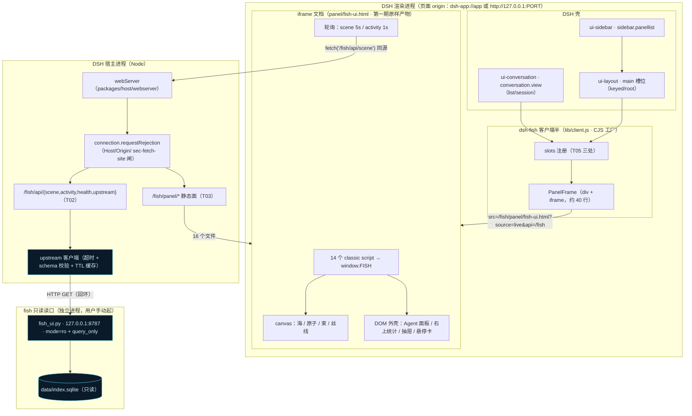
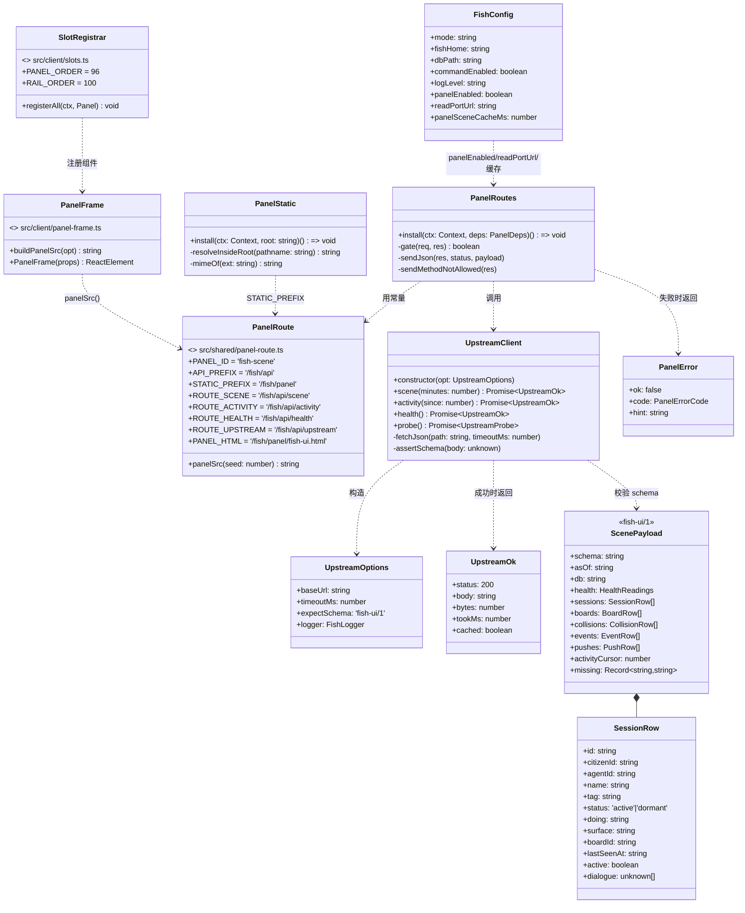
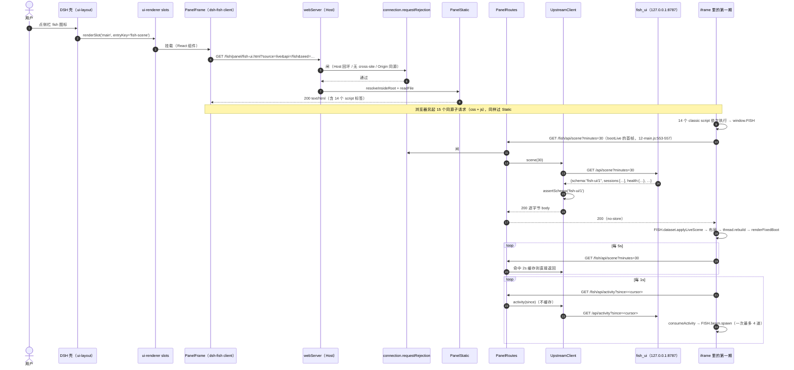
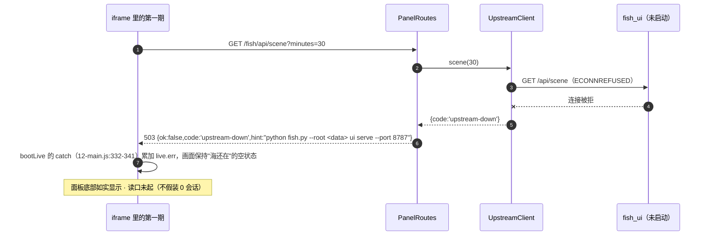
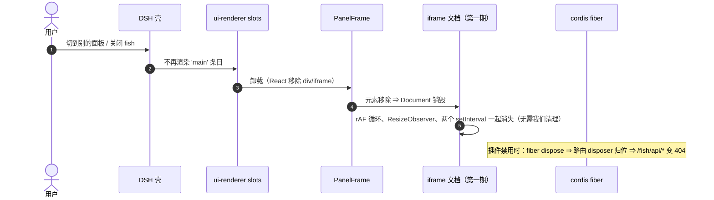
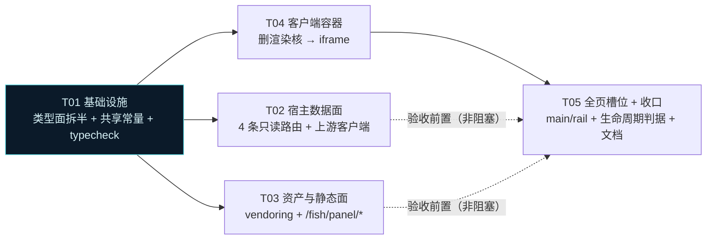

# dsh-fish 面板架构设计 · 把第一期界面搬进 DSH 槽位

> 状态：设计稿（未实施）｜ 取证时间：2026-10-28 10:46–11:10（本机） ｜ 版本基线：DSH 0.2.0-rc.2 / dsh-fish 0.1.0-shadow.0 / fish-ui-1
>
> **本文每一条断言都带 `文件:行号`，行号由 UTF-8 读取工具取得**（本机 pwsh 是 5.1，`Get-Content`/`Select-String` 对 UTF-8 会少数几行，据此取的行号会偏——所以 CSS/JS 的行号一律以 read/grep 工具为准）。

---

## 0. 取证范围与本机实测（先说清楚哪些是量到的、哪些是读出来的）

| 项 | 结论 | 证法 |
|---|---|---|
| 插件宿主半与客户端半都在 | ✅ | `lib/index.js` 458,334 B / `lib/client.js` 9,332 B，mtime 均 `10-28 10:58:24` |
| 构建绿、类型**只剩 1 条红** | ⚠️ 见下方"基线漂移" | `node_modules\.bin\tsc --noEmit` → **1 error / `EXIT=2`**：`src/client/index.ts(29,50): TS2307 Cannot find module 'react'` |
| DSH 宿主路由在本机活着 | ✅ | `GET http://127.0.0.1:19387/collab-ops/api/config` → `200`（dsh-hive 注册的路由） |
| fish 读口**此刻**没起 | ✅ | `GET http://127.0.0.1:8787/api/health` → 连接被拒 |
| 壳里有没有 CSP | ❌ 没有（见 Q1） | 读了 4 处 CSP 出现点，全都不在应用壳上 |
| 客户端能 require 的模块表 | 9 个静态 seed | `packages/client/web/src/platform.ts:8-14` |
| 面板要落的槽位声明者 | 都在册 | `profiles/node_modules/@deepseek-ai/` 下 `dsh-client-ui-layout` / `-sidebar` / `-conversation` / `-renderer` / `-slots` 均存在 |

### 0.1 ⚠️ 基线漂移（本文调研期间，仓库被另一个会话改过两次）

这是**实测到的并行写入**，会直接影响 T01 的前提，必须写在最前面：

| 时刻 | 文件 | 变化 | 对本文的影响 |
|---|---|---|---|
| 11:02:03 | `tsconfig.json` | `lib` 由 `["ES2023"]`（原 `:5`）改为 **`["ES2023","DOM","DOM.Iterable"]`**（现 `:6`） | 原来的 **13 条 DOM 类型错（`HTMLCanvasElement`×2/`window`×3/`requestAnimationFrame`×2/`ResizeObserver`×3/`cancelAnimationFrame`×1）被"压掉"了 12 条，只剩 `react` 1 条**。注意：这是**放宽**（node 半边现在也看得到 DOM），不是**分离** |
| 10:58:26–27 | `spec/*`（`contract.json` / `schema.fingerprint.json` / `tools.json` / `cli-map.json` / `layout/cut.json` …） | 整套被**重新生成**（与 `lib/index.js` 同一秒，像是跑了 `pnpm run gen:spec`） | **`spec/schema.fingerprint.json` 现在含 17 张 `kb_*` 表/索引**（`kb_index`/`kb_fts`/`kb_vault`/`kb_access`… 共 59 处 `kb_` 命中）。这是任务书 §四.2 明确警告的"把并行开发的中间态固化成契约" —— 见 §15-**R9**（P0 级风险） |

**由此产生的两条纪律**：

1. T01 的目标因此**改写**（见 §10-T01）：不是"清 13 条红"，而是①把 DOM 类型**收回**客户端半边（`src/index.ts` 里写 `document` 必须编不过）；②解掉 `react` 的解析。放宽 DOM lib 能让人闭嘴，但不能让"Node 产物里误用浏览器 API"这件事被编译器拦下。
2. **`spec/` 不应再被任何任务触碰**；10:58 那次生成留下的指纹雷，由主理人裁定怎么处置（本文不擅自回退别人的工作区状态）。

**一条重要的取证纪律**：`p0/` 正在被另一个 AI 并行开发（`fish_common.py` 10:43 刚改过，正在加 `kb_index`/`kb_fts` 与 `fish_push_rerank.py`）。本文对 `p0/` **只读**，不复制、不改写、不生成。`check:spec` 现在 0/2 是那个中间态的真实反映，**不是回归**，本设计也**不**通过"重新生成 spec"来消除它。

---

## 1. 五问结论速览

| 问题 | 结论 | 一句话理由 |
|---|---|---|
| **Q1 数据流** | **必须经宿主半代理**（新增 `ctx.webServer` 三条只读路由）。直连 8787 技术上"可能"可行，但**不能作为交付前提** | 壳里根本没有 CSP（所以"被 CSP 拦"这个理由不成立）；真正的风险是跨源三闸（CORS/混合内容/PNA）里有未实测项、以及直连等于承认"一个 `ACAO:*` 且无鉴权的端口"就是我们的数据面 |
| **Q2 DOM 外壳** | **路线 (b)：第一期当作一份产物原样 vendoring，装在 iframe 里跑**（不是"注入到 React 树里"） | 第一期的 CSS 是全局无命名空间的（`html,body{overflow:hidden}`、`*{box-sizing}`、`#scene{position:fixed}`），进同文档必炸宿主；iframe 给它一个完整视口，反而**正中它本来的设计前提** |
| **Q3 视图模型** | **源码只有一份（第一期）**；插件侧只存产物副本 + `manifest.json` 哈希门禁；**删掉**插件里那份简化渲染核 | classic script 端不能 `import`；把第一期改成 ESM 会破坏它自己的交付条件；而哈希门禁能把"漂移"从人的自觉变成一条会红的判据 |
| **Q4 生命周期** | 三层：cordis fiber（路由/样式）→ React `useEffect`（容器）→ **iframe 文档自己拥有 rAF/RO/定时器，随元素销毁而原子消失** | 这是 iframe 路线的第二个大红利：泄漏面从"我必须逐个清理"变成"结构上不存在" |
| **Q5 任务分解** | T01 基础设施 → T02 宿主数据面 / T03 资产与静态面 / T04 客户端容器 → T05 全页槽位与收口 | 见 §10/§11；最大深度 2（T01→T04→T05） |

---

## 2. Q1：数据流怎么走

### 2.1 事实取证：CSP 到底有没有

先纠正一个容易先入为主的判断——**DSH 应用壳没有任何 CSP**：

| 位置 | 有没有 CSP | 说明 |
|---|---|---|
| `checkout\apps\web\index.html`（开发壳） | **无** | 全文件只有 `charset` / `viewport` / `manifest` / `icon` / `title` |
| `checkout\apps\web\dist\index.html`（构建壳） | **无** | 同上 + `modulepreload` |
| `checkout\apps\desktop\src\web-document.ts:18-36`（桌面壳的静态服务） | **无** | 只写 `content-type`（`:33-35`） |
| `checkout\apps\desktop\src\web-document.ts:77-93`（转发到 Host） | **无** | 只**删**掉 `set-cookie`/`content-encoding` 等连接级头（`:58-62`、`:89-91`），不**加**安全头 |
| `checkout\apps\desktop\renderer\{welcome,update-dialog,policy-login-loading,mandatory-update}.html` | 有 | 都是桌面自己的弹窗页，与应用壳无关 |
| `packages\credentials\deepseek-account-platform\src\index.ts:645` | 有 | 登录页（`default-src 'none'`） |
| `packages\api\session-controller\src\media-references.ts:19` | 有 | 媒体沙箱（`sandbox; default-src 'none'`） |
| `packages\client\ui-sidebar-documentpreview\src\client\html\basic-document.ts:18-19` | 有 | 文档预览 iframe（`connect-src 'none'`） |

全仓 `content-security-policy` 只有上述 4 处**非应用壳**的命中（`grep -i "Content-Security-Policy"` 全检出）。**所以"直连会被 CSP 拦"这个理由不成立**——这也是为什么下面的结论必须建立在别的事实上。

### 2.2 直连在浏览器里到底要过几道闸

客户端半跑在桌面端的页面里，页面 origin 是 **`dsh-app://app`**：

- `apps\desktop\src\main.ts:399` → `const applicationUrl = `${SCHEME}://app/``，`SCHEME = 'dsh-app'`（`apps\desktop\src\ipc.ts:90`）
- `apps\desktop\src\main.ts:132-142` → 该 scheme 注册为 `standard: true, secure: true, supportFetchAPI: true, corsEnabled: true`（`dsh-app://app` 因此是一个**安全上下文**）
- `apps\desktop\src\main.ts:229-237` → `webSecurity: true`（标准 CORS 与混合内容规则照常执行）

于是 `fetch('http://127.0.0.1:8787/api/scene')` 要过三道：

| 闸 | 现状 | 判定 |
|---|---|---|
| **CORS** | fish 读口回 `Access-Control-Allow-Origin: *`（`fish_ui.py:521-524`，`do_OPTIONS` 也回 `*`），且不用凭证 | 预期**能过**（简单 GET） |
| **混合内容** | 文档是安全上下文，目标是 `http://127.0.0.1`（回环属于 potentially trustworthy） | 预期**能过**（按规范回环豁免） |
| **Private Network Access** | 由 `dsh-app://` 这种非 http(s) 发起者访问 local/loopback 地址空间 | **未实测，是未知项**。本机 Chromium 版本、Electron 版本都会影响它 |

结论：直连**不是"技术上不可能"，而是"把一个未实测的浏览器闸门写进交付前提"**。这在工程上不可接受——尤其当旁边就有一条没有这个不确定性的路。

### 2.3 宿主的真实约束：Host/Origin 信任闸（这条决定了面板必须走同源）

`packages\client\connection\src\api-request-trust.ts:91-118` 是 DSH 对**所有**本机 HTTP 面的信任闸：

1. `Host` 头必须是回环或被 `trustedHosts` 声明（`:99-103`）
2. `sec-fetch-site: cross-site` **一律拒**（`:106`）
3. 带了 `Origin` 就必须等于本 authority；**`Origin: null` 一律拒**（`:110-117`，"sandboxed iframes / file: 页面"）

宿主插件注册的路由**应当**复用这道闸——官方 `packages\host\open-in-app\src\index.ts` 就是这么做的（`:184-191` 的 `rejected()`，`:47` 的 `inject = ['webServer','connection','subprocess']`）。

这条对我们有**两个直接后果**：

- 面板的 HTTP 面必须是**同源相对路径**（`/fish/api/...`），否则它自己的信任闸会打死自己；
- 面板 iframe **不能**用裸 `sandbox="allow-scripts"`（那会让 origin 变成 `null`，`:110-117` 判死）——见 §3.4。

### 2.4 两条路的取舍

| 维度 | (A) 浏览器直连 `127.0.0.1:8787` | (B) 宿主半代理 `/fish/api/*` |
|---|---|---|
| 需要改的代码 | 客户端半 1 处 base URL | 宿主半 3 条路由 + 1 个上游客户端 |
| 浏览器闸门 | CORS（预期过）/ 混合内容（预期过）/ **PNA（未知）** | **零**（同源） |
| 读口没起时的表现 | 浏览器网络错误，面板只能"白屏 + 控制台红字" | 宿主半可以回 **503 + 可执行提示**，面板显示一等公民的"读口未起"态 |
| 安全面 | 直接依赖"8787 无鉴权 + `ACAO:*`"（**任何本机网页都能读你的 fish 投影**——这是 p0 侧的一个真实安全项，见 §15-R4） | 请求走 DSH 自己的信任闸；面板不需要知道第二个端口 |
| 以后换数据源（fish 本体 HTTP / 直读 SQLite / 换端口） | 客户端要跟着改 | **只改宿主半一处** |
| 多宿主一致性（桌面端 `dsh-app://` vs 浏览器端 `http://127.0.0.1:PORT`） | 两个 origin、两套判断 | 一套代码 |
| 多一跳开销 | 无 | 回环多一跳（亚毫秒级）+ 进程内 JSON 透传 |
| 与既有实践一致 | 无先例 | dsh-hive 全族都是 `/collab-ops/api/*`；本机实测 200（§0） |

**结论：走 (B)。** 并且把 (A) 的可行性写成"将来若要重开这条路，先做这 20 行探针"，不进本期。

### 2.5 宿主半路由的形状

```ts
// 契约（唯一来源 src/shared/panel-route.ts）
GET  /fish/api/scene      → 上游 /api/scene 原样透传（含 ?minutes=）
GET  /fish/api/activity   → 上游 /api/activity 原样透传（含 ?since=）
GET  /fish/api/health     → 上游 /api/health 原样透传
GET  /fish/api/upstream   → 本插件自有：上游是否可达 + 读到的 schema/asOf/耗时
GET  /fish/panel/*        → 第一期货物的静态面（见 Q2/T03）
```

四条硬约定（**为什么是"原样透传"而不是包一层信封**）：第一期的适配器直接读 `scene.sessions` / `scene.health` / `scene.asOf`（`js/04-dataset.js:144-...`、`js/12-main.js:270-294`），任何外层信封都要改第一期代码 → 违反"零漂移"。

- 成功：**字节透传上游 body**，只加 `cache-control: no-store`（上游自己也是 no-store，`fish_ui.py:520`）。
- 失败：本插件自有信封 `{ok:false, code, hint}` + 非 200。`code` 取值域固定为
  `upstream-down`（连不上）｜`upstream-timeout`（>1.5s）｜`upstream-bad-schema`（`schema !== 'fish-ui/1'`）｜`upstream-bad-json`。
- 缓存：scene 2s / health 1s / activity **不缓存**（它本身就是增量、有 cursor）。
- 只读：**只注册 GET**；其它方法回 405 + `allow: GET`（照 `open-in-app/src/index.ts:198-201`）。

上游地址配置化（`readPortUrl`，默认 `http://127.0.0.1:8787`）。**不 autostart**，理由见 §14。

---

## 3. Q2：第一期那套 DOM 外壳怎么搬

### 3.1 先说为什么"原样注入到 React 树里"必然出事

第一期的 CSS 是**全局且无命名空间**的截图级别证据：

| 选择器 | 行号 | 在 DSH 里会发生什么 |
|---|---|---|
| `:root { --bg-deep … --mono --sans --ease … }` | `css/fish-ui.css:13-...` | 覆盖宿主 `:root`；`--mono/--sans` 是常见名，直接改掉宿主字体栈 |
| `* { box-sizing: border-box }` | `:47` | 改掉宿主全站盒模型 |
| `* { scrollbar-width… }` `*::-webkit-scrollbar` | `:56-...` | 重绘宿主所有滚动条 |
| `html, body { height:100%; overflow: hidden; … }` | `:70-78` | **直接杀死宿主滚动** |
| `#scene { position: fixed; inset: 0 }` | `:87` | 画布铺满整个应用，盖住对话区 |

再叠上 JS 侧的全局性：14 个 classic script 全部 IIFE 挂 `window.FISH`（`js/01-config.js:15-18` 的模式），`12-main.js` 里 `document.getElementById('scene')`（`:474`）、`window.addEventListener('pointermove'…)`（`:354`）都在**主文档**上。两份实例必冲突，一份实例必污染宿主。

### 3.2 三条候选（外加一条该被排除的第四条）

**(a) 重写为 React 组件**
- 要重画：海（`06-sea.js` 390 行，含 `glowSprite` 预渲染、按屏幕 y 反解 z 的透视/波浪五分量）、原子（`07-atom.js` 478 行，含 orbits/fish/bits/electrons 四层）、信息束（`08-beam.js` 260 行，含贝塞尔弓形与海面落点）、丝线（`09-thread.js` 304 行，含 Prim 生成树配边）、面板/卡片/抽屉（`10`/`11`/`14` 共 745 行）。
- 风险：重写必然出现"像但不一样"，而**用户要的是同一个世界**（`src/client/index.ts:5-12` 已把这条裁定写进代码注释）。

**(b) 第一期当产物 vendoring，装进 iframe 里跑**
- 第一期是**按整视口设计的**（`html,body{height:100%}` + `#scene{position:fixed;inset:0}` + `LAYOUT.panel{width:268,left:26,top:26}`，`js/01-config.js:76-84`）。iframe 正好给它一个完整视口：那三条"会炸宿主"的全局规则在 iframe 里**全是正确的**。
- 零改写：`fish-ui.html` 已经支持 `?source=live&api=<base>`（`js/12-main.js:541-547`），我们把 `api` 指到 `/fish` 即可（见 §3.4）。
- 代价：焦点在 iframe 内时 DSH 全局快捷键不生效；画面与 DSH 设计语言不一致（用户已裁定要一致的那个"一致"是**跟 fish 一致**）。

**(c) 只搬 canvas，DOM 外壳按 DSH 原生视觉重做**
- 视觉一致度最差：左侧 Agent 面板 + 右上 5 项统计 + 详情抽屉 + 悬停卡片正好是"信息架构"本身，重做它们等于重做产品。
- 优点：与 DSH 融合最好、可无障碍、可主题化。
- 但用户当前诉求是"搬"，不是"融"。

**(被排除) (b') Shadow DOM 代替 iframe** —— 写在这里是为了不留疑问：
- `html, body { height: 100% }` 在 shadow root 内**不匹配任何元素**，高度链断掉 → `#scene{position:fixed}` 于是相对视口铺满**整个应用**；
- `:root` 变量在 shadow root 上不生效（要改成 `:host`）→ 必须改 CSS = 制造漂移；
- classic script 只能在主文档作用域里 eval → `window.FISH` 全局泄漏、`document.getElementById('scene')` 打到主文档。
- 一句话：**Shadow DOM 要求我们改一期的 CSS/JS 才能工作，iframe 一行都不用改。**

### 3.3 评分（权重取自本项目的既有裁定）

| 维度 | 权重 | (a) React 重写 | (b) iframe 产物 | (c) canvas + 原生壳 |
|---|---|---|---|---|
| 视觉一致度（与第一期） | 40% | 3 | **5** | 2 |
| 与第一期漂移风险 | 25% | 2（两份实现长期并存） | **4**（哈希门禁，可红） | 1 |
| 工作量（1 高 → 5 低） | 20% | 1（数千行重画） | **4**（搬运 + 两个路由） | 3 |
| 与 DSH 设计语言冲突（5 = 冲突小） | 15% | 3 | **2** | 5 |
| **加权** | | **2.55** | **4.10** | **2.35** |

**结论：(b)。** 权重里"视觉一致度"占 40%，依据不是我的偏好，而是这条已写进代码的裁定（`src/client/index.ts:4-12`："用户定的是**做视觉一致的方案**……代价是这块面板和 DSH 的 DOM 体系是割裂的……收益：视觉与 fish 独立软件 100% 一致"）。本设计不改这个裁定，只把它执行彻底。

### 3.4 iframe 契约（这几条是硬约束，不是建议）

```ts
// src/client/index.ts（容器，约 40 行）
h('div', { style: { flex:'1 1 0', minHeight:0, position:'relative', overflow:'hidden' } },
  h('iframe', {
    src: buildPanelSrc(),            // /fish/panel/fish-ui.html?source=live&api=/fish&seed=20261027
    title: 'fish',
    style: { position:'absolute', inset:0, width:'100%', height:'100%', border:0, display:'block' },
  }))
```

1. **不加 `sandbox`**（或必须带 `allow-same-origin`）。理由已取证：`api-request-trust.ts:110-117` 把 `Origin: null` 判死，裸 `sandbox="allow-scripts"` 会让 `/fish/api/*` 全部 403。资产是我们自己的同源文件，与 `ui-sidebar-documentpreview` 处理"用户上传 HTML"的场景不同（那里用 `sandbox="allow-scripts"` 是对的，因为内容不可信）。
2. **外层仍是 `flex: 1 1 0; minHeight: 0; position: relative`，iframe 用 absolute 铺满**。这条沿用已经修过 bug 的结论，不要退回 `minHeight` 或 `height:100%`：宿主 `.viewArea` 是 flex 容器（`ui-conversation/.../ConversationRoot.module.css:240-245`），输入框出 overlay 时它变成 `flex:1 1 0; min-height:0; overflow:hidden`（`:482-486`）。
3. **`?api=/fish`**：`liveFetch` 是 `live.base + path`（`js/12-main.js:262-267`），`path` 形如 `/api/scene`，所以 base 取 `/fish` 就落到 `/fish/api/scene`。**第一期的 JS 一行都不用改**。
4. **`?seed=` 固定**：截图/回归要可复现（第一期自己的判据依赖 `?t/seed/n`，`README.md:205-215`）。生产默认固定 seed（不是随机），保证同机同帧。
5. **`?once=1` 留给无头截图**：第一期为无头专门留了这个开关（`12-main.js:578-579` 注释："live 模式的 setInterval 会让 headless 永远不'空闲'"）。验收脚本用它。
6. **`conversation.view` 是 `scope: 'session'` 的 list 槽位**（`ui-conversation/src/client/contract/slots.ts:185`、`apply.ts:357`）——而 fish 的海是**全局**视图。所以本期先保留已跑通的 `conversation.view`（成本最低、已验证），在 T05 增开 `main`（`ui-layout/src/client/index.ts:73`：`'main': { kind:'keyed'; scope:'root' }`）+ `sidebar.panellist`（`ui-sidebar/src/client/contract/slots.ts:35`）作为**主入口**。这是"先证明管子通、再换更合适的插座位"的顺序，不是永久双开。

---

## 4. Q3：视图模型怎么共享，避免两份代码漂移

### 4.1 漂移已经发生了（不是风险，是现状）

`src/client/index.ts:56-237` 有一份**自包含的简化渲染核**（`SEA` 参数、`waveH`、`ATOMS` 5 个演示原子、`renderScene`），文件头自己写着"算法与参数取自 06-sea.js 与 07-atom.js，但这里是 TS + 自包含……现在重复一次是为了先证明'能跑'"（`:21-26`）。同一套视觉现在有**两个实现**，且已经不一致（简化版没有 beam/thread/panel/tooltip/sheet/logos）。

### 4.2 三条候选

| 候选 | 可行性 | 判定 |
|---|---|---|
| **抽 npm 包** | 第一期是 classic script（`fish-ui.html:116` 注释明说"按依赖顺序加载（classic script，file:// 可直接双击打开）"），**不能 import**；要为它服务就得给第一期加构建 | ❌ 破坏第一期自己的交付条件（`file://` 双击可开） |
| **共享源码目录 + 两端各自构建** | 需要把第一期的 IIFE 改成 UMD/ESM 双形态，或在插件侧再写一层 ESM 包装去 eval 源码 | ❌ 两个构建面 + 一层 eval，复杂度大于收益；且 eval 出来的 `window.FISH` 仍是全局 |
| **只在插件侧维护，第一期反向 import** | 第一期要 import 就得上构建，同上 | ❌ |
| **✅ 产物级 vendoring + 哈希门禁** | 源码只有一份（第一期）；插件侧存的是**字节副本** + 一份记录来源与哈希的 `manifest.json`；`scripts/sync-panel-assets.mjs --check` 把"副本 ≠ 源"变成红灯 | ✅ 采用 |

### 4.3 为什么"哈希门禁"比"抽包"更结实

抽包解决的是**符号级**共享（`import` 同一个函数）。但第一期的耦合不在符号上，而在**整份文档**上（CSS 全局规则 + 14 个 script 的加载序 + `window.FISH` 命名空间）。对这种耦合，"字节相同"是比"符号相同"更强的保证：它连"有人改了一期一个色值"都能抓到。

`panel/manifest.json` 的形状（生成物，不入 git 也行；入 git 更利于评审）：

```json
{
  "schema": "dsh-fish/panel-assets@1",
  "generatedAt": "2026-10-28T03:10:00Z",
  "sourceRoot": "I:\\app\\DSH-Home\\workspace\\learn\\大肥鱼生命系统\\ui-第一期-20261027",
  "sourceKind": "first-phase-ui",
  "files": [
    { "path": "fish-ui.html", "bytes": 6002, "sha256": "…" },
    { "path": "css/fish-ui.css", "bytes": 28213, "sha256": "…" },
    { "path": "js/01-config.js", "bytes": 6369, "sha256": "…" }
  ],
  "extra": ["boot/PROVENANCE.md"]
}
```

**16 个文件**（`fish-ui.html` + `css/fish-ui.css` + `js/01..14`，实测：js 目录 14 个文件，`09/13`/`12` 的加载序在 `fish-ui.html:117-130` 里与文件名序不同——`13-logos.js` 在 `12-main.js` **之前**加载，这点不能想当然）。

门禁的三条判据（`scripts/sync-panel-assets.mjs --check`）：

1. 16 个文件都在，且 `sha256` 与 manifest 一致；
2. manifest 的 `sourceRoot` **存在**时，逐个与源文件比对字节（源不在本机 → 打印"跳过漂移对拍"并以 0 退出，**不假装通过**）；
3. 插件侧 `panel/` 里**多出来的文件**一律报错（防止有人往产物目录里塞手改代码）。

### 4.4 顺手把已经漂移的那份删掉

T04 删除 `src/client/index.ts:56-237`（`SEA`/`waveH`/`ATOMS`/`renderScene`）。判据写进 `scripts/check-client-bundle.mjs`：产物里出现 `renderScene` / `ATOMS` / `getContext('2d')` 任一 → 红。

---

## 5. Q4：状态与生命周期

### 5.1 三层，各管一段（这是本设计的关键结构）

| 层 | 拥有什么 | 释放机制 | 依据 |
|---|---|---|---|
| **cordis fiber** | 宿主半的 3+1 条路由、客户端半的样式标签/字典/槽位条目 | `ctx.effect(() => resources, label)`；fiber dispose 时逆序释放 | `packages\host\webserver\src\index.ts:166-173`（`register` 返回 disposer）；`open-in-app/src/index.ts:193-204`（`ctx.effect(() => ctx.webServer.register(...))`） |
| **React** | 那个 `div` 容器与 `iframe` 元素 | `useEffect` 返回清理函数；`slots.register()` 内部**已经是** `ctx.effect`，槽位条目随 fiber 消失 → React 树被卸载 | `ui-renderer/src/client/registry.ts:741-746`（`register` = `ctx.effect(...)`）；`registry.ts:209-271`（`inject` 是声明期嵌套 effect） |
| **iframe 文档** | `requestAnimationFrame` 循环、`ResizeObserver`、**两路轮询**（`setInterval` 5s / 1s） | **不需要我们清理**：`iframe` 元素被移除 = 它的 `Document` 被销毁 = 定时器与 rAF 一起消失 | `js/12-main.js:327-346`（两个 `setInterval`）、`:271-276`（rAF 自递归）、`src/client/index.ts:252-292`（上一版手写清理，删掉） |

**为什么这条比"逐项清理"强**：上一版客户端半自己在 `useEffect` 里管 rAF + ResizeObserver（`src/client/index.ts:278-291`），清漏一项就是一条静默泄漏；而 iframe 的销毁是**结构性**的——即使第一期哪天加了新的定时器，也不会漏。

### 5.2 宿主侧的配对关系

- 插件未启用 / `panelEnabled: false` → 路由不存在 → `GET /fish/api/scene` 应回 **404**（`webserver` 的 fallback 决定，`:231-237`），不是 503。判据可测。
- 插件 fiber dispose → 路由 disposer 归位 → 同上 404。
- 槽位条目消失 → `ui-layout` 的 `retainMainPanels` 会把"当前选中的整页面板"清空，不会留一个空壳（`ui-layout/src/client/index.ts:159-168`、`:195-196`）。所以我们**不需要**在卸载时手改宿主选中态。

### 5.3 泄漏判据（可跑、可失败）

```text
静态：lib/client.js 里不得出现 setInterval / setTimeout / requestAnimationFrame / ResizeObserver
      （它们应该全部在 panel/js/* 里；客户端半只画一个 iframe）
动态：打开/关闭面板 20 次 → document.querySelectorAll('iframe').length 回到基线；
      DevTools Performance 录制 5s → 帧数归零；宿主进程 RSS 不单调上升
路由：curl -X POST /fish/api/scene → 405；插件禁用后 GET → 404
```

---

## 6. 架构图



---

## 7. 文件清单与职责

### 7.1 现有文件（本设计会改）

| 路径 | 现状 | 本设计怎么改 |
|---|---|---|
| `tsconfig.json` | 单 program；11:02 有人把 `lib` 放宽成 `["ES2023","DOM","DOM.Iterable"]`（现 `:6`），"压掉"了 12 条 DOM 错，只剩 `react` 1 条红 | T01 拆成 base + node 半边（DOM 收回客户端） |
| `src/index.ts` | 只装配契约门禁 + `/fish` 命令（:142-168） | T02 加 config 三键 + `ctx.inject(['webServer','connection'])` 装面板数据面 |
| `src/client/index.ts` | 369 行，含自包含渲染核（:56-237）+ 单槽位（:341-368） | T04 删渲染核换 iframe；T05 把注册挪进 `slots.ts` 并增两处 |
| `tsdown.config.ts` | `CLIENT_ROWS = []`（:43-46，注释"本批不注册任何槽位"**已过期**） | T05 补两行（`ui-layout` / `ui-sidebar`），与 `package.json` 的 `dsh.client.inject` 严格同序；T01 加一条"两张表相等"的判据 |
| `package.json` | `dsh.client.inject` 只有 `ui-conversation`（:39-42）；`files` 不含 `panel`（:26-32） | T05 补两行 inject；T03 把 `panel` 加进 `files`；T01 加 `typecheck` 脚本指向新入口 |
| `cordis.patch.yml` | `disabled: false` + `fishHome`（:34-44） | T02 补 `readPortUrl` 等键的注释与默认值说明 |
| `README.md` | 21KB，验收命令在 §4（:153-180） | T04 增"面板"一节；T05 增验收清单 |

### 7.2 新增文件（按任务）

| 路径 | 任务 | 职责 |
|---|---|---|
| `tsconfig.base.json` | T01 | 两半边共享的 compilerOptions（严格度一盘棋） |
| `tsconfig.client.json` | T01 | `lib: ES2024+DOM+DOM.Iterable`，`include: src/client/**, src/shared/**` |
| `src/shared/panel-route.ts` | T01 | **唯一**的路由/静态面/面板 id/查询参数常量（两半边都 import 它） |
| `src/client/types/react.d.ts` | T01 | 手写的最小 react 环境声明（3 个成员），理由见 §13-A3 |
| `scripts/typecheck.mjs` | T01 | 生成两份解析后的 tsconfig（typeRoots/paths 按 `$DSH_HOME` 推出），跑 `tsc --noEmit` |
| `src/host/upstream.ts` | T02 | 回环 HTTP 客户端：超时、JSON 解析、schema 校验、错误码映射、TTL 缓存 |
| `src/host/panel-routes.ts` | T02 | 注册 4 条路由：信任闸 → 上游 → 透传/错误信封；405 与 no-store |
| `scripts/check-panel-routes.mjs` | T02 | 假 ctx + 假上游，覆盖 200/405/503/bad-schema/撤销 |
| `scripts/sync-panel-assets.mjs` | T03 | 从第一期目录复制 16 个文件 + 写 `panel/manifest.json`；`--check` 只校验 |
| `panel/**`（生成物） | T03 | 16 个第一期文件 + `manifest.json` + `PROVENANCE.md` |
| `src/host/panel-static.ts` | T03 | `/fish/panel/*` 静态服务：mime、穿越防护、`no-store`、404 |
| `scripts/check-panel-assets.mjs` | T03 | 哈希对拍、mime、穿越、非法方法、多余文件 |
| `src/client/panel-frame.ts` | T04 | `buildPanelSrc()`（纯函数，可单测）+ `<iframe>` 装配 |
| `scripts/check-client-bundle.mjs` | T04 | 产物形状判据（见 §10-T04） |
| `src/client/slots.ts` | T05 | 三处槽位注册集中一处（order 常量、label thunk） |
| `scripts/check-panel-lifecycle.mjs` | T05 | 注册/撤销/零定时器/两张模块表相等 的判据 |
| `docs/验收命令.md` | T05 | 本文 §10 的命令清单（可复制执行） |

---

## 8. 数据结构与接口



**接口约定（要点）**

| 面 | 方法 | 入参 | 成功 | 失败 |
|---|---|---|---|---|
| `/fish/api/scene` | GET | `?minutes=1..1440`（缺省 30，越界钳制——与 `fish_ui.py:542-546` 同口径） | 上游 body **逐字节** + `cache-control: no-store` | `503 {ok:false,code:'upstream-down'\|'upstream-timeout'\|'upstream-bad-schema'\|'upstream-bad-json',hint}` |
| `/fish/api/activity` | GET | `?since=<int>`（缺省 0） | 同上（**不缓存**） | 同上 |
| `/fish/api/health` | GET | — | 同上（缓存 1s） | 同上 |
| `/fish/api/upstream` | GET | — | `200 {ok:true,reachable:true,baseUrl,schema,asOf,tookMs,sessions:n}` | `200 {ok:true,reachable:false,baseUrl,reason}`（**这是探活面，永远 200**——面板靠它区分"读口没起"和"插件坏了"） |
| `/fish/panel/*` | GET/HEAD | — | 文件字节 + 正确 `content-type` | `404` / `403`（穿越） / `405` |

**为什么 `/fish/api/upstream` 用"永远 200 + reachable 布尔"**：它是**诊断面**，调用方要能区分"宿主路由存在但上游死"和"宿主路由根本不存在（插件没启用）"。后者会 404，前者 200+false。dsh-hive 的 canvas 面用了同一个模式（`src/canvas/api.ts:43` 注释："唯一裁决面，**永远应答**，关掉也答 200 + enabled:false"）。

---

## 9. 程序调用流程

### 9.1 正常路径（面板打开 → 出第一帧 → 进入轮询）



### 9.2 读口没起（这是**默认会走**的路径，必须是一等公民）



**这里有一条必须改一期的一条**（唯一一处允许改）：
`js/12-main.js:332-341` 现在把错误吞成 `live.err++`。live 模式的失败会让面板显示成"0 个会话"，看起来像"fish 里没人"，而不是"读口没起"。
处理办法不是改一期源码，而是**在 T03 的 `panel/` 里加一个 6 行的 `boot/PROVENANCE.md` 说明 + 由容器在 iframe 外套一层状态条**：`PanelFrame` 每 5s 打一次 `/fish/api/upstream`，`reachable:false` 时在 iframe **上方**压一条 28px 的提示条（"读口未起 · 一键复制命令"）。这样第一期零改动，且用户看得到原因。

### 9.3 卸载



---

## 10. 任务分解（T01–T05）

> 硬规则：最多 5 个任务；每个任务 ≥3 个相关文件；T01 必须是基础设施；依赖尽量只指回 T01。
> **验收命令都可跑、可失败**；每条附"变异自证"（把判据破坏掉，它必须红）。

### T01 · 项目基础设施：类型面拆半 + 共享契约常量（P0）

| 项 | 内容 |
|---|---|
| 源文件 | `tsconfig.base.json`（新）、`tsconfig.json`（改）、`tsconfig.client.json`（新）、`src/shared/panel-route.ts`（新）、`src/client/types/react.d.ts`（新）、`scripts/typecheck.mjs`（新）、`package.json`（改 scripts） |
| 依赖 | 无 |
| 交付物 | ① node/客户端两套 program；② 一条命令跑完两边的 `tsc --noEmit`；③ 两半边共用的常量模块 |

**为什么必须先做**：`node_modules\.bin\tsc --noEmit` 现在 **1 error / EXIT 2**（`src/client/index.ts:29` 的 `import ... from 'react'`）。而这条"只剩 1 条"是**别人在 11:02 用放宽 DOM lib 换来的**（见 §0.1）：`tsconfig.json:6` 现在 `["ES2023","DOM","DOM.Iterable"]` —— **node 半边的 41 个 `.ts`（`src/index.ts` + `core/*` + `domain/*` 20 个 + `ports/*` + `hosts/*` + `surfaces/*` + `layout/*`）**从此也能写 `document`/`window` 而编得过，而它们的产物是要在 Node 里跑的。所以 T01 要做的不是"让 tsc 闭嘴"，而是：

- **类型面按运行期拆半**：node 半边 `lib: ES2023` + `types: ["node"]`；客户端半边 `lib: [...DOM, DOM.Iterable]` + 手写 react 声明（§13-A3）；
- 两半边各出一份 program，一条命令跑完（否则"我只跑了一半"这种漏法没人看得见）；
- 顺手把两半边共用的**契约常量**落到 `src/shared/panel-route.ts`（T02/T04 都要它，现在放进去比以后补便宜）。

**验收命令**

```powershell
cd I:\app\fish-public\dsh-fish
node scripts/typecheck.mjs          # 期望 EXIT 0；输出两段：node 半边 0 error / client 半边 0 error
npx tsdown                          # 期望 EXIT 0，lib/index.js 与 lib/client.js 都被重写
node -e "const f=require('node:fs');for(const p of ['lib/index.js','lib/client.js']){const s=f.statSync(p);if(s.size<1000)throw new Error(p+' too small');console.log(p,s.size)}"
```

**变异自证**（必须红）

```powershell
# 往 node 半边塞一个 DOM 类型：DOM lib 已从 node 半边收回，这一行必须编不过
Add-Content src\index.ts "`nconst __probe: HTMLCanvasElement | null = null`n"
node scripts/typecheck.mjs   # 期望 EXIT != 0 且错误来自 node 半边（TS2304 Cannot find name 'HTMLCanvasElement'）
git checkout -- src\index.ts
```

> ⚠️ **写作用域冲突提示**：`tsconfig.json` 在 11:02:03 被另一个会话改过（§0.1）。T01 派单前必须先与那个会话协调（或确认它已收工），否则两个人会踩在同一行上。

**额外判据**（写进 `scripts/typecheck.mjs` 的收尾断言）

- `src/host/**` 与 `src/index.ts` 不得出现在 client program 的 `include` 里；`src/client/**` 不得出现在 node program 里（防"把 DOM 代码塞进 Node 产物"）。
- **两张模块表必须相等**：`tsdown.config.ts` 的 `CLIENT_MODULE_TABLE`（= `PLATFORM_MODULES` + `CLIENT_ROWS`）里的 `CLIENT_ROWS` 与 `package.json` 的 `dsh.client.inject` **逐项同序**。现状是 `package.json` 有 1 行、`CLIENT_ROWS` 是空数组（`tsdown.config.ts:43-46` 的注释"本批不注册任何槽位"已过期）——这条断言现在就该红，T05 修好它。

---

### T02 · 宿主半数据面：4 条只读路由 + 上游客户端（P0）

| 项 | 内容 |
|---|---|
| 源文件 | `src/host/upstream.ts`（新）、`src/host/panel-routes.ts`（新）、`src/index.ts`（改：config 三键 + 第二段 inject）、`cordis.patch.yml`（改：新键注释）、`scripts/check-panel-routes.mjs`（新） |
| 依赖 | T01 |
| 交付物 | `/fish/api/{scene,activity,health,upstream}` 可用；读口没起时回 503+可执行提示；`panelEnabled:false` 时四条路由都不注册 |

**验收命令**

```powershell
cd I:\app\fish-public\dsh-fish
npx tsdown
node scripts/check-panel-routes.mjs    # 自起假上游（端口 0）+ 假 ctx，逐条断言，EXIT 0
```

`check-panel-routes.mjs` 的断言清单（每条都可失败）：

1. 注册了且仅注册了 4 条，方法只放 `GET`/`HEAD`；
2. 上游 200 → 本插件回 200，body **逐字节相等**（把上游 body 做 sha256 对拍）；
3. 上游 500 → 本插件回 503 `code:'upstream-down'`，且 `hint` 里含可执行命令；
4. 上游回 `{"schema":"fish-ui/2"}` → 503 `code:'upstream-bad-schema'`；
5. 上游回非 JSON → 503 `code:'upstream-bad-json'`；
6. 上游不回（超时 1.5s）→ 503 `code:'upstream-timeout'`；
7. `POST /fish/api/scene` → 405 + `allow: GET`；
8. `Host` 头是非回环（伪造 `evil.example`）→ 403（信任闸生效）；
9. 带 `Origin: null` → 403（同上，`api-request-trust.ts:110-117`）；
10. 调用 disposer 后 → 4 条路由全部消失。

**真机验收**（需要用户手动起读口）

```powershell
# ① 读口没起（默认状态）
curl.exe -s -o NUL -w "%{http_code}`n" http://127.0.0.1:19387/fish/api/health      # 期望 503
curl.exe -s http://127.0.0.1:19387/fish/api/upstream                                # 期望 {"ok":true,"reachable":false,…}
# ② 起读口（另开一个窗口；这是只读口，mode=ro + query_only）
python "I:\app\DSH-Home\workspace\learn\大肥鱼生命系统\p0\fish.py" --root "I:\app\DSH-Home\workspace\learn\大肥鱼生命系统\p0\data" ui serve --port 8787
# ③ 再验
curl.exe -s http://127.0.0.1:19387/fish/api/upstream                                # 期望 reachable:true, schema:"fish-ui/1"
curl.exe -s "http://127.0.0.1:19387/fish/api/scene?minutes=30" | node -e "let s='';process.stdin.on('data',d=>s+=d).on('end',()=>{const j=JSON.parse(s);if(j.schema!=='fish-ui/1')throw new Error('schema '+j.schema);if(!Array.isArray(j.sessions))throw new Error('sessions');console.log('sessions',j.sessions.length,'boards',j.boards.length,'asOf',j.asOf)})"
```

> ⚠️ PowerShell 5.1 里 `curl` 是 `Invoke-WebRequest` 的别名 —— 必须写 `curl.exe`。这是本机实测过的坑。

**变异自证**：把 `UpstreamClient` 的 `timeoutMs` 改成 1ms → 断言 6 必红；把信任闸那两行注掉 → 断言 8/9 必红。

---

### T03 · 第一期资产 vendoring + `/fish/panel/*` 静态面（P0）

| 项 | 内容 |
|---|---|
| 源文件 | `scripts/sync-panel-assets.mjs`（新）、`panel/**`（生成，16 文件 + manifest）、`src/host/panel-static.ts`（新）、`scripts/check-panel-assets.mjs`（新）、`package.json`（`files` 加 `panel`） |
| 依赖 | T01 |
| 交付物 | 第一期 16 个文件逐字节进包；`/fish/panel/fish-ui.html` 可直接打开；漂移可判 |

**验收命令**

```powershell
cd I:\app\fish-public\dsh-fish
node scripts/sync-panel-assets.mjs            # 生成 panel/ 与 panel/manifest.json（打印 16 行 sha256）
node scripts/sync-panel-assets.mjs --check    # 期望 EXIT 0
node scripts/check-panel-assets.mjs           # 清单 / 哈希 / mime / 穿越 / 多余文件，EXIT 0
```

**变异自证**

```powershell
# 在源目录改一个字节：副本与源必须判红
Add-Content "I:\app\DSH-Home\workspace\learn\大肥鱼生命系统\ui-第一期-20261027\js\02-utils.js" " "
node scripts/sync-panel-assets.mjs --check ; echo "期望 EXIT 1"
# 复原该字节（用 git 或手工删掉行尾那个空格）
```

`check-panel-assets.mjs` 断言清单：

1. 16 个相对路径齐全（`fish-ui.html`、`css/fish-ui.css`、`js/01-config.js` … `js/14-sheet.js`）；
2. 每个 sha256 与 manifest 一致；
3. `fish-ui.html` 里的 14 个 `<script src>` 相对路径都能在 `panel/` 里找到（**反向索引检查**，防"复制漏了但清单自己一致"）；
4. 穿越：`/fish/panel/../package.json` → 403；`/fish/panel/%2e%2e/package.json` → 403；
5. `POST /fish/panel/fish-ui.html` → 405；`HEAD` → 200 且 body 为空；
6. `panel/` 里出现 manifest 未登记的文件 → 红（防手改产物）。

---

### T04 · 客户端容器：删自包含渲染核，换 iframe（P0）

| 项 | 内容 |
|---|---|
| 源文件 | `src/client/index.ts`（改：删 `:56-237`、`:248-331`，保留 flex 契约）、`src/client/panel-frame.ts`（新）、`scripts/check-client-bundle.mjs`（新）、`README.md`（改：新增"面板"一节） |
| 依赖 | T01（契约常量）；运行期还需要 T02/T03 已落地（**验收前置**，不是任务阻塞） |
| 交付物 | 面板用第一期原样产物渲染；插件侧不再有第二份渲染代码 |

**验收命令**

```powershell
cd I:\app\fish-public\dsh-fish
npx tsdown
node scripts/check-client-bundle.mjs      # 见下，EXIT 0
```

`check-client-bundle.mjs` 断言（全部对 `lib/client.js` 做）：

1. **不含** `renderScene` / `ATOMS` / `getContext(` （旧渲染核已删干净）；
2. **含** `/fish/panel/fish-ui.html`（来自 `src/shared/panel-route.ts`，不是散落字面量）；
3. **不含** `8787`（端口只许出现在宿主半配置里）；
4. **不含** `setInterval` / `requestAnimationFrame`（轮询在 iframe 里，不在插件里）；
5. banner 逐字节等于 `window.__ModuleLoader__.load({ id: "dsh-fish", factory: (require) => {`，footer 逐字节等于 `return module.exports; } });`（`tsdown.config.ts:93-95` 的契约）；
6. `lib/client.js` 里 `require(` 的实参集合 ⊆ 模块表（`PLATFORM_MODULES` ∪ `dsh.client.inject`）——这条现在会过，但它是防"以后随手 import 一个宿主包"的唯一闸。

**真机验收**：DSH 里 fish 面板显示**真数据**（活跃会话数 > 0，右上统计有数），并且：

```powershell
# 面板开着时，宿主侧应看到稳定的一秒一次活动轮询（不是插件发的，是 iframe 发的）
# 关掉面板 → 轮询停止（宿主日志 / netstat 观察均可）
```

**变异自证**：把 `buildPanelSrc()` 的 `api=/fish` 改成 `api=http://127.0.0.1:8787` → 断言 3 必红（`8787` 出现）。

---

### T05 · 全页槽位 + 生命周期收口 + 文档（P1）

| 项 | 内容 |
|---|---|
| 源文件 | `src/client/slots.ts`（新：三处注册集中）、`src/client/index.ts`（改：调 `slots.ts`）、`package.json`（`dsh.client.inject` 补 2 行）、`tsdown.config.ts`（`CLIENT_ROWS` 补 2 行同序）、`scripts/check-panel-lifecycle.mjs`（新）、`docs/验收命令.md`（新） |
| 依赖 | T04 |
| 交付物 | 侧栏 fish 入口 → 整页面板；`conversation.view` 保留为第二入口；"两张模块表相等"的断言转绿 |

**为什么补那两行 inject**：`main` 槽位由 `ui-layout` 声明（`ui-layout/src/client/index.ts:73`），`sidebar.panellist` 由 `ui-sidebar` 声明（`ui-sidebar/src/client/contract/slots.ts:35`）。`slots.inject()` 能容忍声明后到（`ui-renderer/src/client/registry.ts:229-245` 会 reconcile），但"声明者先上"是官方做法（dsh-hive 的 5 行 inject 就是这个用途，见其 `tsdown.config.ts` 注释），且能让首帧不闪。

**验收命令**

```powershell
cd I:\app\fish-public\dsh-fish
npx tsdown
node scripts/typecheck.mjs                # 含"两张模块表逐项同序"断言
node scripts/check-panel-lifecycle.mjs    # 注册/撤销/零定时器，EXIT 0
```

`check-panel-lifecycle.mjs` 断言：

1. 客户端半源码里 `slots.register` 恰好 3 处，`name` 分别为 `conversation.view` / `main` / `sidebar.panellist`，且 `main` 带 `key`（keyed 槽位，`ui-layout/src/client/index.ts:73`）；
2. `order` 用两个不同常量（阈值判据：96 与 100 不相等——避免"改侧栏排序顺手改了内嵌容器位次"）；
3. 假 ctx 跑 `apply` → dispose → 三个条目全部消失（`ctx.slots.entries(name)` 为空）；
4. `lib/client.js` 零定时器（同 T04 断言 4）。

**真机验收（人眼 + 一条脚本）**

1. 侧栏出现 fish 图标，点开 = 整页；`#hive`/`#collab-ops` 的深链不打架；
2. 面板开着时 `curl.exe -s http://127.0.0.1:19387/fish/api/upstream` 为 `reachable:true`；
3. 切走面板 → 再切回，画面重挂载且首帧 < 1s；
4. 连开关 20 次，`document.querySelectorAll('iframe').length` 回到基线（DevTools Console 手跑一行即可）。

---

## 11. 任务依赖图



最大依赖深度 **2**（T01 → T04 → T05）；T02 与 T03 可并行，二者只依赖 T01。

---

## 12. 共享知识（跨文件约定，写代码前必须统一）

1. **路由常量唯一来源**：`src/shared/panel-route.ts`。客户端产物里出现任何 `/fish/api/...`、`/fish/panel/...`、`8787` 的**字面量**都是缺陷（T04 判据 2/3 会红）。理由：两半边分别打进两个产物，字面量散落必然漂。
2. **透传口径**：`/fish/api/{scene,activity,health}` 成功时**逐字节透传上游**，不得包信封、不得重排字段、不得裁剪数组。失败才用本插件信封。
3. **错误信封**：`{ok:false, code, hint}`。`code` 是**闭集**（`upstream-down` / `upstream-timeout` / `upstream-bad-schema` / `upstream-bad-json` / `panel-asset-missing`）；`hint` 必须**可执行**（给命令、给文件路径），不写"请检查配置"这种话。
4. **信任闸**：所有新增宿主路由第一行就是 `connection.requestRejection(req)`（`Reflect.get(ctx,'connection')`，照 `open-in-app/src/index.ts:79-86`）；`connection` 不在册 → 面板数据面**不装**（`ctx.inject(['webServer','connection'], …)`），插件其余部分照常存活（沿用 `src/index.ts:156-158` 的两段式装配纪律：行级 inject 会卡死整个插件）。
5. **只读纪律（影子期，三条不变）**：不注册模型可见工具（`MODEL_SURFACE.toolRegistrations === 0`，`src/index.ts:37`）、不向模型上下文注入、不写 fish 库。**面板面新增一条**：宿主半不得写 fish 库、不得 spawn 常驻进程、不得 `chmod`/`touch` p0 下任何文件。
6. **日志**：宿主半统一走 `core/logger`，child 名 `panel`；上游失败**每 5 分钟最多一条** warn（其余降 debug），否则读口没起时会把日志刷满。
7. **不缓存 activity**：它自带 cursor（`fish_ui.py:448-450` 的 `max_activity_seq`），缓存它等于吞掉增量。
8. **时间口径**：面板展示只用相对时间与 `asOf`（第一期已有 `ago()`，`14-sheet.js:...`）；不要把 UTC 字符串本地化再解析。
9. **构建只有一条路**：`cd I:\app\fish-public\dsh-fish && npx tsdown`。**不跑 `pnpm install`**（会要求删整个 `profiles/node_modules`，326 个宿主包锚点，重演 2026-09-30 事故）。**不跑 `gen:spec` / `gen:snapshot`**（现网库有并行开发的 `kb_*` 中间态表，重新生成会把中间态固化成契约 —— **10:58 已经发生过一次，见 §0.1 / R9**）。
10. **面板 id 与位次**：`PANEL_ID = 'fish-scene'`（沿用现状，`src/client/index.ts:43`）；`conversation.view` 的 `order` 保持 96（已被用户实测过），`sidebar.panellist` 另用一个常量（建议 100），两者不得共用同一个常量。

---

## 13. 待明确事项与本设计的假设

| 编号 | 事项 | 本文的假设 | 若假设不成立的影响 |
|---|---|---|---|
| **A1** | 谁来起读口 | **用户手动**起 `fish ui serve`；插件只 attach（不 spawn） | 若要 autostart，T02 需加 `readPort.autostart` 键 + 进程守护 + 端口探测复用，工作量约 +1 任务；且与"p0 并行开发中"直接冲突（跑到半改的文件） |
| **A2** | 面板主入口落点 | 主入口 `main`（整页）+ 保留 `conversation.view` | 若只保留 `conversation.view`：视图宽度受对话列限制，第一期左侧 268px 面板在窄列下占比过大 |
| **A3** | React 类型从哪来 | **手写 3 个成员的环境声明**（`src/client/types/react.d.ts`） | 若改为真 `@types/react`：本机 `profiles/node_modules/@types` 只有 `node`（实测），检出里只有 pnpm store 的 `@types+react@18.3.31`，需在 typecheck 脚本里做多路径探测；若将来开 JSX，必须换成真类型 |
| **A4** | iframe 是否 sandbox | **不加 sandbox**（同源信任我们自己的产物） | 若加 `sandbox="allow-scripts"`：`/fish/api/*` 会因 `Origin: null` 全部 403（`api-request-trust.ts:110-117`）；若加 `allow-same-origin allow-scripts`：等价于没有 sandbox |
| **A5** | 第一期底部"3/6/12 规模切换"与"暂停"按钮 | **保留**（零改动原则） | 在 live 模式下它们只能影响演示数据开关/画面时钟，语义上多余但无害；若要去掉，必须改 `fish-ui.html`/`12-main.js` → 破坏字节一致 → 需在 manifest 里登记"受控差异" |
| **A6** | 首帧体积 | 16 个文件、约 100KB 未压缩，同源、无 TLS、无 CDN | 若首帧偏慢：`webserver` 的 `compression: 'gzip'` 可开（`packages/host/webserver/src/index.ts:59-74`），但那是**全局**配置，不属于本插件 |
| **A7** | `check:spec` 0/2 | 视为并行开发的真实中间态，**不动** | 若有人把它当回归去"修"（重新生成 spec），会把 `kb_index`/`kb_fts` 固化成契约 —— **而这件事已经发生了**（10:58，见 §0.1 与 R9）。这是本设计明确反对、且要求主理人裁定的处置项 |

---

## 14. 本设计**不做**的事（划界比承诺重要）

1. **不 autostart python 读口**。理由三条：① `p0/` 正在被并行开发，长驻进程会跑到半改的文件（`fish_common.py` 10:43 刚改过）；② 孤儿进程与端口冲突要和用户手动实例抢 8787；③ 插件现有 python 用法是"一次性 + 快照"（`ports/python.ts:1-30` 解释得很清楚），长驻服务是另一种形态，不该顺手引入。
2. **不重写第一期为 React**（Q2 已否）。
3. **不改 `p0/` 一个字节**（含不修 §15-R4 那个 `ACAO:*` 问题 —— 只在报告里指出）。
4. **不跑 `gen:spec` / `gen:snapshot` / `pnpm install`**（§12-9）。
5. **不注册模型可见工具、不注入上下文、不写 fish 库**（影子期三条）。
6. **不做 SSE/WebSocket**：继续用第一期现成的 5s/1s 轮询。要改成推送是另一件事（dsh-hive 的 `host/routes/stream.ts` 是现成范式，但会让"一期零改动"这条前提失效）。
7. **不做主题联动**：不把 DSH 的 theme token 灌进 iframe（第一期的色彩语义是它自己的世界观，`01-config.js:8-14`）。
8. **不做键盘/无障碍桥**：iframe 内的键盘事件不冒泡到宿主；本期不桥接、不声明可用性改进。
9. **不做 `openPath` 桥**：第一期抽屉里"打开项目文件夹"会依次探 `window.FISH_HOST` → `window.dsh`（`14-sheet.js:174-187`），在 DSH 里两者都不存在 → 会落到 `file://` 兜底并被拦。**本期不改**，登记为已知（见 R6）。
10. **不碰 dsh-hive 的 `/collab-ops/*` 面**，也不建议它补信任闸（不在本任务边界内，只记一条观察）。

---

## 15. 已知风险（按"会不会咬人"排序）

| 编号 | 风险 | 现在能不能消 | 兜底 |
|---|---|---|---|
| **R9** 🔴 | **`spec/schema.fingerprint.json` 已被重生成，含 17 张 `kb_*` 表/索引（59 处 `kb_` 命中）**（10:58，§0.1）。启动门禁拿现网库 `sqlite_master` 重算指纹与之比对；一旦并行开发的 AI 把 `kb_*` 回退/改名（"中间态"的预期归宿），**指纹不匹配 → 插件 fail closed 拒绝启用**，表现会像"插件坏了"：面板消失、`/fish` 命令消失、`/fish/api/*` 全 404 | 能，但**不归本设计动手**：`spec/` 是生成物，回退属于别人的工作区状态 | 请主理人裁定：①`git checkout -- spec/` 回退到 10:58 之前的版本（spec 是生成物，回退无副作用）；②或在换心期前**不再跑 `gen:spec`** 并接受当前指纹；③面板面的验收**不要**依赖"插件能启用"这一点，改为分两层：路由层脚本判据（T02 可独立跑）+ 整机人眼验收 |
| **R1** | **焦点隔离**：焦点在 iframe 内时，DSH 全局快捷键（⌘K 等）不生效 | 不能（iframe 的固有代价） | 面板本身是鼠标语义（第一期 README 明说"触屏未适配"、无键盘交互）；把"点一下面板外的宿主区域即可拿回快捷键"写进 README |
| **R2** | **DSH 以后给壳加 CSP**（比如 `frame-src 'self'` / `connect-src 'self'`） | 部分：**同源设计天然免疫**（`'self'` 允许同源 iframe 与同源 fetch）。若是 `frame-src 'none'` 则一切皆死 | 这就是选同源代理的第二个理由；若那天来了，方案是改用 DSH 的 shell 槽位而非 iframe |
| **R3** | **vendoring 漂移靠脚本门禁，人忘了跑就没有门禁** | 能（把 `sync-panel-assets.mjs --check` 挂进 `verify` 脚本） | 建议 T03 就把它加进 `package.json` 的 `verify` 链 |
| **R4** | **fish 读口无鉴权 + `Access-Control-Allow-Origin: *`**（`fish_ui.py:521-524`）：本机任何网页、任何进程都能读整份 fish 投影（会话名/看板/路径/冲突） | **不能**（p0 冻结，且只绑回环只挡外网、不挡本机浏览器） | 建议 fish 侧后续加一次性 token（`?token=` 或 header）+ 收紧 ACAO 到具体 origin；本设计通过"经宿主代理"把**插件自己**的风险面降到零，但消不掉那个端口本身的问题 |
| **R5** | 轮询开销：面板开着时 1 req/s 活动流 + 每 5s 场景快照 | 部分（宿主缓存 2s/1s 只能吸收突发） | 面板切走即卸载（`main` 是 keyed 单例，只有选中时渲染）；后续可加 `?pause=1` 的 visibility 桥（要改一期，本期不做） |
| **R6** | 抽屉里"打开项目文件夹"在 DSH 里失效（`window.dsh.openPath` 不存在） | 能（T05 之后可作为独立小任务：宿主加一条 `POST /fish/api/open-path`，走 `ctx.connection` + 系统 `open`） | 路径已明文显示在按钮下方（`14-sheet.js` 的实现），用户可手动复制 |
| **R7** | iframe 首帧 16 个串行同源请求（HTTP/1.1 并发上限 6） | 能（gzip / `modulepreload` 式预取不适用，但可加 `<link rel=preload>`… 需改一期） | 回环延迟极低，实测首帧应在百毫秒级；T04 的验收里量一次 |
| **R8** | 第一期的 `?once=1` 只拉一次快照（`12-main.js:578-579`）→ 无头截图不会"永远忙" | 已具备 | 视觉回归脚本用它 |

---

## 附：本设计的"可证伪点"（写给评审）

如果下面任一条被证伪，主轴结论要改：

1. 若在本机实测发现 **PNA 会拦** `dsh-app://app → http://127.0.0.1:8787`（开 DevTools 看 network 的失败原因即可，5 分钟）——那也不改变结论（结论是"不该依赖未实测闸门"），但会让 §2.4 的 (A) 列更难看；
2. 若发现 **DSH 会在运行时给页面注入 CSP**（在 DevTools 里读 `document.querySelector('meta[http-equiv]')` 与响应头）——Q1 的推理链要重写；
3. 若第一期**不接受 iframe 的字号/DPR 表现**（在 700px 宽的 `conversation.view` 里 268px 面板占比 38%，观感可能不协调）——那就必须把主入口提前到 `main`（把 T05 的一部分前移到 T04）；
4. 若 `webServer.register` 在**桌面端 composition** 里不可用（本机已用 dsh-hive 的 `/collab-ops/api/config` 实测 200 反驳了这条，但插件若被装进 web profile 需重验）。
